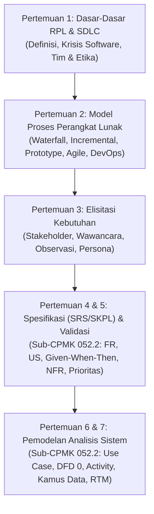

# Audit & Panduan Analisis Materi Perkuliahan RPL
## Analisis Komprehensif Berkas `materi-perkuliahan/` dan Panduan Akademik Proyek SmartPOS
*Dosen Pengampu: Dwi Rizki Bramantio, S.T., M.T. — Program Studi Teknik Informatika, Universitas Teknologi Bandung*

---

## 1. Dekonstruksi dan Audit Silabus Perkuliahan (Pertemuan 1 – 7)

Folder `materi-perkuliahan/` berisi 5 berkas materi slide perkuliahan Rekayasa Perangkat Lunak (RPL) yang membentuk alur pembelajaran bertahap (*scaffolded learning*):



### Rincian Analisis Setiap Modul Kuliah:

| Berkas Kuliah | Materi Pokok | Standar & Kriteria Wajib Dosen | Penerapan pada SmartPOS |
| :--- | :--- | :--- | :--- |
| **pertemuan-1-rpl.pdf** | Dasar-dasar RPL, krisis perangkat lunak, anatomi sistem berlapis, tim rekayasa, dan etika profesional. | Memahami perangkat lunak sebagai kesatuan program, basis data, dan dokumentasi. Pendekatan terstruktur dalam menyelesaikan masalah nyata. | Menganalisis akar masalah toko sembako & pangkalan LPG (selisih stok tabung, ketergantungan internet) sebagai masalah rekayasa sistem. |
| **pertemuan-2-rpl.pdf** | Evaluasi model proses SDLC: Waterfall, Incremental, Prototype, Spiral, Agile Development, dan DevOps. | **Format Argumentatif Wajib (Slide 22):** Mahasiswa wajib menyatakan: *"Kami memilih model [X] karena karakteristik proyek [Y]..."* berdasarkan bukti empiris. | Memilih model **Iterative-Incremental dengan pendekatan Agile-Kanban** berdasarkan modularitas fitur SmartPOS dan mitigasi risiko stok ganda. |
| **pertemuan-3-rpl.pdf** | Teknik elisitasi kebutuhan (wawancara, observasi, kuesioner, workshop) dan perumusan persona. | Menggali masalah pengguna tanpa bias, menyusun persona pengguna, serta memisahkan *Problem Statement* $\rightarrow$ *User Need* $\rightarrow$ *System Requirement*. | Menyusun profil persona Pak Hendra (Owner) dan Rina (Kasir), serta merumuskan kebutuhan konversi "Beli Rp" dan pencatatan sirkulasi tabung gas. |
| **pertemuan-4&5-rpl.pdf** | Spesifikasi Kebutuhan (SRS/SKPL) & Validasi *(Sub-CPMK 052.2)* | 1. Dokumen SRS formal.<br>2. Minimal 5 User Story.<br>3. Acceptance Criteria format **Given-When-Then**.<br>4. Tabel NFR (*Quality Attribute, Definition, Scope/How*).<br>5. Matriks Prioritas 4 Kolom (**High, Medium, Low, No Priority**). | Menyusun dokumen SRS lengkap dengan 20 Kebutuhan Fungsional (FR), 5 User Story terinci dengan AC Given-When-Then, 7 atribut NFR, dan matriks prioritas 4 level. |
| **pertemuan-6&7-rpl.pdf** | Pemodelan Analisis Perangkat Lunak *(Sub-CPMK 052.2)* | 1. Use Case Diagram komprehensif.<br>2. Skenario Use Case lengkap (Main, Alt, Exception Flow).<br>3. Context Diagram sistem.<br>4. DFD Level 0 dengan data store jelas.<br>5. Activity Diagram alur bisnis inti.<br>6. Kamus Data terstruktur.<br>7. Konsistensi Context Diagram $\leftrightarrow$ DFD $\leftrightarrow$ Database. | Memodelkan Use Case, Context Diagram, DFD Level 0 (7 proses, 7 data store), 2 Activity Diagram kritis, 3 Skenario Use Case terstruktur, dan Kamus Data lengkap. |

---

## 2. Hubungan Antar Modul Dokumentasi Proyek

Untuk membedakan antara panduan akademik, laporan resmi ujian, dan spesifikasi teknis pengembangan, struktur dokumentasi SmartPOS dirancang sebagai berikut:

```
docs/
├── 01-panduan-akademik/          <-- Panduan penilaian & peta kurikulum mata kuliah
├── 02-laporan-uts/               <-- DOKUMEN RESMI YANG DIKUMPULKAN KE DOSEN UNTUK UTS
│   ├── LAPORAN_UTUH_UTS_SMARTPOS.md  <-- Dokumen kompilasi master tunggal (Cover, Bab I - V)
│   └── bab/                          <-- Naskah per bab (jika dikumpulkan secara modular)
└── 03-spesifikasi-teknis/        <-- Referensi arsitektur kode, skema SQL, & aturan bisnis untuk developer
```
