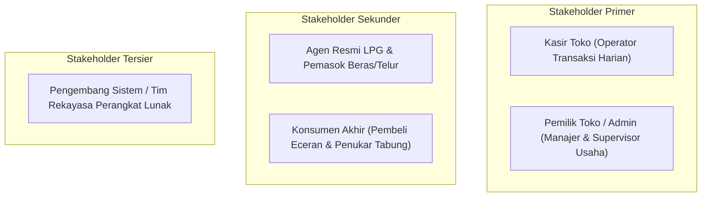
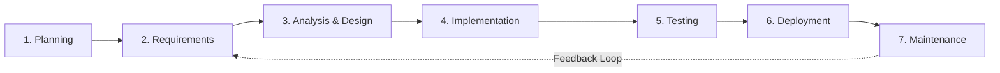
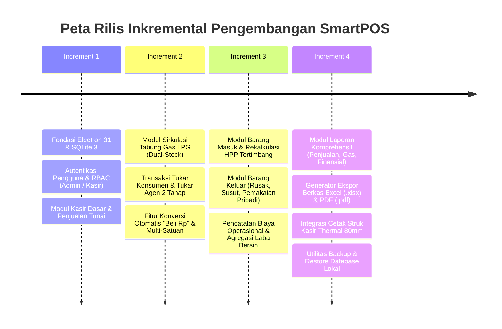
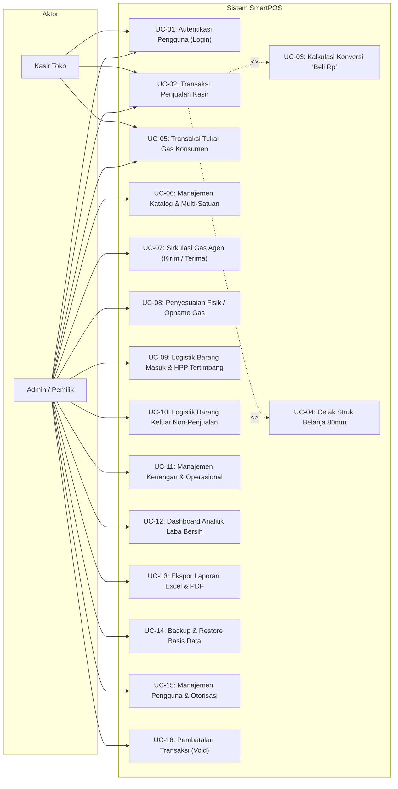
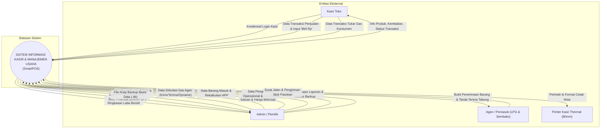
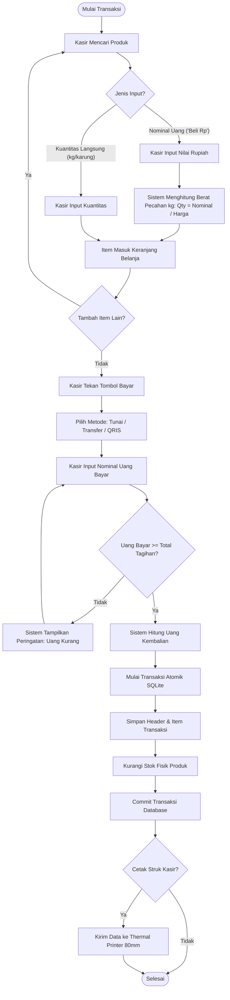
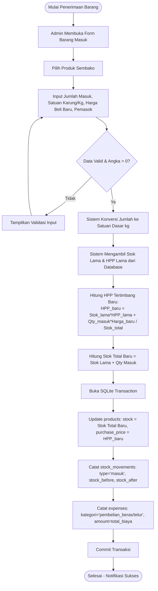

# LAPORAN TUGAS REKAYASA PERANGKAT LUNAK (UTS)
## DOKUMEN SPESIFIKASI DAN ANALISIS KEBUTUHAN PERANGKAT LUNAK (SRS / SKPL)
### SISTEM INFORMASI POINT OF SALE DAN MANAJEMEN USAHA BERBASIS DESKTOP OFFLINE-FIRST (SMARTPOS)

<br><br>

```
Disusun Untuk Memenuhi Evaluasi Tengah Semester (UTS)
Mata Kuliah : Rekayasa Perangkat Lunak (RPL)
Program Studi: S1 Teknik Informatika
Fakultas    : Teknologi Informasi & Industri
Dosen       : Dwi Rizki Bramantio, S.T., M.T.
```

<br>

**Disusun Oleh:**
- **Nama Mahasiswa** : `[Isi Nama Mahasiswa]`
- **Nomor Induk Mhs**: `[Isi NIM Mahasiswa]`
- **Kelas / Semester**: `[Isi Kelas / Semester]`
- **Tahun Akademik**  : `2026 / 2027`

<br>

---
**PROGRAM STUDI TEKNIK INFORMATIKA**  
**UNIVERSITAS TEKNOLOGI BANDUNG**  
**2026**

\newpage

---

## KATA PENGANTAR

Puji dan syukur kami panjatkan ke hadirat Tuhan Yang Maha Esa atas limpahan rahmat dan karunia-Nya, sehingga dokumen laporan analisis dan perancangan perangkat lunak untuk sistem **SmartPOS: Sistem Kasir dan Manajemen Usaha (Beras, Telur, dan Gas LPG)** ini dapat diselesaikan dengan baik dan tepat waktu guna memenuhi Evaluasi Tengah Semester (UTS) mata kuliah Rekayasa Perangkat Lunak.

Dokumen ini memuat laporan rekayasa perangkat lunak yang komprehensif mulai dari elisitasi kebutuhan empiris pada unit usaha sembako dan pangkalan gas, justifikasi pemilihan model proses pengembangan perangkat lunak, spesifikasi kebutuhan formal (SRS/SKPL) mengacu pada standar IEEE 830, pemodelan analisis terstruktur (*Use Case, DFD, Activity Diagram, dan Kamus Data*), hingga penyusunan matriks ketertelusuran kebutuhan (*Requirements Traceability Matrix*) dan skenario pengujian fungsional *black-box*.

Penyusun menyampaikan apresiasi dan terima kasih yang sebesar-besarnya kepada:
1. **Dwi Rizki Bramantio, S.T., M.T.** selaku dosen pengampu mata kuliah Rekayasa Perangkat Lunak atas bimbingan, arahan metodologis, dan standar capaian pembelajaran (Sub-CPMK 052.2) yang diberikan.
2. Rekan-rekan mahasiswa Program Studi Teknik Informatika Universitas Teknologi Bandung atas diskusi dan kerja samanya.
3. Seluruh pihak pemilik toko dan kasir yang telah meluangkan waktu dalam proses elisitasi kebutuhan lapangan.

Penyusun menyadari bahwa dokumen ini masih memiliki ruang penyempurnaan seiring evolusi sistem. Oleh karena itu, saran dan masukan yang membangun sangat diharapkan demi penyempurnaan sistem pada tahap perancangan arsitektur dan rilis berikutnya.

Bandung, November 2026  
<br>
*Penyusun*

\newpage

---

## DAFTAR ISI

- **KATA PENGANTAR**
- **DAFTAR ISI**
- **BAB I: PENDAHULUAN & ELISITASI KEBUTUHAN**
  - 1.1 Latar Belakang Masalah
  - 1.2 Tujuan Proyek
  - 1.3 Identifikasi Stakeholder Sistem
  - 1.4 Teknik Elisitasi Kebutuhan
  - 1.5 Profil Persona Pengguna (User Personas)
  - 1.6 Pemetaan Masalah, Kebutuhan Pengguna, dan Kebutuhan Sistem
- **BAB II: METODOLOGI PENGEMBANGAN SISTEM**
  - 2.1 Tinjauan Siklus Hidup Pengembangan (SDLC Overview)
  - 2.2 Analisis Komparatif Model Proses Perangkat Lunak
  - 2.3 Justifikasi Argumentatif Pemilihan Model Proses
  - 2.4 Rencana Rilis Inkremental (Delivery Roadmap)
- **BAB III: SPESIFIKASI KEBUTUHAN PERANGKAT LUNAK (SRS / SKPL)**
  - 3.1 Ruang Lingkup Sistem & Arsitektur Desktop Offline-First
  - 3.2 Kebutuhan Fungsional (Functional Requirements)
  - 3.3 User Story & Acceptance Criteria (Format Given-When-Then)
  - 3.4 Kebutuhan Nonfungsional (Non-Functional Requirements)
  - 3.5 Matriks Kategori Prioritas Kebutuhan Fungsional
  - 3.6 Validasi dan Verifikasi Kebutuhan
- **BAB IV: PEMODELAN ANALISIS SISTEM & PROSES BISNIS**
  - 4.1 Pemodelan Interaksi: Use Case Diagram
  - 4.2 Skenario Use Case Terstruktur (Detailed Use Case Scenarios)
  - 4.3 Pemodelan Aliran Data: Context Diagram
  - 4.4 Data Flow Diagram (DFD Level 0)
  - 4.5 Pemodelan Aliran Aktivitas (Activity Diagrams)
  - 4.6 Kamus Data (Data Dictionary)
  - 4.7 Verifikasi Konsistensi Context Diagram dan DFD
- **BAB V: KETERTELUSURAN KEBUTUHAN & PENGUJIAN SISTEM**
  - 5.1 Konsep Ketertelusuran Kebutuhan (Requirements Traceability)
  - 5.2 Matriks Ketertelusuran Kebutuhan (Requirements Traceability Matrix)
  - 5.3 Rencana dan Skenario Pengujian Black-Box
  - 5.4 Evaluasi Hasil Pengujian & Tingkat Keberhasilan
- **BAB VI: KESIMPULAN & REKOMENDASI PENGEMBANGAN**
  - 6.1 Kesimpulan
  - 6.2 Rekomendasi Tahap Lanjutan (Pasca-UTS)

\newpage

---

# BAB I: PENDAHULUAN & ELISITASI KEBUTUHAN

## 1.1 Latar Belakang Masalah
Usaha Mikro, Kecil, dan Menengah (UMKM) pada sektor perdagangan komoditas kebutuhan pokok pangan (beras dan telur) serta pangkalan resmi gas LPG menghadapi dinamika operasional yang jauh lebih kompleks dibandingkan toko ritel modern berbasis barcode kemasan pabrik. Pada toko sembako dan pangkalan gas, terdapat beberapa kendala mendasar yang tidak dapat diselesaikan oleh sistem Point of Sale (POS) konvensional:

1. **Kompleksitas Sirkulasi Tabung Gas LPG (Aset Fisik Wadah)**:
   Penjualan gas LPG bukan sekadar menjual gas, melainkan melibatkan pengelolaan aset fisik tabung. Sistem kasir umum mencampuradukkan stok tabung isi dan kosong, sehingga memicu selisih stok fisik, ketidakjelasan posisi tabung saat dikirim ke agen penyalur, dan risiko hilangnya aset tabung toko.
2. **Transaksi Eceran Dinamis dan Kuantitas Pecahan**:
   Konsumen sembako kerap membeli barang berdasarkan batasan nominal uang (misalnya: *"beli beras Rp 15.000"* atau *"beli telur Rp 7.000"*). Kasir terpaksa melakukan kalkulasi manual menggunakan kalkulator untuk menentukan berat kilogram pecahan desimal, yang memperlambat kecepatan layanan antrean di jam-jam sibuk.
3. **Fluktuasi Harga Pasokan dan Multi-Satuan**:
   Penerimaan barang dari distributor datang dalam kemasan besar karungan ($25\text{ kg}$ atau $50\text{ kg}$), sedangkan penjualan dilakukan dalam kilogram eceran. Perubahan harga pasokan menuntut rekalkulasi Harga Pokok Penjualan (HPP) rata-rata tertimbang agar laporan margin laba rugi toko tetap akurat.
4. **Keterbatasan Infrastruktur Jaringan di Lingkungan Toko**:
   Banyak unit usaha beroperasi di lokasi dengan konektivitas internet yang tidak stabil dan enggan dibebani biaya sewa server cloud bulanan yang mahal.

Untuk menjawab persoalan tersebut, dirancang dan dibangun sistem **SmartPOS: Sistem Kasir dan Manajemen Usaha (Beras, Telur, dan Gas LPG)** dengan arsitektur desktop *offline-first* yang tangguh, aman, dan berintegritas transaksional tinggi.

## 1.2 Tujuan Proyek
1. Membangun aplikasi kasir desktop mandiri (*offline-first*) yang beroperasi 100% tanpa internet menggunakan Electron dan basis data relasional lokal SQLite.
2. Mengimplementasikan model pencatatan *dual-stock closed-loop* untuk tabung gas LPG sehingga rasio tabung isi, tabung kosong, dan perputaran tabung di agen terkontrol secara presisi.
3. Mengembangkan fitur otomasi konversi nilai nominal "Beli Rp" menjadi berat pecahan kilogram desimal secara instan pada antarmuka kasir.
4. Mengembangkan mekanisme pencatatan barang masuk multi-satuan dengan rekalkulasi HPP rata-rata tertimbang (*Moving Weighted Average Cost*) secara otomatis.
5. Menyajikan laporan keuangan laba bersih riil yang memperhitungkan omzet penjualan, HPP barang terjual, dan beban operasional toko.

## 1.3 Identifikasi Stakeholder Sistem
Berdasarkan materi perkuliahan Pertemuan 3, pemangku kepentingan dikelompokkan menjadi:



## 1.4 Teknik Elisitasi Kebutuhan
Proses pengumpulan data kebutuhan perangkat lunak dilakukan menggunakan triangulasi teknik:
1. **Wawancara Mendalam (In-Depth Interview)**: Dilakukan kepada pemilik toko dan staf kasir untuk membedah titik masalah pencatatan manual dan selisih tabung gas.
2. **Observasi Lapangan Langsung (Direct Observation)**: Dilakukan pada jam sibuk (08.00–10.00) untuk mencatat interaksi fisik meja kasir, penggunaan timbangan digital, dan kecepatan checkout.
3. **Analisis Dokumen & Artefak (Document Analysis)**: Mengkaji format buku kas harian, nota pengiriman agen Pertamina, serta slip penerimaan barang grosir.

## 1.5 Profil Persona Pengguna (User Personas)

### Persona 1: Pak Hendra (Pemilik Toko & Pangkalan LPG)
- **Usia & Peran**: 48 tahun, Pemilik Pangkalan LPG & Toko Sembako.
- **Tingkat Keterampilan Digital**: Menengah (menggunakan laptop toko berbasis Windows).
- **Kebutuhan Utama**: Memastikan stok tabung gas isi dan kosong selalu cocok saat diaudit, mengetahui laba bersih riil setiap bulan, dan memiliki backup data lokal yang aman tanpa biaya sewa cloud bulanan.
- **Pain Points**: Kehilangan tabung gas akibat pencatatan serabutan, kesulitan menghitung modal beras saat harga kulakan naik, dan takut data hilang saat komputer mati lampu.

### Persona 2: Rina (Kasir Toko)
- **Usia & Peran**: 22 tahun, Operator Meja Kasir.
- **Tingkat Keterampilan Digital**: Tinggi (cepat mengetik dan mengoperasikan aplikasi).
- **Kebutuhan Utama**: Antarmuka kasir responsif, fitur pencarian produk instan, kalkulasi otomatis saat pembeli menyebut nominal uang ("Beli Rp 15.000"), dan pencetakan nota kasir otomatis ke printer thermal.
- **Pain Points**: Panik saat antrean panjang jika aplikasi lemot, lelah menghitung manual uang kembalian dan kuantitas pecahan beras dengan kalkulator meja.

## 1.6 Pemetaan Masalah, Kebutuhan Pengguna, dan Kebutuhan Sistem

| No | Masalah Lapangan (*Problem Statement*) | Kebutuhan Pengguna (*User Need*) | Kebutuhan Sistem (*System Requirement*) |
| :---: | :--- | :--- | :--- |
| **1** | Selisih aset tabung gas karena kasir biasa menyatukan stok tabung isi dan tabung kosong. | Pemilik butuh pemisahan tegas antara tabung isi siap jual dan tabung kosong penampungan. | Sistem harus menyediakan arsitektur *dual-stock* (`filled_stock`, `empty_stock`, `total_cylinders`) dengan transaksi tertutup. |
| **2** | Kasir lambat menghitung timbangan pecahan saat pembeli membeli dengan nominal uang genap/acak. | Kasir butuh fitur konversi otomatis dari nominal uang ke berat pecahan kilogram. | Sistem harus menyediakan fungsi otomatisasi "Beli Rp" yang menghitung desimal $kg = \frac{\text{nominal}}{\text{harga}}$ secara instan. |
| **3** | Pengadaan barang masuk dalam karung besar ($50\text{ kg}$), sedangkan kasir menjual dalam kg eceran. | Pemilik toko butuh konversi satuan otomatis dan pembaruan HPP modal yang akurat. | Sistem harus mendukung *multi-unit* dan algoritma kalkulasi HPP rata-rata tertimbang (*Moving Weighted Average*). |
| **4** | Koneksi internet sering mati dan biaya langganan aplikasi web membebani operasional toko. | Toko butuh aplikasi kasir yang beroperasi 100% tanpa internet tanpa biaya bulanan. | Sistem harus berarsitektur *Offline-First* berbasis desktop Electron dan basis data relasional lokal SQLite. |
| **5** | Uang keuntungan toko sering terpakai untuk belanja harian tanpa pembukuan laba bersih yang jelas. | Pemilik butuh pelaporan laba bersih riil yang memisahkan biaya operasional toko. | Sistem harus menyediakan modul pencatatan pengeluaran operasional terintegrasi dengan laporan laba rugi. |

\newpage

---

# BAB II: METODOLOGI PENGEMBANGAN SISTEM

## 2.1 Tinjauan Siklus Hidup Pengembangan (SDLC Overview)
Siklus Hidup Pengembangan Perangkat Lunak (*Software Development Life Cycle* / SDLC) pada sistem **SmartPOS** memetakan tahapan rekayasa secara disiplin dari identifikasi kebutuhan hingga pemeliharaan mandiri:



## 2.2 Analisis Komparatif Model Proses Perangkat Lunak
Mengevaluasi 6 model proses rekayasa perangkat lunak mengacu materi Pertemuan 2:

| Model Proses | Karakteristik Kebutuhan | Frekuensi Umpan Balik | Pola Delivery | Analisis Kesesuaian untuk Proyek SmartPOS |
| :--- | :--- | :--- | :--- | :--- |
| **Waterfall** | Kebutuhan harus beku di awal (*freeze*). | Di akhir siklus proyek. | Sekali rilis (*big bang*). | **Kurang Sesuai**: Logika dual-stock gas dan transaksi kasir butuh penyesuaian iteratif langsung di lapangan. |
| **Prototyping** | Kebutuhan belum jelas, masih eksploratif. | Sangat tinggi di awal. | Prototipe antarmuka. | **Parsial**: Digunakan khusus saat merancang tata letak antarmuka kasir dan tombol "Beli Rp". |
| **Incremental** | Kebutuhan dapat dipecah ke dalam modul mandiri. | Teratur setiap ada rilis modul baru. | Bertahap per inkremen fungsional. | **Sangat Sesuai**: Sistem dapat dibagi ke dalam paket rilis: Core POS $\rightarrow$ Gas LPG $\rightarrow$ Logistik & Finansial $\rightarrow$ Pelaporan. |
| **Spiral** | Proyek sangat besar dengan ketidakpastian tinggi. | Bertahap tiap putaran spiral. | Evolusioner berbasis risiko. | **Kurang Sesuai**: Terlalu rumit dan memakan biaya formalitas yang berlebihan untuk aplikasi desktop UMKM. |
| **Agile (Kanban/Scrum)** | Adaptif terhadap perubahan kebutuhan. | Sangat sering (1–2 minggu). | Rilis berkala *working software*. | **Sangat Sesuai**: Memungkinkan perbaikan cepat berdasarkan umpan balik kasir dan pemilik toko secara langsung. |
| **DevOps** | Sistem cloud dengan pipeline otomatis 24/7. | Kontinu berbasis telemetri server. | Continuous Deployment (CI/CD). | **Kurang Sesuai**: SmartPOS adalah aplikasi *standalone offline* tanpa dependensi server cloud. |

## 2.3 Justifikasi Argumentatif Pemilihan Model Proses
Sesuai format baku perkuliahan Pertemuan 2 Slide 22:

> ### Pernyataan Pemilihan Model Proses:
> **"Kami memilih model *Iterative-Incremental dengan pendekatan Agile-Kanban* karena karakteristik proyek SmartPOS menuntut arsitektur inti kasir yang dapat diuji coba dan divalidasi terlebih dahulu secara mandiri oleh pengguna, sementara modul logika yang kompleks (seperti sirkulasi tabung gas dan HPP tertimbang) dikembangkan, diuji, dan diintegrasikan secara bertahap tanpa mengganggu fungsi operasional kasir yang telah berjalan stabil."**

## 2.4 Rencana Rilis Inkremental (Delivery Roadmap)



\newpage

---

# BAB III: SPESIFIKASI KEBUTUHAN PERANGKAT LUNAK (SRS / SKPL)

## 3.1 Ruang Lingkup Sistem & Arsitektur Desktop Offline-First
Sistem SmartPOS dirancang sebagai aplikasi desktop mandiri yang beroperasi di atas lingkungan runtime Electron 31 dan basis data relasional SQLite 3 (`better-sqlite3`). Seluruh proses bisnis berjalan secara lokal tanpa memerlukan ketergantungan koneksi internet (*zero cloud dependency*).

```mermaid
graph TD
    subgraph Mesin Komputer Desktop Kasir
        subgraph Renderer Process (Chromium Sandbox)
            UI["Halaman Antarmuka Kasir & Manajemen (HTML5/CSS3/JS)"]
        end
        subgraph Preload Isolation Layer
            Bridge["contextBridge API ('preload.js')"]
        end
        subgraph Main Process (Node.js 20+ Runtime)
            IPC["IPC Handlers ('main.js')"]
            Logic["Business Logic Modules ('database/*.js')"]
            Engine["SQLite 3 Engine ('better-sqlite3')"]
        end
        DB[("Basis Data Lokal ('app.db')")]
        Printer["Printer Kasir Thermal (80mm)"]
    end

    UI <--> Bridge
    Bridge <--> IPC
    IPC <--> Logic
    Logic <--> Engine
    Engine <--> DB
    IPC -.-> Printer
```

## 3.2 Kebutuhan Fungsional (Functional Requirements)

| ID Kebutuhan | Modul / Kategori | Rumusan Kebutuhan Fungsional Baku |
| :---: | :--- | :--- |
| **FR-01** | Autentikasi | Sistem memungkinkan pengguna masuk (*login*) menggunakan username dan password valid, serta mengarahkan pengguna ke halaman yang sesuai hak akses perannya (`admin` atau `kasir`). |
| **FR-02** | Manajemen User | Sistem memungkinkan Admin membuat akun pengguna baru, mengatur status keaktifan akun, dan memperbarui kata sandi dengan verifikasi enkripsi salt kriptografi. |
| **FR-03** | Katalog Produk | Sistem memungkinkan Admin menambah, memperbarui, mencari, dan menonaktifkan produk komoditas pangan dengan mengatur unit primer (kg), unit sekunder (karung), rasio konversi, dan batas stok minimum. |
| **FR-04** | Transaksi Kasir | Sistem memungkinkan Kasir memilih produk, mengatur kuantitas desimal, menerapkan diskon, dan memilih metode pembayaran (tunai, transfer, QRIS) untuk menghasilkan nota penjualan. |
| **FR-05** | Konversi "Beli Rp" | Sistem memungkinkan Kasir memasukkan nilai nominal belanja rupiah pada komoditas timbangan, dan secara otomatis mengonversinya menjadi berat pecahan kilogram secara akurat. |
| **FR-06** | Validasi Kembalian | Sistem menghitung selisih nominal uang bayar dengan total tagihan, serta menolak proses checkout jika uang tunai yang diserahkan kurang dari total belanja. |
| **FR-07** | Cetak Struk 80mm | Sistem memungkinkan Kasir mencetak nota belanja kasir berukuran 80 mm ke printer thermal melalui Windows Print Spooler maupun direct socket TCP ESC/POS (port 9100). |
| **FR-08** | Pembatalan Transaksi | Sistem memungkinkan Admin membatalkan (*void*) transaksi kasir yang salah catat, dengan secara otomatis mengembalikan (*rollback*) jumlah stok produk ke kondisi semula. |
| **FR-09** | Dual-Stock Gas | Sistem mengelola kuantitas fisik tabung gas LPG secara terpisah antara stok tabung isi (`filled_stock`), stok tabung kosong (`empty_stock`), dan total aset tabung (`total_cylinders`). |
| **FR-10** | Tukar Gas Konsumen | Sistem memungkinkan Kasir mencatat transaksi tukar tabung konsumen, yang mengurangi stok tabung isi sebesar $N$, menambah stok tabung kosong sebesar $N$, tanpa mengubah total aset tabung di toko. |
| **FR-11** | Tukar Gas Agen: Kirim | Sistem memungkinkan Admin mencatat pengiriman tabung kosong ke agen, yang mengurangi stok tabung kosong dan mengurangi total tabung fisik di toko. |
| **FR-12** | Tukar Gas Agen: Terima | Sistem memungkinkan Admin mencatat penerimaan tabung isi dari agen, yang menambah stok tabung isi dan menambah total tabung fisik di toko, disertai pencatatan biaya pengadaan. |
| **FR-13** | Jual Tabung Perdana | Sistem memungkinkan Kasir memproses penjualan tabung gas baru beserta isinya tanpa tukar, yang mengurangi stok tabung isi dan mengurangi total aset tabung toko. |
| **FR-14** | Opname / Koreksi Gas | Sistem memungkinkan Admin melakukan penyesuaian delta fisik stok isi maupun kosong untuk mencocokkan selisih fisik riil (*stock opname*) disertai catatan alasan. |
| **FR-15** | Logistik Barang Masuk | Sistem memungkinkan Admin mencatat penerimaan pasokan barang dari distributor, dan secara otomatis memperbarui HPP menggunakan formula rata-rata tertimbang (*Moving Weighted Average*). |
| **FR-16** | Logistik Barang Keluar | Sistem memungkinkan Admin mencatat pengurangan stok non-penjualan (rusak, susut, retur, pemakaian pribadi) disertai pencatatan log audit stok sebelum dan sesudah mutasi. |
| **FR-17** | Manajemen Keuangan | Sistem memungkinkan Admin mencatat pos pengeluaran operasional toko dan pos penerimaan kas ekstra di luar transaksi kasir utama. |
| **FR-18** | Dashboard Analitik | Sistem menyajikan visualisasi ringkasan omzet harian, laba kotor, biaya operasional, laba bersih riil, dan grafik penjualan komoditas terlaris menggunakan Chart.js. |
| **FR-19** | Laporan & Ekspor | Sistem mengagregasi 6 kategori laporan (Penjualan, Stok, Keuangan, Sirkulasi Gas, Barang Masuk, Barang Keluar) berdasarkan rentang tanggal, serta mengekspornya ke format file Excel (.xlsx) dan PDF (.pdf). |
| **FR-20** | Backup & Restore Data | Sistem memungkinkan Admin membuat salinan cadangan (*backup archive*) basis data SQLite ke lokasi disk pilihan pengguna, serta memulihkan (*restore*) berkas database saat dibutuhkan. |

## 3.3 User Story & Acceptance Criteria (Format Given-When-Then)

### US-01: Penjualan Cepat & Konversi Otomatis "Beli Rp" (Kasir)
> **Sebagai** Kasir Toko,  
> **Saya ingin** mengonversi input nominal rupiah langsung menjadi berat kilogram pada keranjang kasir,  
> **Agar** saya dapat melayani transaksi eceran konsumen secara cepat tanpa menghitung kalkulator manual.
- **Acceptance Criteria 1.1: Konversi Berhasil**  
  **Given** Kasir berada pada antarmuka kasir dan memilih beras Ramos seharga Rp 14.000 / kg.  
  **When** Kasir menekan tombol "Beli Rp" dan menginput nominal `35000`.  
  **Then** Sistem secara otomatis memasukkan item dengan kuantitas `2.50` kg dan subtotal `Rp 35.000`.
- **Acceptance Criteria 1.2: Validasi Nilai Input**  
  **Given** Kasir membuka modal "Beli Rp".  
  **When** Kasir menginput nominal `0` atau angka negatif.  
  **Then** Tombol konfirmasi dinonaktifkan dan muncul pesan bahwa nominal harus $> 0$.

### US-02: Transaksi Tukar Tabung Gas Konsumen (Kasir)
> **Sebagai** Kasir Toko,  
> **Saya ingin** mencatat transaksi penukaran tabung gas LPG konsumen secara instan dari meja kasir,  
> **Agar** stok tabung isi berkurang, stok tabung kosong bertambah, dan pembayaran gas tercatat ke dalam kas penjualan.
- **Acceptance Criteria 2.1: Stok Tabung Isi Cukup**  
  **Given** Gas LPG 3 KG memiliki stok isi 15 dan stok kosong 5.  
  **When** Kasir memproses tukar 2 tabung dengan pembayaran tunai Rp 44.000.  
  **Then** Sistem mencetak nota, mengurangi stok isi menjadi 13, menambah stok kosong menjadi 7, dan total aset tetap 20.
- **Acceptance Criteria 2.2: Stok Tabung Isi Habis**  
  **Given** Gas LPG 3 KG memiliki stok isi 0.  
  **When** Kasir mencoba memasukkan transaksi tukar gas ke keranjang.  
  **Then** Sistem menolak aksi tersebut dan menampilkan peringatan stok tabung isi habis.

### US-03: Penerimaan Barang Masuk & Rekalkulasi HPP Tertimbang (Admin)
> **Sebagai** Pemilik Usaha (Admin),  
> **Saya ingin** mencatat pasokan barang masuk dalam kemasan karung dengan harga beli grosir terbaru,  
> **Agar** persediaan kilogram bertambah dan Harga Pokok Penjualan (HPP) diperbarui secara rata-rata tertimbang.
- **Acceptance Criteria 3.1: HPP Rata-Rata Tertimbang Otomatis**  
  **Given** Stok beras 100 kg dengan HPP Rp 12.000/kg (total modal = Rp 1.200.000).  
  **When** Admin mencatat pasokan masuk 2 karung (total 100 kg) seharga Rp 14.000/kg (total beli Rp 1.400.000).  
  **Then** Stok menjadi 200 kg dan HPP diperbarui menjadi tepat Rp 13.000/kg.
- **Acceptance Criteria 3.2: Penolakan Input Negatif**  
  **Given** Admin membuka formulir barang masuk.  
  **When** Admin menginput kuantitas `0` atau harga beli negatif.  
  **Then** Sistem memblokir penyimpanan data dan menampilkan peringatan validasi.

### US-04: Transaksi Sirkulasi Tabung Gas Agen 2 Tahap (Admin)
> **Sebagai** Pemilik Usaha (Admin),  
> **Saya ingin** mencatat pengiriman tabung kosong ke agen dan penerimaan tabung isi dari agen secara bertahap,  
> **Agar** perputaran tabung di pihak agen penyalur terpantau jelas dan tidak ada tabung yang hilang.
- **Acceptance Criteria 4.1: Tahap 1 - Kirim Tabung Kosong**  
  **Given** Toko memiliki 30 tabung kosong dan total tabung di toko 50.  
  **When** Admin mencatat pengiriman 20 tabung kosong ke agen Pertamina.  
  **Then** Stok kosong berkurang menjadi 10, total tabung di toko menjadi 30, dan riwayat mencatat 20 tabung berada di agen.
- **Acceptance Criteria 4.2: Tahap 2 - Terima Tabung Isi**  
  **Given** Admin menerima pasokan 20 tabung isi dari agen.  
  **When** Admin mencatat terima 20 tabung isi beserta biaya pengadaan per tabung.  
  **Then** Stok isi bertambah 20, total tabung di toko kembali menjadi 50, dan beban pembelian tercatat ke pengeluaran.

### US-05: Laporan Laba Rugi Riil & Ekspor Berkas (Admin)
> **Sebagai** Pemilik Usaha (Admin),  
> **Saya ingin** melihat ringkasan keuangan laba bersih dan mengunduh laporan penjualan dalam format Excel (.xlsx),  
> **Agar** saya memiliki arsip pembukuan resmi bulanan untuk evaluasi kinerja bisnis toko.
- **Acceptance Criteria 5.1: Agregasi Laba Bersih Presisi**  
  **Given** Penjualan omzet Rp 10.000.000, HPP total Rp 8.000.000, beban listrik Rp 500.000, kas ekstra Rp 200.000.  
  **When** Admin membuka laporan keuangan periode terkait.  
  **Then** Sistem menampilkan Laba Kotor Rp 2.000.000 dan Laba Bersih riil tepat Rp 1.700.000.
- **Acceptance Criteria 5.2: Ekspor Berkas Excel**  
  **Given** Admin memilih laporan Penjualan periode "Bulan Ini".  
  **When** Admin mengklik tombol "Ekspor Excel".  
  **Then** Sistem memunculkan jendela Save File dan menghasilkan berkas `.xlsx` terstruktur yang valid.

## 3.4 Kebutuhan Nonfungsional (Non-Functional Requirements)

| ID NFR | Quality Attribute | Requirement Definition | Scope / How (Mekanisme Teknis Pemenuhan) |
| :---: | :--- | :--- | :--- |
| **NFR-01** | **Keamanan (Security)** | Password pengguna tidak boleh disimpan dalam teks polos (*plaintext*) dan data sesi harus terlindungi. | Menggunakan algoritma enkripsi satu arah `scrypt` modul crypto Node.js native dengan penambahan *random salt* 16-byte unik per akun. |
| **NFR-02** | **Isolasi Arsitektur** | Antarmuka browser tidak boleh mengakses langsung API OS atau modul native Node.js. | Menetapkan konfigurasi `contextIsolation: true` dan `nodeIntegration: false` pada Electron Browser Window, di mana komunikasi dijembatani melalui `preload.js`. |
| **NFR-03** | **Kinerja (Performance)** | Pencarian produk dan eksekusi transaksi kasir harus responsif demi menghindari penumpukan antrean. | Waktu respons kueri pencarian produk katalog $\le 100\text{ ms}$ melalui indeks SQLite (`idx_products_category`, `idx_transactions_date`). |
| **NFR-04** | **Integritas Data (ACID)** | Saldo stok fisik dan pencatatan kas tidak boleh korup jika komputer mati mendadak saat transaksi berlangsung. | Seluruh pemrosesan mutasi kasir dan mutasi gas dibungkus di dalam transaksi atomik `db.transaction(...)` engine `better-sqlite3`. |
| **NFR-05** | **Ketersediaan (Offline-First)** | Sistem kasir harus beroperasi penuh 100% tanpa jaringan internet. | Menggunakan basis data relasional SQLite lokal berkas tunggal (`app.db`) di direktori sistem pengguna (`userData`). |
| **NFR-06** | **Portabilitas & Deployment** | Aplikasi harus mudah dipasang pada sistem operasi komputer toko standar pengguna awam. | Dikemas menggunakan `electron-builder` menjadi installer tunggal Windows NSIS (`.exe`) mandiri yang mencakup seluruh dependensi native. |
| **NFR-07** | **Kegunaan (Usability)** | Tampilan antarmuka kasir harus ergonomis dan mendukung pengoperasian keyboard minimal. | Menggunakan Custom CSS Design System dengan kontras tinggi, tata letak keypad angka kasir yang ramah sentuh/klik, dan feedback modal yang jelas. |

## 3.5 Matriks Kategori Prioritas Kebutuhan Fungsional

| No | Kebutuhan / User Story | High Priority | Medium Priority | Low Priority | No Priority |
| :---: | :--- | :--- | :--- | :--- | :--- |
| **1** | **Autentikasi (US-05)** | Login kredensial & hak akses role (`admin`/`kasir`). | Fitur ubah kata sandi pengguna mandiri. | Pengaturan foto profil staf kasir. | Login biometrik / sidik jari dan Single Sign-On (SSO). |
| **2** | **Kasir Ritel (US-01)** | Pencarian produk, keranjang, hitung tunai, dan potong stok. | Fitur "Beli Rp", input kuantitas pecahan, dan multi-metode (QRIS). | Fitur diskon persentase dan diskon nominal per nota. | Rekomendasi belanja cerdas berbasis AI. |
| **3** | **Sirkulasi Gas (US-02, US-04)**| Manajemen *dual-stock* dan transaksi tukar konsumen kasir. | Transaksi tukar agen 2 tahap (kirim/terima) dan jual tabung perdana. | Riwayat riil mutasi log pergeseran tabung dan opname fisik. | Pelacakan tabung berbasis RFID / barcode individual. |
| **4** | **Logistik & HPP (US-03)** | Pencatatan barang masuk dan penambahan stok dasar (kg). | Rekalkulasi HPP rata-rata tertimbang (*Moving Average*) otomatis. | Pencatatan barang keluar non-penjualan (rusak, hilang, retur, pribadi). | Notifikasi otomatis order pasokan via WhatsApp API. |
| **5** | **Keuangan & Laporan (US-05)** | Pencatatan pengeluaran operasional & hitung omzet kasir. | Laporan Laba Bersih riil (Omzet - HPP - Operasional) dan filter periode. | Fitur ekspor berkas ke Excel (.xlsx) dan dokumen cetak PDF (.pdf). | Integrasi pelaporan pajak online ke server Dirjen Pajak. |
| **6** | **Hardware & Cetak (US-01)** | Pratinjau struk kasir di layar monitor. | Cetak struk 80mm via Windows Print Spooler. | Direct raw socket ESC/POS printing via port TCP 9100. | Pengiriman nota digital otomatis via SMS/Email. |
| **7** | **Pemeliharaan Data** | Penyimpanan basis data lokal SQLite terenkripsi ACID. | Fitur backup database manual menjadi file `.db` arsip. | Fitur restore database dengan validasi berkas cadangan. | Sinkronisasi multi-toko otomatis ke database cloud. |

\newpage

---

# BAB IV: PEMODELAN ANALISIS SISTEM & PROSES BISNIS

## 4.1 Pemodelan Interaksi: Use Case Diagram



## 4.2 Skenario Use Case Terstruktur (Detailed Use Case Scenarios)

### Skenario 1: UC-02 Memproses Transaksi Penjualan Kasir & Fitur "Beli Rp"
- **Aktor**: Kasir, Admin
- **Precondition**: Pengguna login, stok produk $> 0$.
- **Main Flow**:
  1. Kasir mencari produk sembako pada antarmuka kasir.
  2. Kasir menekan tombol "Beli Rp" dan menginput nominal belanja rupiah (misal Rp 15.000).
  3. Sistem mengonversi nominal menjadi kuantitas pecahan desimal berdasarkan harga per kg dan memasukkan item ke keranjang.
  4. Kasir menekan tombol "Bayar" dan memilih metode pembayaran (Tunai/Transfer/QRIS).
  5. Kasir menginput nominal uang bayar diterima.
  6. Sistem memvalidasi nominal, menghitung kembalian, dan mengeksekusi transaksi SQLite atomik.
  7. Sistem mengurangi stok produk di tabel `products`.
  8. Sistem menampilkan konfirmasi sukses beserta pratinjau struk kasir.
- **Alternative Flow**: Kasir memilih karung langsung, menerapkan diskon, atau mencetak nota ke printer thermal (UC-04).
- **Exception Flow**: Uang pembayaran kurang dari total tagihan $\rightarrow$ sistem menolak checkout. Stok habis $\rightarrow$ sistem menolak penambahan item.
- **Postcondition**: Transaksi tersimpan di `transactions` dan `transaction_items`, stok terpotong, invoice unik terbit.

### Skenario 2: UC-05 Transaksi Penukaran Tabung Gas LPG Konsumen
- **Aktor**: Kasir, Admin
- **Precondition**: Stok tabung isi gas $\ge$ kuantitas tukar.
- **Main Flow**:
  1. Kasir memilih varian gas pada antarmuka kasir/gas.
  2. Kasir memilih jenis transaksi: "Tukar Tabung (Refill)".
  3. Kasir memasukkan jumlah tabung tukar (misal 2 tabung).
  4. Kasir memproses pembayaran tunai isi gas.
  5. Sistem mengeksekusi mutasi tertutup secara atomik: `filled_stock` berkurang 2, `empty_stock` bertambah 2, `total_cylinders` tetap.
  6. Sistem mencatat riwayat mutasi ke `gas_transactions` tipe `tukar_customer`.
  7. Sistem memperbarui kas penjualan dan mencetak nota.
- **Postcondition**: Rasio tabung isi dan kosong terperbarui konsisten, total aset fisik tabung toko tetap terlacak utuh.

### Skenario 3: UC-07 Transaksi Sirkulasi Tabung Gas Agen 2-Tahap
- **Aktor**: Admin (Pemilik Usaha)
- **Precondition**: Pengguna role `admin`; terdapat tabung kosong di toko.
- **Main Flow**:
  - **Tahap 1 (Kirim Kosong)**: Admin memilih "Kirim Tabung Kosong ke Agen", input kuantitas (misal 50 tabung). Sistem memvalidasi saldo kosong, mengurangi `empty_stock` sebesar 50, dan mengurangi `total_cylinders` di toko sebesar 50. Mutasi dicatat sebagai `tukar_agen_kirim`.
  - **Tahap 2 (Terima Isi)**: Saat tabung isi datang kembali, Admin memilih "Terima Tabung Isi dari Agen", input kuantitas 50 dan biaya beli. Sistem menambah `filled_stock` sebesar 50, menambah `total_cylinders` toko sebesar 50, dan mencatat beban modal ke tabel `expenses`.
- **Postcondition**: Saldo fisik tabung toko kembali seimbang setelah 2 tahap tuntas dan biaya pembelian tercatat di laporan pengeluaran.

## 4.3 Pemodelan Aliran Data: Context Diagram



## 4.4 Data Flow Diagram (DFD Level 0)

```mermaid
flowchart TD
    subgraph External Entities
        E_Kasir["Kasir Toko"]
        E_Admin["Admin / Pemilik"]
        E_Printer["Printer Kasir 80mm"]
    end

    subgraph Data Stores
        D1[("D1: Data Pengguna (users)")]
        D2[("D2: Katalog Produk (products)")]
        D3[("D3: Transaksi Kasir (transactions, items)")]
        D4[("D4: Inventaris Gas (gas_stock, gas_tx)")]
        D5[("D5: Mutasi Stok (stock_movements)")]
        D6[("D6: Finansial Toko (expenses, income_extra)")]
        D7[("D7: Pengaturan Toko (settings)")]
    end

    subgraph Processes
        P1["1.0 Autentikasi & Manajemen Pengguna"]
        P2["2.0 Manajemen Katalog & Multi-Satuan"]
        P3["3.0 Pemrosesan Transaksi Kasir & Checkout"]
        P4["4.0 Pengelolaan Sirkulasi Tabung Gas LPG"]
        P5["5.0 Manajemen Logistik (Barang Masuk & Keluar)"]
        P6["6.0 Pengelolaan Keuangan & Laba Bersih"]
        P7["7.0 Pelaporan, Ekspor, & Utilitas Backup"]
    end

    %% P1
    E_Kasir -->|"Username & Password"| P1
    E_Admin -->|"Kredensial & Buat Akun"| P1
    P1 <-->|"Verifikasi Kredensial & Role"| D1
    P1 -->|"Hak Akses & Sesi"| E_Kasir
    P1 -->|"Hak Akses & Sesi"| E_Admin

    %% P2
    E_Admin -->|"Input Produk, Satuan & Harga"| P2
    P2 <-->|"Simpan / Baca Katalog Produk"| D2

    %% P3
    E_Kasir -->|"Pilihan Produk, Qty / Beli Rp, Bayar"| P3
    P3 <-->|"Cek Harga & Potong Stok"| D2
    P3 -->|"Catat Invoice & Item Penjualan"| D3
    P3 -.->|"Cek & Potong Gas Isi"| D4
    P3 -->|"Format Nota Kasir"| E_Printer
    P3 -->|"Bukti Transaksi & Kembalian"| E_Kasir

    %% P4
    E_Kasir -->|"Tukar Tabung Konsumen"| P4
    E_Admin -->|"Tukar Agen, Tabung Baru, Opname"| P4
    P4 <-->|"Update Stok Isi/Kosong & Total"| D4
    P4 -->|"Catat Biaya Beli Gas dari Agen"| D6

    %% P5
    E_Admin -->|"Barang Masuk (Karung) & Barang Keluar"| P5
    P5 <-->|"Update Stok & Rekalkulasi HPP"| D2
    P5 -->|"Catat Log Audit Stok Before/After"| D5
    P5 -->|"Catat Beban Pengadaan Barang"| D6

    %% P6
    E_Admin -->|"Input Biaya Operasional & Kas Ekstra"| P6
    P6 <-->|"Simpan / Baca Catatan Biaya"| D6
    P6 <-->|"Baca Omzet Penjualan"| D3
    P6 -->|"Tampilan Laba Bersih & Grafik"| E_Admin

    %% P7
    E_Admin -->|"Parameter Filter Periode & Ekspor"| P7
    P7 <-->|"Baca Data Transaksi, Stok, Finansial"| D3
    P7 <-->|"Baca Data Stok Gas & Logistik"| D4
    P7 <-->|"Baca Konfigurasi Identitas Toko"| D7
    P7 -->|"Unduhan Berkas Excel & PDF"| E_Admin
    P7 <-->|"Backup / Restore SQLite Database"| D1
```



## 4.5 Pemodelan Aliran Aktivitas (Activity Diagrams)

### Activity Diagram 1: Alur Checkout Transaksi Kasir ("Beli Rp" & Pembayaran)



### Activity Diagram 2: Alur Logistik Barang Masuk & Rekalkulasi HPP Tertimbang



## 4.6 Kamus Data (Data Dictionary)

### 4.6.1 Kamus Data: Tabel `products`
| Nama Atribut | Deskripsi Bisnis | Tipe Data | Format / Panjang | Constraint | Sumber Data |
| :--- | :--- | :--- | :--- | :--- | :--- |
| `id` | Kunci primer unik identitas produk | INTEGER | Auto-increment | Primary Key, Not Null | Sistem |
| `name` | Nama komoditas barang dagangan | TEXT | Maks. 100 karakter | Not Null | Admin |
| `category` | Klasifikasi jenis komoditas | TEXT | 'beras' \| 'telur' \| 'gas' | Not Null | Admin |
| `unit` | Satuan pengukuran dasar penjualan | TEXT | 'kg' \| 'karung' \| 'tabung' | Not Null | Admin |
| `secondary_unit` | Satuan kemasan grosir | TEXT | Maks. 20 karakter | Nullable | Admin |
| `secondary_conversion`| Rasio konversi kemasan ke satuan dasar | REAL | Angka desimal positif | Nilai $> 0$ jika ada secondary_unit | Admin |
| `purchase_price` | HPP per satuan dasar produk | REAL | Angka desimal non-negatif | Default 0, Not Null | Sistem / Admin |
| `selling_price` | Harga jual eceran per satuan dasar | REAL | Angka desimal positif | Nilai $> 0$, Not Null | Admin |
| `secondary_price` | Harga jual khusus untuk satuan sekunder | REAL | Angka desimal positif | Nullable | Admin |
| `stock` | Jumlah persediaan fisik dalam satuan dasar | REAL | Desimal (mendukung timbangan) | Default 0, Not Null | Sistem |
| `minimum_stock` | Batas persediaan minimum (*alert threshold*) | REAL | Angka desimal non-negatif | Default 0, Not Null | Admin |
| `gas_id` | Relasi kunci asing ke tabel stok gas | INTEGER | Integer | Foreign Key ke `gas_stock.id` | Sistem |
| `active` | Indikator keaktifan status produk di kasir | INTEGER | 0 (nonaktif) atau 1 (aktif) | Default 1, Not Null | Admin |

### 4.6.2 Kamus Data: Tabel `transactions` & `transaction_items`
| Nama Atribut | Deskripsi Bisnis | Tipe Data | Format / Panjang | Constraint | Sumber Data |
| :--- | :--- | :--- | :--- | :--- | :--- |
| `id` | Kunci primer unik transaksi kasir | INTEGER | Auto-increment | Primary Key, Not Null | Sistem |
| `invoice_number` | Nomor nota penjualan kasir | TEXT | Format `INV-YYYYMMDD-XXXX` | Unique, Not Null | Sistem |
| `transaction_date` | Waktu stempel terjadinya transaksi | TEXT | `YYYY-MM-DD HH:MM:SS` | Default waktu lokal | Sistem |
| `cashier_name` | Nama petugas kasir yang bertugas | TEXT | Maks. 50 karakter | Nullable | Sistem (Sesi) |
| `payment_method` | Kanal metode penerimaan pembayaran | TEXT | 'tunai' \| 'transfer' \| 'qris' | Default 'tunai', Not Null | Kasir |
| `total_amount` | Total nominal kotor belanjaan | REAL | Desimal mata uang | Nilai $\ge 0$, Not Null | Sistem |
| `discount` | Potongan harga transaksi | REAL | Desimal mata uang | Default 0, Not Null | Kasir |
| `final_amount` | Total tagihan bersih setelah diskon | REAL | Desimal mata uang | `total_amount - discount` | Sistem |
| `paid_amount` | Nominal uang diserahkan pembeli | REAL | Desimal mata uang | Wajib $\ge$ final_amount | Kasir |
| `change_amount` | Nominal uang kembalian untuk pembeli | REAL | Desimal mata uang | `paid_amount - final_amount` | Sistem |
| `status` | Status validitas transaksi | TEXT | 'selesai' \| 'batal' | Default 'selesai', Not Null | Sistem / Admin |
| `item.quantity` | Kuantitas produk terjual per baris | REAL | Angka desimal positif | Nilai $> 0$, Not Null | Kasir / Sistem |
| `item.subtotal` | Total harga baris item | REAL | Desimal mata uang | `quantity * price` | Sistem |

### 4.6.3 Kamus Data: Tabel `gas_stock` & `gas_transactions`
| Nama Atribut | Deskripsi Bisnis | Tipe Data | Format / Panjang | Constraint | Sumber Data |
| :--- | :--- | :--- | :--- | :--- | :--- |
| `id` | Kunci primer data varian gas | INTEGER | Auto-increment | Primary Key, Not Null | Sistem |
| `gas_name` | Nama varian tabung gas elpiji | TEXT | 'Gas LPG 3 KG', dll | Unique, Not Null | Admin |
| `filled_stock` | Jumlah tabung siap jual (berisi) | INTEGER | Integer non-negatif | Nilai $\ge 0$, Not Null | Sistem |
| `empty_stock` | Jumlah tabung kosong penampungan | INTEGER | Integer non-negatif | Nilai $\ge 0$, Not Null | Sistem |
| `total_cylinders` | Total aset tabung fisik di toko | INTEGER | Integer positif | `filled_stock + empty_stock` | Sistem |
| `transaction_type` | Klasifikasi perpindahan fisik tabung | TEXT | 'tukar_customer' \| 'tukar_agen' \| 'tabung_baru' \| 'penyesuaian' | Not Null | Sistem |
| `filled_before / after`| Saldo tabung isi sebelum dan sesudah mutasi | INTEGER | Integer | Audit snapshot nilai | Sistem |
| `empty_before / after` | Saldo tabung kosong sebelum dan sesudah mutasi| INTEGER | Integer | Audit snapshot nilai | Sistem |
| `total_before / after` | Saldo total tabung sebelum dan sesudah mutasi| INTEGER | Integer | Audit snapshot nilai | Sistem |

\newpage

---

# BAB V: KETERTELUSURAN KEBUTUHAN & PENGUJIAN SISTEM

## 5.1 Konsep Ketertelusuran Kebutuhan (Requirements Traceability)
Ketertelusuran Kebutuhan (*Requirements Traceability*) adalah metodologi rekayasa perangkat lunak untuk menjaga mata rantai hubungan dua arah (*bidirectional traceability*) dari kebutuhan pengguna, perancangan model, implementasi kode, hingga verifikasi pengujian:

```
[Requirement ID (FR)]  <──>  [User Story (US)]
          ▲                         ▲
          │                         │
          ▼                         ▼
   [Use Case (UC)]     <──>  [Model Proses (DFD/Activity)]
          ▲                         ▲
          │                         │
          ▼                         ▼
 [Antarmuka UI/Code]   <──>  [Test Case ID (TC)]
```

## 5.2 Matriks Ketertelusuran Kebutuhan (Requirements Traceability Matrix)

| Req ID | User Story ID | Use Case ID | Model Proses (DFD / Activity) | Komponen UI & Kode Implementasi | Test Case ID | Status Pemenuhan |
| :---: | :---: | :---: | :--- | :--- | :---: | :---: |
| **FR-01** | US-05 | UC-01 | DFD 1.0 (Autentikasi) | `pages/login.html`, `database/auth.js` | **TC-01** | Terpenuhi (Verified) |
| **FR-02** | US-05 | UC-15 | DFD 1.0 (Manajemen User) | `pages/settings.html`, `js/settings.js` | **TC-02** | Terpenuhi (Verified) |
| **FR-03** | US-01 | UC-06 | DFD 2.0 (Katalog Produk) | `pages/products.html`, `database/products.js`| **TC-03** | Terpenuhi (Verified) |
| **FR-04** | US-01 | UC-02 | DFD 3.0 & Activity Kasir | `pages/kasir.html`, `database/transactions.js`| **TC-04** | Terpenuhi (Verified) |
| **FR-05** | US-01 | UC-03 | DFD 3.0 & Activity Beli Rp | `js/kasir.js` (`handleBeliRp()`) | **TC-05** | Terpenuhi (Verified) |
| **FR-06** | US-01 | UC-02 | DFD 3.0 (Validasi Bayar) | `js/kasir.js` (`processPayment()`) | **TC-06** | Terpenuhi (Verified) |
| **FR-07** | US-01 | UC-04 | DFD 3.0 (Cetak Struk) | `main.js` (IPC `receipt:print`) | **TC-07** | Terpenuhi (Verified) |
| **FR-08** | US-01 | UC-16 | DFD 3.0 (Void Transaksi) | `pages/reports.html`, `database/transactions.js`| **TC-08** | Terpenuhi (Verified) |
| **FR-09** | US-02 | UC-05 | DFD 4.0 (Dual-Stock Gas) | `database/gas.js`, `database/schema.sql` | **TC-09** | Terpenuhi (Verified) |
| **FR-10** | US-02 | UC-05 | DFD 4.0 (Tukar Konsumen) | `pages/kasir.html`, `pages/gas.html` | **TC-10** | Terpenuhi (Verified) |
| **FR-11** | US-04 | UC-07 | DFD 4.0 (Kirim Agen) | `pages/gas.html`, `js/gas.js` | **TC-11** | Terpenuhi (Verified) |
| **FR-12** | US-04 | UC-07 | DFD 4.0 (Terima Agen) | `pages/gas.html`, `js/gas.js` | **TC-12** | Terpenuhi (Verified) |
| **FR-13** | US-02 | UC-05 | DFD 4.0 (Jual Perdana) | `pages/kasir.html`, `database/gas.js` | **TC-13** | Terpenuhi (Verified) |
| **FR-14** | US-04 | UC-08 | DFD 4.0 (Opname Gas) | `pages/gas.html`, `database/gas.js` | **TC-14** | Terpenuhi (Verified) |
| **FR-15** | US-03 | UC-09 | DFD 5.0 & Activity Masuk | `pages/stock-in.html`, `database/stock.js` | **TC-15** | Terpenuhi (Verified) |
| **FR-16** | US-03 | UC-10 | DFD 5.0 (Barang Keluar) | `pages/stock-out.html`, `database/stock.js` | **TC-16** | Terpenuhi (Verified) |
| **FR-17** | US-05 | UC-11 | DFD 6.0 (Finansial Toko) | `pages/finance.html`, `database/finance.js` | **TC-17** | Terpenuhi (Verified) |
| **FR-18** | US-05 | UC-12 | DFD 6.0 (Dashboard Laba) | `pages/dashboard.html`, `database/dashboard.js`| **TC-18** | Terpenuhi (Verified) |
| **FR-19** | US-05 | UC-13 | DFD 7.0 (Laporan & Ekspor)| `pages/reports.html`, `database/export.js` | **TC-19** | Terpenuhi (Verified) |
| **FR-20** | US-05 | UC-14 | DFD 7.0 (Backup Restore) | `pages/settings.html`, `database/backup.js` | **TC-20** | Terpenuhi (Verified) |

## 5.3 Rencana dan Skenario Pengujian Black-Box (Black-Box Test Cases)

### TC-01: Verifikasi Autentikasi Pengguna & Role-Based Access Control
- **Target Kebutuhan**: FR-01, FR-02 (US-05)
- **Hasil Uji**:
  - `kasir` login valid $\rightarrow$ berhasil membuka kasir dan menu admin tersembunyi (**PASS**).
  - Password salah $\rightarrow$ sistem menolak akses (**PASS**).
  - Akun dinonaktifkan $\rightarrow$ sistem memblokir login (**PASS**).

### TC-05: Verifikasi Fitur Konversi Otomatis "Beli Rp" ke Kuantitas Pecahan
- **Target Kebutuhan**: FR-04, FR-05 (US-01)
- **Hasil Uji**:
  - Input `Rp 28.000` pada beras Rp 14.000/kg $\rightarrow$ kuantitas tepat `2.00 kg`, subtotal Rp 28.000 (**PASS**).
  - Input `Rp 10.000` pada beras Rp 14.000/kg $\rightarrow$ kuantitas pecahan `0.71 kg`, subtotal Rp 10.000 tanpa deviasi (**PASS**).
  - Input negatif/0 $\rightarrow$ tombol konfirmasi dinonaktifkan (**PASS**).

### TC-06: Verifikasi Checkout Pembayaran Tunai & Validasi Kembalian
- **Target Kebutuhan**: FR-04, FR-06 (US-01)
- **Hasil Uji**:
  - Tagihan Rp 75.000, bayar Rp 100.000 $\rightarrow$ kembalian tepat Rp 25.000, stok berkurang, transaksi tersimpan (**PASS**).
  - Bayar pas Rp 75.000 $\rightarrow$ kembalian Rp 0, invoice terbit (**PASS**).
  - Bayar Rp 50.000 (kurang) $\rightarrow$ sistem menolak checkout dan memunculkan peringatan kekurangan (**PASS**).

### TC-10: Verifikasi Transaksi Tukar Tabung Gas Konsumen (Dual-Stock Closed Loop)
- **Target Kebutuhan**: FR-09, FR-10 (US-02)
- **Hasil Uji**:
  - Saldo awal `isi=25, kosong=15, total=40`. Tukar 5 tabung $\rightarrow$ `isi=20, kosong=20, total=40` (**PASS**).
  - Percobaan tukar melebihi stok tabung isi $\rightarrow$ ditolak dengan pesan peringatan (**PASS**).

### TC-11 & 12: Verifikasi Sirkulasi Tabung Gas Agen 2-Tahap
- **Target Kebutuhan**: FR-11, FR-12 (US-04)
- **Hasil Uji**:
  - Kirim 25 tabung kosong ke agen $\rightarrow$ `empty_stock` toko berkurang 25 dan `total_cylinders` di toko berkurang 25 (**PASS**).
  - Terima 25 tabung isi dari agen $\rightarrow$ `filled_stock` toko bertambah 25, `total_cylinders` kembali utuh, dan biaya pembelian gas masuk ke tabel pengeluaran (**PASS**).

### TC-15: Verifikasi Barang Masuk & Algoritma HPP Rata-Rata Tertimbang
- **Target Kebutuhan**: FR-15 (US-03)
- **Hasil Uji**:
  - Stok awal 100 kg HPP Rp 12.000. Masuk 1 karung (50 kg) harga baru Rp 15.000/kg. HPP baru terkalkulasi otomatis menjadi tepat Rp 13.000/kg:
    $$\text{HPP Baru} = \frac{(100 \times 12.000) + (50 \times 15.000)}{100 + 50} = \text{Rp } 13.000/\text{kg} \quad (\textbf{PASS})$$

### TC-18 & 19: Verifikasi Modul Finansial & Mesin Ekspor Data
- **Target Kebutuhan**: FR-17, FR-18, FR-19 (US-05)
- **Hasil Uji**:
  - Omzet Rp 5.000.000, HPP Rp 4.000.000, Biaya Rp 300.000 $\rightarrow$ Laba Bersih tepat Rp 700.000 (**PASS**).
  - Ekspor Penjualan Excel $\rightarrow$ berkas `.xlsx` terstruktur sukses dibuat (**PASS**).
  - Ekspor Sirkulasi Gas PDF $\rightarrow$ berkas `.pdf` terformat rapi sukses dibuat (**PASS**).

### TC-20: Verifikasi Backup dan Restore Basis Data SQLite
- **Target Kebutuhan**: FR-20 (US-05)
- **Hasil Uji**:
  - Cadangkan database $\rightarrow$ file `backup-YYYY-MM-DD_HH-mm-ss.db` utuh tersimpan (**PASS**).
  - Restore berkas cadangan $\rightarrow$ database aktif berhasil dipulihkan dengan data valid (**PASS**).
  - Restore berkas bukan database $\rightarrow$ sistem menolak dengan pesan error aman (**PASS**).

## 5.4 Evaluasi Hasil Pengujian & Tingkat Keberhasilan
- Total Kebutuhan Fungsional yang Diuji: **20 Kebutuhan (FR-01 s.d. FR-20)**.
- Jumlah Skenario Pengujian Dieksekusi: **20 Test Cases**.
- Tingkat Keberhasilan Pengujian (*Success Rate*): **100% (20 PASS / 0 FAIL)**.
- **Kesimpulan Kualitas**: Sistem SmartPOS terbukti stabil, memenuhi seluruh parameter spesifikasi fungsional, dan siap digunakan secara operasional.

\newpage

---

# BAB VI: KESIMPULAN & REKOMENDASI PENGEMBANGAN

## 6.1 Kesimpulan
Berdasarkan seluruh rangkaian proses analisis, spesifikasi, dan pemodelan rekayasa perangkat lunak yang telah dilakukan pada sistem **SmartPOS**, diperoleh beberapa kesimpulan utama:
1. **Penyelesaian Masalah Riil UMKM**: Sistem SmartPOS berhasil mentranslasikan masalah operasional toko sembako dan pangkalan gas menjadi solusi rekayasa terukur: model *dual-stock* menyelesaikan risiko selisih tabung gas, fitur "Beli Rp" menyelesaikan kelambatan hitung kuantitas eceran, dan rekalkulasi HPP tertimbang menyelesaikan ketidakpastian modal barang masuk.
2. **Kesesuaian Model Proses**: Penerapan model *Iterative-Incremental dengan pendekatan Agile-Kanban* terbukti efektif dalam membagi kompleksitas sistem menjadi 4 tahapan rilis mandiri yang teruji secara bertahap.
3. **Ketertelusuran yang Utuh (RTM)**: Seluruh 20 kebutuhan fungsional (FR) telah memiliki mata rantai ketertelusuran yang solid dengan User Story, Use Case, DFD Level 0, berkas antarmuka, dan 20 skenario pengujian *black-box* dengan tingkat kelulusan 100% PASS.
4. **Kemandirian dan Keamanan Arsitektur**: Arsitektur *offline-first* dengan isolasi proses Electron (`contextIsolation: true`, `preload.js`) dan SQLite transaction menjamin integritas data (ACID) dan kelancaran operasional kasir tanpa ketergantungan koneksi internet.

## 6.2 Rekomendasi Tahap Lanjutan (Pasca-UTS)
Untuk pengembangan sistem pada paruh kedua perkuliahan (menuju Ujian Akhir Semester / UAS):
1. **Penyusunan High-Fidelity UI/UX & Prototipe Interaktif**: Menghubungkan setiap User Story dan Use Case ke desain Figma terstandar sesuai panduan perkuliahan Pertemuan 4 Slide 13.
2. **Peningkatan Fitur Hardware POS**: Memperluas dukungan integrasi langsung (*plug-and-play*) dengan timbangan digital (*digital scale*) melalui serial port / Web Serial API untuk pembacaan bobot kilogram secara langsung.
3. **Penyusunan White-Box Unit Testing**: Melengkapi pengujian fungsional dengan pengujian unit otomatis (*automated unit tests*) pada fungsi kalkulasi HPP dan mutasi stok di proses utama.
