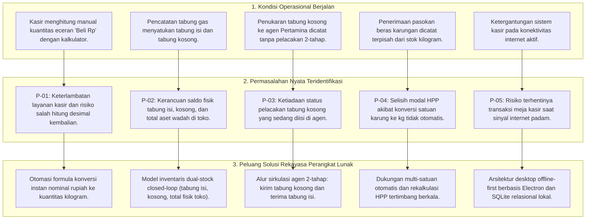
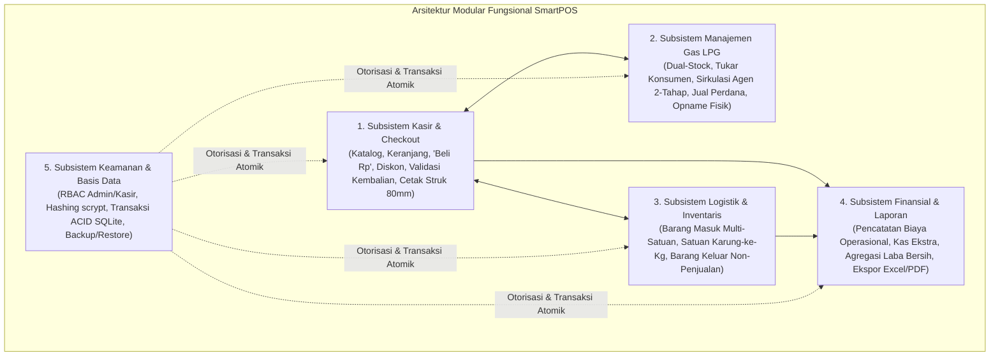
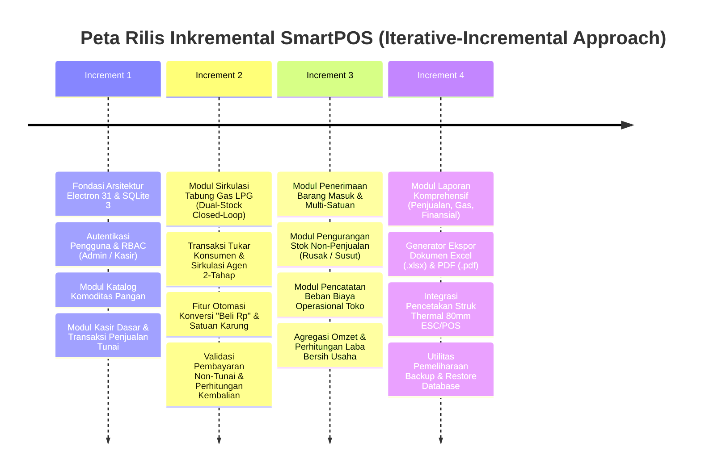

# BAB I: PENDAHULUAN

---

## 1.1 Latar Belakang
Sektor perdagangan eceran komoditas kebutuhan pokok pangan (beras dan telur) serta pangkalan resmi gas *Liquefied Petroleum Gas* (LPG) bersubsidi merupakan urat nadi rantai pasok kebutuhan dasar rumah tangga di Indonesia. Berdasarkan data Badan Pusat Statistik (BPS, 2024), komoditas pangan seperti beras dan telur secara konsisten memberikan kontribusi signifikan terhadap komposisi konsumsi rumah tangga, sementara gas LPG 3 kg merupakan barang kebutuhan pokok bersubsidi yang tata niaga dan pendistribusian fisiknya diatur secara ketat oleh pemerintah melalui Keputusan Menteri Energi dan Sumber Daya Mineral Nomor 37.K/MG.01/MEM.M/2023 tentang Petunjuk Teknis Pendistribusian Isi Ulang *Liquefied Petroleum Gas* Tertentu Tepat Sasaran.

Meskipun memegang peranan strategis dalam melayani kebutuhan konsumsi harian masyarakat, tata kelola transaksi dan pencatatan operasional pada unit usaha sembako dan pangkalan gas lingkungan permukiman sebagian besar masih mengandalkan pencatatan pembukuan fisik berbasis kertas (*paper-based bookkeeping*) menggunakan buku nota, atau menggunakan aplikasi kasir ritel umum (*general Point of Sale*). Karakteristik komoditas beras, telur, dan gas LPG memiliki tingkat dinamika dan kompleksitas yang jauh berbeda dari barang ritel modern kemasan pabrik berbasis barcode (seperti sabun, makanan instan, atau minuman botol):

1. **Penjualan Eceran Curah dan Kebiasaan Transaksi "Beli Rp"**:
   Konsumen sembako di Indonesia sangat terbiasa berbelanja dengan menyebutkan batasan nominal uang rupiah (*budget-driven purchasing*), seperti: *"Beli beras Rp15.000"* atau *"Beli telur Rp8.000"*. Pada sistem kasir konvensional, kasir terpaksa melakukan kalkulasi manual menggunakan kalkulator meja ($15.000 / 14.000 = 1,0714\text{ kg}$) sebelum menimbang barang secara fisik. Proses manual ini memperlambat pelayanan di meja kasir dan rentan menimbulkan kesalahan input kuantitas maupun perhitungan uang kembalian.
2. **Sirkulasi Fisik Tabung Gas LPG (Aset Wadah Tertutup)**:
   Perdagangan tabung gas LPG bukan hanya transaksi komoditas isi gas (*commodity sale*), melainkan melibatkan pengelolaan aset fisik wadah tabung (*cylinder asset management*). Pangkalan gas harus membedakan secara tegas antara persediaan tabung isi siap jual, tabung kosong penampungan hasil penukaran konsumen, dan perputaran tabung di pihak agen resmi penyalur Pertamina saat pengisian ulang. Aplikasi kasir umum cenderung menyatukan status tabung, sehingga pengelola usaha kesulitan mengidentifikasi selisih fisik tabung atau memantau jumlah tabung yang masih berada di agen penyalur.
3. **Fluktuasi Harga Pasokan dan Multi-Satuan**:
   Penerimaan komoditas dari distributor datang dalam satuan kemasan besar (karung beras 25 kg atau 50 kg; peti telur), sementara penjualan ke konsumen akhir dilakukan dalam satuan kilogram eceran. Fluktuasi harga grosir menuntut penyesuaian modal Harga Pokok Penjualan (HPP) secara presisi menggunakan kalkulasi rata-rata tertimbang (*Moving Weighted Average Cost*). Ketidakmampuan memperbarui HPP secara berkala menyebabkan perhitungan margin keuntungan usaha menjadi bias.
4. **Keterbatasan Infrastruktur Jaringan Internet dan Beban Biaya SaaS**:
   Banyak unit usaha toko sembako dan pangkalan gas beroperasi pada lokasi fisik dengan stabilitas koneksi internet yang fluktuatif. Penggunaan aplikasi kasir berbasis web (*cloud pure Software-as-a-Service* / SaaS) menimbulkan risiko terhentinya operasional meja kasir saat jaringan terputus, di samping membebani pemilik usaha dengan biaya langganan bulanan (*recurring fee*).

Laporan Ujian Tengah Semester (UTS) ini menyajikan analisis kebutuhan dan pemodelan analisis perangkat lunak untuk sistem **SmartPOS: Sistem Kasir dan Manajemen Usaha (Beras, Telur, dan Gas LPG) Berbasis Desktop Offline-First**. Mengingat aplikasi SmartPOS telah memiliki implementasi perangkat lunak pada repositori proyek, pendekatan penyusunan laporan ini menerapkan **analisis berbasis implementasi (*implementation-based analysis / reverse engineering*)** yang memetakan kebutuhan sistem terhadap fungsionalitas yang tersedia pada kode sumber dan skema basis data, sekaligus menyajikan pemodelan analisis formal menuju perancangan arsitektur perangkat lunak lanjutan.

---

## 1.2 Identifikasi Masalah
Berdasarkan analisis terhadap proses operasional ritel sembako dan pangkalan gas LPG serta inspeksi teknis terhadap sistem yang dibangun, permasalahan yang mendasari rekayasa perangkat lunak SmartPOS diidentifikasi ke dalam lima butir masalah spesifik:

Rincian lima butir masalah tersebut meliputi:
1. **P-01 (Keterbatasan Perhitungan Manual Transaksi Eceran Curah)**: Kebiasaan konsumen membeli komoditas curah dalam batasan nominal rupiah mengharuskan kasir menghitung nilai pecahan desimal kilogram secara manual, yang memperlambat alur pelayanan dan rentan terhadap kesalahan hitung.
2. **P-02 (Kerancuan Pencatatan Persediaan Ganda Tabung Gas LPG)**: Sistem pencatatan kasir umum tidak memisahkan inventaris tabung isi dari tabung kosong hasil penukaran konsumen, sehingga saldo fisik tabung pangkalan sulit dipantau secara akurat.
3. **P-03 (Ketiadaan Pelacakan Sirkulasi Agen Dua Tahap)**: Perpindahan tabung kosong ke agen pengisian dan penerimaan kembali tabung isi sering berlangsung dengan jeda waktu, sehingga memerlukan pencatatan sirkulasi bertahap agar jumlah tabung yang berada di luar toko terlacak transparan.
4. **P-04 (Kompleksitas Multi-Satuan dan Pembaruan Modal HPP)**: Pembelian beras dalam satuan karung (50 kg) yang dijual dalam satuan kilogram eceran dengan harga beli yang berfluktuasi memerlukan konversi satuan otomatis dan mekanisme pembaruan harga pokok penjualan (HPP).
5. **P-05 (Kerentanan Ketergantungan Internet dan Beban Biaya Langganan)**: Penggunaan aplikasi kasir berbasis komputasi awan (*cloud*) berisiko lumpuh saat jaringan internet lokal mengalami gangguan, serta membebani unit usaha dengan biaya sewa perangkat lunak berkala.

---

## 1.3 Rumusan Masalah
Mengacu pada latar belakang dan identifikasi masalah, rumusan masalah dalam dokumen analisis kebutuhan dan pemodelan perangkat lunak SmartPOS dirumuskan sebagai berikut:
1. Bagaimana menganalisis dan merumuskan spesifikasi kebutuhan perangkat lunak (*Software Requirements Specification* / SRS) yang komprehensif, tidak ambigu, dan terverifikasi untuk unit usaha sembako dan pangkalan gas LPG?
2. Bagaimana memodelkan logika bisnis pengelolaan tabung gas LPG bersubsidi dengan arsitektur *dual-stock closed-loop* dan mekanisme sirkulasi agen dua tahap?
3. Bagaimana merancang fungsi otomasi konversi transaksi curah berbasis nominal uang ("Beli Rp") dan pengelolaan multi-satuan karung ke kilogram pada modul kasir?
4. Bagaimana memodelkan analisis sistem menggunakan notasi formal Unified Modeling Language (OMG UML 2.5.1) dan Data Flow Diagram (DFD) Level 0 hingga Level 1 yang konsisten dan seimbang (*balanced*)?
5. Bagaimana mengevaluasi konsistensi, keterpaduan, dan keterlacakan kebutuhan (*traceability*) antar-artefak rekayasa perangkat lunak mulai dari identifikasi masalah hingga pemodelan analisis?

---

## 1.4 Tujuan Pengembangan Sistem
Tujuan pengembangan sistem dan penyusunan dokumen laporan ini dibedakan ke dalam dua aspek utama:

### 1.4.1 Tujuan Fungsional Sistem (System Operational Objectives)
1. Membangun aplikasi kasir desktop mandiri (*offline-first*) yang dapat beroperasi 100% tanpa ketergantungan pada koneksi internet.
2. Mengotomasi kalkulasi konversi nilai nominal belanja "Beli Rp" menjadi kuantitas pecahan kilogram secara instan di meja kasir.
3. Mengimplementasikan pengelolaan stok gas LPG ganda (*dual-stock closed-loop*) yang memisahkan tabung isi, tabung kosong, dan total aset tabung di toko secara tertutup.
4. Menyediakan pencatatan sirkulasi tabung agen dua tahap (kirim kosong dan terima isi) serta rekalkulasi HPP rata-rata tertimbang.
5. Menyediakan fitur pencatatan beban operasional toko dan agregasi laporan laba rugi bersih riil serta fasilitas pencadangan (*backup-restore*) data lokal berbasis SQLite.

### 1.4.2 Tujuan Akademik Analisis dan Dokumentasi (Academic Documentation Objectives)
1. Memenuhi seluruh kriteria tugas Ujian Tengah Semester (UTS) mata kuliah Rekayasa Perangkat Lunak sesuai silabus dan standar Sub-CPMK 052.2.
2. Menyusun dokumen spesifikasi kebutuhan perangkat lunak (SRS) yang memuat Kebutuhan Fungsional (FR), Kebutuhan Nonfungsional (NFR), User Story, Acceptance Criteria berformat Given-When-Then, dan matriks prioritas.
3. Menyajikan model analisis sistem yang patuh pada standar formal: Use Case Diagram dan Activity Diagram sesuai OMG UML 2.5.1, serta Context Diagram, DFD Level 0, DFD Level 1, dan Kamus Data sesuai kaidah pemodelan aliran data terstruktur.
4. Menyusun Requirements Traceability Matrix (RTM) yang membuktikan keterlacakan dua arah (*bidirectional traceability*) dari masalah hingga pemodelan.

---

## 1.5 Batasan Masalah
Agar pembahasan laporan tetap terarah pada ruang lingkup yang terukur dan sesuai dengan implementasi aktual sistem, ditetapkan batasan-batasan masalah sebagai berikut:
1. **Platform dan Arsitektur**: Sistem dibangun sebagai aplikasi desktop mandiri (*standalone single-device*) berbasis runtime **Electron 31 (Node.js 20+ dan Chromium)** dengan basis data relasional lokal **SQLite 3** melalui native binding `better-sqlite3`.
2. **Lingkungan Sistem Operasi**: Sistem dirancang dan diuji untuk berjalan pada sistem operasi **Windows 64-bit (Windows 10 / Windows 11)**.
3. **Kemandirian Jaringan (*Offline-First*)**: Sistem beroperasi penuh secara lokal pada satu komputer kasir tanpa memerlukan koneksi internet, tanpa sinkronisasi multi-cabang, dan tanpa arsitektur komputasi awan terdistribusi.
4. **Komoditas yang Dikelola**: Ruang lingkup komoditas dibatasi secara spesifik pada:
   - Komoditas pangan curah: beras (dengan dukungan satuan karung dan kg) serta telur ayam/bebek (satuan kg).
   - Komoditas gas LPG: tabung 3 kg (bersubsidi), tabung 5,5 kg (*Bright Gas*), dan tabung 12 kg.
5. **Metode Pembayaran**: Transaksi kasir mendukung pencatatan pembayaran Tunai, Transfer Bank, dan QRIS Statis. Verifikasi keberhasilan transaksi transfer dan QRIS dilakukan secara manual oleh kasir (tidak terhubung dengan *payment gateway* perbankan otomatis).
6. **Perangkat Keras Periferal**: Mendukung pencetakan nota belanja kasir menggunakan printer thermal lebar 80 mm (atau 58 mm kompatibel) melalui driver Windows Spooler atau protokol raw ESC/POS (USB dan jaringan LAN/TCP port 9100). Sistem tidak terintegrasi secara langsung melalui kabel ke timbangan digital (input bobot hasil timbangan dilakukan secara manual oleh kasir).
7. **Perhitungan HPP**: Algoritma *Moving Weighted Average Cost* diimplementasikan pada pencatatan pasokan gas LPG dari agen, sedangkan pada penerimaan beras dan telur sistem saat ini mencatat harga beli pasokan terakhir.
8. **Pengguna Sistem**: Sistem menerapkan pengendalian akses berbasis peran (*Role-Based Access Control* / RBAC) yang dibatasi pada dua peran pengguna: **Admin (Pemilik Usaha)** dan **Kasir**.

---

## 1.6 Gambaran Umum Sistem
Sistem **SmartPOS** dirancang sebagai solusi terintegrasi untuk mengelola seluruh aspek operasional toko sembako dan pangkalan gas LPG. Arsitektur modular SmartPOS membagi fungsionalitas aplikasi ke dalam lima subsistem utama yang saling terhubung:

1. **Subsistem Transaksi Penjualan (Kasir)**: Menyajikan antarmuka meja kasir dengan pencarian produk cepat, kalkulasi otomatis modal dialog "Beli Rp", validasi pembayaran tunai dan perhitungan uang kembalian, serta pencetakan struk kasir thermal 80 mm.
2. **Subsistem Manajemen Gas LPG (Dual-Stock)**: Mengisolasi stok tabung isi (`filled_stock`) dan tabung kosong (`empty_stock`), mengeksekusi mutasi tertutup penukaran konsumen secara atomik, mengelola penjualan tabung perdana, serta mencatat pengiriman dan penerimaan tabung ke/dari agen Pertamina.
3. **Subsistem Logistik dan Inventaris**: Mengonversi satuan kemasan karung ke kilogram serta mencatat mutasi barang masuk dari pemasok dan barang keluar non-penjualan (rusak, susut, retur, pemakaian pribadi).
4. **Subsistem Finansial dan Pelaporan**: Mengagregasi omzet penjualan, pemasukan kas ekstra, dan beban biaya operasional toko (listrik, sewa, gaji pegawai) untuk menghasilkan laporan laba bersih riil, serta menyediakan generator ekspor berkas Excel (.xlsx) dan PDF.
5. **Subsistem Keamanan dan Basis Data**: Menjamin integritas data lokal melalui transaksi atomik SQLite (ACID compliant), pemisahan konteks memori Electron (*context isolation*), pengendalian akses berbasis peran (RBAC), serta fasilitas pencadangan (*backup*) dan pemulihan (*restore*) basis data.

---

## 1.7 Pemilihan Model Proses Pengembangan Perangkat Lunak

### 1.7.1 Analisis Kondisi Proses Berjalan dan Permasalahan (*As-Is vs To-Be*)
Dalam rekayasa perangkat lunak, perancangan sistem diawali dengan memahami kesenjangan antara proses berjalan (*as-is*) dengan kondisi target yang diharapkan (*to-be*):

| Dimensi Operasional | Kondisi Proses Berjalan (*As-Is*) | Kondisi Target SmartPOS (*To-Be*) | Peluang Perbaikan Rekayasa |
| :--- | :--- | :--- | :--- |
| **Transaksi Eceran Curah** | Kasir membagi nominal uang dengan harga per kg menggunakan kalkulator meja secara manual. | Sistem menyediakan dialog "Beli Rp" yang otomatis mengonversi nominal rupiah menjadi kuantitas desimal instan. | Menghilangkan beban hitung manual di meja kasir dan meminimalkan kesalahan kembalian. |
| **Pencatatan Tabung Gas** | Catatan buku nota menyatukan tabung isi dan kosong sebagai satu angka komoditas biasa. | Model *dual-stock closed-loop* memisahkan saldo tabung isi, kosong, dan total aset fisik pangkalan. | Memberikan transparansi aset fisik tabung pangkalan secara tertutup dan presisi. |
| **Sirkulasi Agen Pertamina** | Pengiriman tabung kosong ke agen mengandalkan ingatan atau nota sobekan yang rentan hilang. | Modul sirkulasi mencatat alur 2-tahap: kirim tabung kosong dan terima tabung isi secara transparan. | Mengeliminasi risiko kehilangan tabung pangkalan yang sedang diisi ulang di agen. |
| **Penerimaan Barang Grosir** | Pasokan beras karungan dicatat terpisah dan tidak terhubung otomatis dengan stok eceran kg. | Sistem mengonversi satuan karung ke kg secara otomatis berdasarkan rasio konversi saat barang masuk. | Menjaga konsistensi stok dasar eceran toko secara real-time. |
| **Ketergantungan Infrastruktur** | Pembukuan manual rentan rusak, sedangkan aplikasi SaaS web lumpuh jika internet padam. | Aplikasi desktop lokal mandiri (*offline-first*) dengan basis data relasional SQLite berintegritas ACID. | Operasional kasir tetap berjalan 100% tanpa jaringan internet dan tanpa biaya sewa periodik. |

### 1.7.2 Analisis Komparatif Model Proses Rekayasa Perangkat Lunak
Untuk menentukan model proses yang paling tepat dalam mengembangkan dan menyempurnakan perangkat lunak SmartPOS, dilakukan evaluasi komparatif terhadap model proses rekayasa perangkat lunak klasik dan adaptif (Pressman & Maxim, 2020; Sommerville, 2016):

| Model Proses SDLC | Karakteristik Kebutuhan | Toleransi Risiko Proyek | Pola Rilis (*Delivery*) | Evaluasi untuk Proyek SmartPOS |
| :--- | :--- | :--- | :--- | :--- |
| **Waterfall** | Kebutuhan harus beku (*freeze*) di awal tahapan. | Tinggi jika terjadi revisi pada pertengahan siklus. | Sekali rilis di akhir (*Big Bang*). | **Kurang Sesuai**: Logika kasir dan inventaris gas memerlukan pengujian dan iterasi bertahap pada fungsi inti sebelum membangun fungsi analitik. |
| **Prototyping** | Kebutuhan eksploratif, menitikberatkan pada antarmuka. | Sedang, berfokus pada desain grafis antarmuka. | Prototipe antarmuka awal. | **Parsial**: Berguna pada perancangan antarmuka dialog "Beli Rp", namun tidak memadai untuk penjaminan keandalan transaksi ACID basis data. |
| **Incremental** | Kebutuhan dapat dipecah ke dalam modul-modul fungsional mandiri. | Rendah, risiko terisolasi per tahap rilis. | Bertahap per fungsi (*working increment*). | **Sangat Sesuai**: Modul SmartPOS memiliki batasan fungsional tegas (kasir, gas, stok, finansial) yang dapat diuji mandiri. |
| **Agile (Kanban)** | Adaptif terhadap umpan balik alur kerja berkelanjutan. | Rendah, perubahan dikelola melalui aliran kerja visual. | Rilis berkala *working software*. | **Sangat Sesuai**: Memungkinkan tim menyesuaikan tata letak antarmuka kasir dan aturan mutasi gas secara responsif. |
| **DevOps / CI-CD** | Sistem berbasis cloud dengan pipeline otomatis 24/7. | Rendah untuk layanan web terdistribusi. | Continuous Deployment ke cloud server. | **Tidak Sesuai**: SmartPOS berarsitektur desktop offline-first mandiri tanpa server cloud terpusat. |

### 1.7.3 Justifikasi Formal Pemilihan Model Proses
Berdasarkan evaluasi terhadap karakteristik sistem dan kebutuhan operasional, tim menetapkan justifikasi metodologis pemilihan model proses secara formal sebagai berikut:

> **Pernyataan Keputusan Pemilihan Model Proses Rekayasa Sistem:**  
> *"Kami memilih model **Iterative-Incremental dengan pendekatan Agile-Kanban** karena karakteristik sistem SmartPOS menuntut arsitektur modul kasir utama yang dapat diuji coba dan divalidasi terlebih dahulu secara mandiri, sementara subsistem dengan aturan bisnis khusus (seperti pengelolaan sirkulasi tabung gas LPG dual-stock dan penatausahaan stok multi-satuan) dikembangkan, diuji, dan diintegrasikan secara bertahap tanpa mengganggu fungsi operasional kasir yang telah berjalan stabil."*

Penerapan kombinasi model *Iterative-Incremental* dan *Agile-Kanban* ini memberikan fondasi rekayasa yang kokoh melalui tiga keunggulan:
1. **Penjaminan Kestabilan Fungsi Transaksi Kritis**: Modul kasir utama (*Point of Sale*) diselesaikan dan diverifikasi keandalannya terlebih dahulu pada rilis awal, sehingga operasional meja kasir tetap aman saat modul logistik dan pelaporan dibangun.
2. **Fleksibilitas Desain Antarmuka**: Pendekatan adaptif memfasilitasi penyesuaian ergonomi antarmuka kasir (seperti dialog konversi "Beli Rp" dan navigasi keyboard) berdasarkan evaluasi alur penggunaan.
3. **Pengelolaan Alur Kerja Tim Melalui Kanban**: Penerapan alur Kanban dengan pembatasan kerja berjalan (*Work In Progress* / WIP Limit) memastikan tim rekayasa menyelesaikan verifikasi satu modul fungsional secara tuntas sebelum berpindah ke modul berikutnya.

### 1.7.4 Analisis Berdasarkan Karakteristik Proyek, Kebutuhan, Risiko, dan Kemampuan Tim
1. **Karakteristik Proyek**: Perangkat lunak memiliki modularitas fungsional yang tinggi. Pemisahan ke dalam rilis inkremental memungkinkan pengujian modul-modul independen sebelum dihubungkan ke modul pelaporan terpusat.
2. **Kebutuhan Pengguna**: Pengguna membutuhkan fungsionalitas perangkat lunak yang cepat beroperasi (*quick time-to-value*). Modul kasir dasar dapat segera dimanfaatkan tanpa harus menunggu seluruh modul analitik selesai dibangun.
3. **Mitigasi Risiko**: Risiko terbesar sistem terletak pada kesalahan kalkulasi stok gas dan kegagalan integritas transaksi lokal. Dengan model inkremental, logika mutasi gas diuji secara mendalam pada fase khusus sebelum modul finansial dikaitkan.
4. **Kemampuan dan Organisasi Tim**: Pengembangan dilaksanakan oleh kelompok mahasiswa Teknik Informatika dalam rentang waktu semester akademik. Pendekatan Kanban memvisualisasikan pembagian tugas (*backlog*, *in progress*, *testing*, *done*) secara transparan sesuai kapasitas anggota tim.

### 1.7.5 Peta Rilis Inkremental (*Delivery Roadmap*)
Rangkaian pengembangan sistem SmartPOS dipetakan ke dalam empat tahapan rilis inkremental (*Increments*):

Setiap tahapan menghasilkan perangkat lunak yang dapat diuji (*working increment*) dan menjadi dasar verifikasi bagi spesifikasi kebutuhan perangkat lunak (SRS) pada Bab II.
