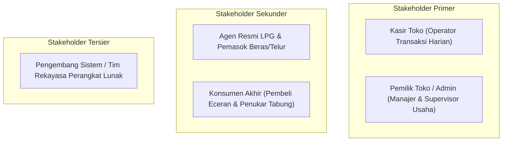

# BAB I: PENDAHULUAN & ELISITASI KEBUTUHAN

---

## 1.1 Latar Belakang Masalah
Usaha Mikro, Kecil, dan Menengah (UMKM) pada sektor perdagangan komoditas kebutuhan pokok pangan (beras dan telur) serta pangkalan resmi gas LPG menghadapi dinamika operasional yang jauh lebih kompleks dibandingkan toko ritel modern berbasis barcode kemasan pabrik. Pada toko sembako dan pangkalan gas, terdapat beberapa kendala mendasar yang tidak dapat diselesaikan oleh sistem Point of Sale (POS) konvensional:

1. **Kompleksitas Sirkulasi Tabung Gas LPG (Aset Fisik Wadah)**:
   Penjualan gas LPG bukan sekadar menjual gas, melainkan melibatkan pengelolaan aset fisik tabung. Sistem kasir umum mencampuradukkan stok tabung isi dan kosong, sehingga memicu selisih stok fisik, ketidakjelasan posisi tabung saat dikirim ke agen penyalur, dan risiko hilangnya aset tabung toko.
2. **Transaksi Eceran Dinamis dan Kuantitas Pecahan**:
   Konsumen sembako kerap membeli barang berdasarkan batasan nominal uang (misalnya: *"beli beras Rp 15.000"* atau *"beli telur Rp 7.000"*). Kasir terpaksa melakukan kalkulasi manual menggunakan kalkulator untuk menentukan berat kilogram pecahan desimal, yang memperlambat kecepatan layanan antrean di jam-jam sibuk.
3. **Fluktuasi Harga Pasokan dan Multi-Satuan**:
   Penerimaan barang dari distributor datang dalam kemasan besar karungan ($25\text{ kg}$ atau $50\text{ kg}$), sedangkan penjualan dilakukan dalam kilogram eceran. Perubahan harga pasokan menuntut rekalkulasi Harga Pokok Penjualan (HPP) rata-rata tertimbang agar laporan margin laba rugi toko tetap akurat.
4. **Keterbatasan Infrastruktur Jaringan di Lingkungan Toko**:
   Banyak unit usaha beroperasi di lokasi dengan konektivitas internet yang tidak stabil dan enggan dibebani biaya sewa server cloud bulanan yang mahal.

Untuk menjawab persoalan tersebut, dirancang dan dibangun sistem **SmartPOS: Sistem Kasir dan Manajemen Usaha (Beras, Telur, dan Gas LPG)** dengan arsitektur desktop *offline-first* yang tangguh, aman, dan berintegritas transaksional tinggi.

---

## 1.2 Tujuan Proyek
Tujuan utama pengembangan sistem SmartPOS adalah:
1. Membangun aplikasi kasir desktop mandiri (*offline-first*) yang dapat beroperasi 100% tanpa internet menggunakan Electron dan basis data relasional lokal SQLite.
2. Mengimplementasikan model pencatatan *dual-stock closed-loop* untuk tabung gas LPG sehingga rasio tabung isi, tabung kosong, dan perputaran tabung di agen terkontrol secara presisi.
3. Mengembangkan fitur otomasi konversi nilai nominal "Beli Rp" menjadi berat pecahan kilogram desimal secara instan pada antarmuka kasir.
4. Mengembangkan mekanisme pencatatan barang masuk multi-satuan dengan rekalkulasi HPP rata-rata tertimbang (*Moving Weighted Average Cost*) secara otomatis.
5. Menyajikan laporan keuangan laba bersih riil yang memperhitungkan omzet penjualan, HPP barang terjual, dan beban operasional toko.

---

## 1.3 Identifikasi Stakeholder Sistem
Berdasarkan analisis pemangku kepentingan (Materi Pertemuan 3), stakeholder SmartPOS dikelompokkan menjadi:

1. **Pemilik Toko / Admin (Primer)**: Bertanggung jawab atas kebijakan harga, pengadaan barang masuk, pemantauan omzet, pengontrolan tabung gas, dan pencatatan biaya operasional.
2. **Kasir Toko (Primer)**: Bertugas melayani antrean pembeli, memilih produk, menginput transaksi "Beli Rp", menerima pembayaran, dan mencetak nota kasir.
3. **Agen Resmi Gas LPG (Sekunder)**: Menyuplai tabung gas isi dan menerima penukaran tabung kosong pangkalan.
4. **Konsumen Akhir (Sekunder)**: Pelanggan yang membutuhkan layanan belanja cepat dengan struk yang jelas.
5. **Pengembang Sistem (Tersier)**: Memastikan kode terstruktur, modular, aman, dan mudah dipelihara.

---

## 1.4 Teknik Elisitasi Kebutuhan
Proses pengumpulan data kebutuhan perangkat lunak dilakukan menggunakan triangulasi teknik:
1. **Wawancara Mendalam (In-Depth Interview)**: Dilakukan kepada pemilik toko dan staf kasir untuk membedah titik masalah pencatatan manual dan selisih tabung gas.
2. **Observasi Lapangan Langsung (Direct Observation)**: Dilakukan pada jam sibuk (08.00–10.00) untuk mencatat interaksi fisik meja kasir, penggunaan timbangan digital, dan kecepatan checkout.
3. **Analisis Dokumen & Artefak (Document Analysis)**: Mengkaji format buku kas harian, nota pengiriman agen Pertamina, serta slip penerimaan barang grosir.

---

## 1.5 Profil Persona Pengguna (User Personas)

### Persona 1: Pak Hendra (Pemilik Toko & Pangkalan LPG)
- **Usia & Peran**: 48 tahun, Pemilik Pangkalan LPG & Toko Sembako.
- **Tingkat Keterampilan Digital**: Menengah (menggunakan laptop toko berbasis Windows).
- **Kebutuhan Utama**: Memastikan stok tabung gas isi dan kosong selalu cocok saat diaudit, mengetahui laba bersih riil setiap bulan, dan memiliki backup data lokal yang aman tanpa biaya sewa cloud bulanan.
- **Pain Points**: Kehilangan tabung gas akibat pencatatan serabutan, kesulitan menghitung modal beras saat harga kulakan naik, dan takut data hilang saat komputer mati lampu.

### Persona 2: Rina (Kasir Toko)
- **Usia & Peran**: 22 tahun, Operator Meja Kasir.
- **Tingkat Keterampilan Digital**: Tinggi (cepat mengetik dan mengoperasikan aplikasi).
- **Kebutuhan Utama**: Antarmuka kasir responsif, fitur pencarian produk instan, kalkulasi otomatis saat pembeli menyebut nominal uang ("Beli Rp 15.000"), dan pencetakan nota kasir otomatis ke printer thermal.
- **Pain Points**: Panik saat antrean panjang jika aplikasi lemot, lelah menghitung manual uang kembalian dan kuantitas pecahan beras dengan kalkulator meja.

---

## 1.6 Pemetaan Masalah, Kebutuhan Pengguna, dan Kebutuhan Sistem

| No | Masalah Nyata Lapangan (*Problem Statement*) | Kebutuhan Pengguna (*User Need*) | Kebutuhan Sistem (*System Requirement*) |
| :---: | :--- | :--- | :--- |
| **1** | Selisih aset tabung gas karena kasir biasa menyatukan stok tabung isi dan tabung kosong. | Pengguna butuh pemisahan tegas antara tabung isi siap jual dan tabung kosong penampungan. | Sistem harus menyediakan arsitektur *dual-stock* (`filled_stock`, `empty_stock`, `total_cylinders`) dengan transaksi tertutup. |
| **2** | Kasir lambat menghitung timbangan pecahan saat pembeli membeli dengan nominal uang genap/acak. | Kasir butuh fitur konversi otomatis dari nominal uang ke berat pecahan kilogram. | Sistem harus menyediakan fungsi otomatisasi "Beli Rp" yang menghitung desimal $kg = \frac{\text{nominal}}{\text{harga}}$ secara instan. |
| **3** | Pengadaan barang masuk dalam karung besar ($50\text{ kg}$), sedangkan kasir menjual dalam kg eceran. | Pemilik toko butuh konversi satuan otomatis dan pembaruan HPP modal yang akurat. | Sistem harus mendukung *multi-unit* dan algoritma kalkulasi HPP rata-rata tertimbang (*Moving Weighted Average*). |
| **4** | Koneksi internet sering mati dan biaya langganan aplikasi web membebani operasional toko. | Toko butuh aplikasi kasir yang beroperasi 100% tanpa internet tanpa biaya bulanan. | Sistem harus berarsitektur *Offline-First* berbasis desktop Electron dan basis data relasional lokal SQLite. |
| **5** | Uang keuntungan toko sering terpakai untuk belanja harian tanpa pembukuan laba bersih yang jelas. | Pemilik butuh pelaporan laba bersih riil yang memisahkan biaya operasional toko. | Sistem harus menyediakan modul pencatatan pengeluaran operasional terintegrasi dengan laporan laba rugi. |
