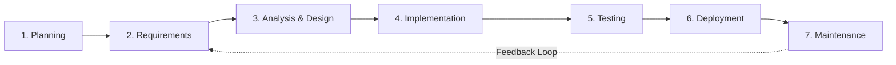
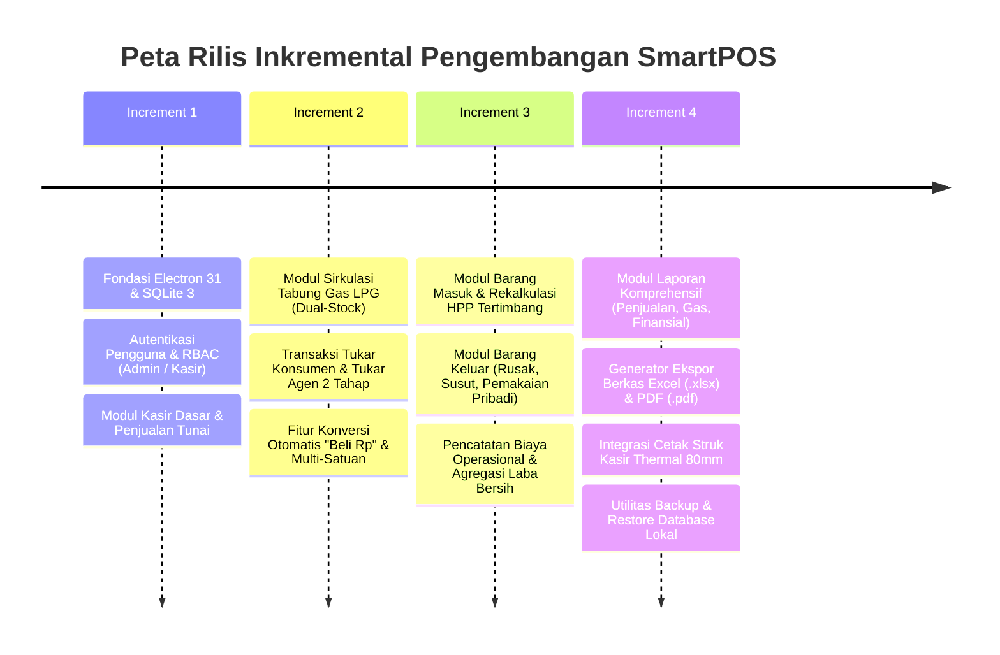

# BAB II: METODOLOGI PENGEMBANGAN SISTEM

---

## 2.1 Tinjauan Siklus Hidup Pengembangan (SDLC Overview)
Siklus Hidup Pengembangan Perangkat Lunak (*Software Development Life Cycle* / SDLC) pada sistem **SmartPOS** memetakan tahapan rekayasa secara disiplin dari identifikasi kebutuhan hingga pemeliharaan mandiri:

- **Planning**: Analisis kelayakan operasional toko sembako & pangkalan gas.
- **Requirements**: Pengumpulan kebutuhan fungsional & nonfungsional melalui wawancara dan observasi.
- **Analysis & Design**: Pemodelan Use Case, DFD Level 0, skema database SQLite, dan desain UI ergonomis.
- **Implementation**: Pengembangan aplikasi desktop menggunakan Electron 31, Node.js, `better-sqlite3`, dan Vanilla JavaScript.
- **Testing**: Pengujian *black-box equivalence partitioning* pada transaksi kasir, sirkulasi tabung gas, dan HPP tertimbang.
- **Deployment**: Pengemasan paket rilis mandiri Windows NSIS (`.exe`) via `electron-builder`.
- **Maintenance**: Fitur pencadangan (*backup*) dan pemulihan (*restore*) database SQLite lokal.

---

## 2.2 Analisis Komparatif Model Proses Perangkat Lunak
Berdasarkan materi perkuliahan Pertemuan 2, dievaluasi 6 model proses rekayasa perangkat lunak:

| Model Proses | Karakteristik Kebutuhan | Frekuensi Umpan Balik | Pola Delivery | Analisis Kesesuaian untuk Proyek SmartPOS |
| :--- | :--- | :--- | :--- | :--- |
| **Waterfall** | Kebutuhan harus beku di awal (*freeze*). | Di akhir siklus proyek. | Sekali rilis (*big bang*). | **Kurang Sesuai**: Logika dual-stock gas dan transaksi kasir butuh penyesuaian iteratif langsung di lapangan. |
| **Prototyping** | Kebutuhan belum jelas, masih eksploratif. | Sangat tinggi di awal. | Prototipe antarmuka. | **Parsial**: Digunakan khusus saat merancang tata letak antarmuka kasir dan tombol "Beli Rp". |
| **Incremental** | Kebutuhan dapat dipecah ke dalam modul mandiri. | Teratur setiap ada rilis modul baru. | Bertahap per inkremen fungsional. | **Sangat Sesuai**: Sistem dapat dibagi ke dalam paket rilis: Core POS $\rightarrow$ Gas LPG $\rightarrow$ Logistik & Finansial $\rightarrow$ Pelaporan. |
| **Spiral** | Proyek sangat besar dengan ketidakpastian tinggi. | Bertahap tiap putaran spiral. | Evolusioner berbasis risiko. | **Kurang Sesuai**: Terlalu rumit dan memakan biaya formalitas yang berlebihan untuk aplikasi desktop UMKM. |
| **Agile (Kanban/Scrum)** | Adaptif terhadap perubahan kebutuhan. | Sangat sering (1–2 minggu). | Rilis berkala *working software*. | **Sangat Sesuai**: Memungkinkan perbaikan cepat berdasarkan umpan balik kasir dan pemilik toko secara langsung. |
| **DevOps** | Sistem cloud dengan pipeline otomatis 24/7. | Kontinu berbasis telemetri server. | Continuous Deployment (CI/CD). | **Kurang Sesuai**: SmartPOS adalah aplikasi *standalone offline* tanpa dependensi server cloud. |

---

## 2.3 Justifikasi Argumentatif Pemilihan Model Proses
Mengacu pada format baku perkuliahan Pertemuan 2 Slide 22:

> ### Pernyataan Pemilihan Model Proses:
> **"Kami memilih model *Iterative-Incremental dengan pendekatan Agile-Kanban* karena karakteristik proyek SmartPOS menuntut arsitektur inti kasir yang dapat diuji coba dan divalidasi terlebih dahulu secara mandiri oleh pengguna, sementara modul logika yang kompleks (seperti sirkulasi tabung gas dan HPP tertimbang) dikembangkan, diuji, dan diintegrasikan secara bertahap tanpa mengganggu fungsi operasional kasir yang telah berjalan stabil."**

### Alasan Penguat:
1. **Modularitas Arsitektur**: Batasan antarmuka kasir, manajemen gas, logistik stok, dan pelaporan terpisah rapi di level database dan IPC, sehingga sangat ideal dikembangkan per rilis inkremental.
2. **Kendali Risiko Bisnis yang Terisolasi**: Kesalahan kalkulasi pada modul gas atau akuntansi tidak akan melumpuhkan fungsi dasar transaksi kasir toko.
3. **Fleksibilitas Uji Coba Lapangan**: Pemilik toko dapat langsung mencoba modul kasir di toko nyata (*working software*) sembari tim menyelesaikan modul generator laporan Excel dan PDF.

---

## 2.4 Rencana Rilis Inkremental (Delivery Roadmap)

- **Inkremen 1**: Fondasi arsitektur Electron yang aman (`contextIsolation: true`, `preload.js`), inisialisasi skema tabel dasar (`users`, `products`, `transactions`), dan fungsi checkout kasir eceran.
- **Inkremen 2**: Implementasi tabel `gas_stock` dan `gas_transactions`, antarmuka penukaran tabung gas, dan logika konversi rupiah ke kilogram desimal.
- **Inkremen 3**: Manajemen logistik inventaris, audit stok (*before/after*), otomatisasi HPP rata-rata tertimbang (*Moving Weighted Average*), dan kalkulasi laba bersih.
- **Inkremen 4**: Integrasi mesin ekspor berkas (`exceljs`, `pdfkit`), driver pencetakan struk 80mm via Windows Spooler & raw ESC/POS port 9100, serta utilitas pencadangan basis data lokal.
