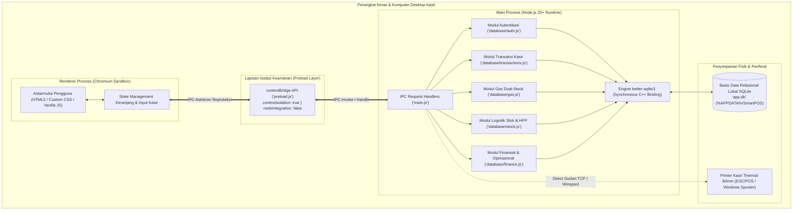
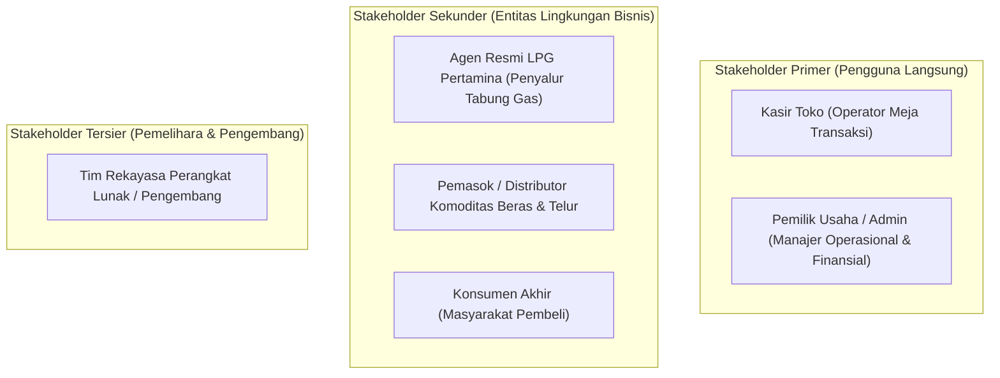
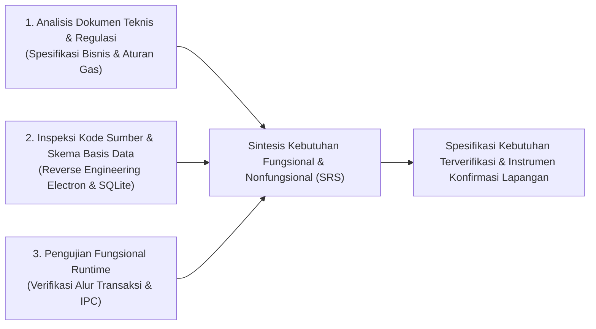
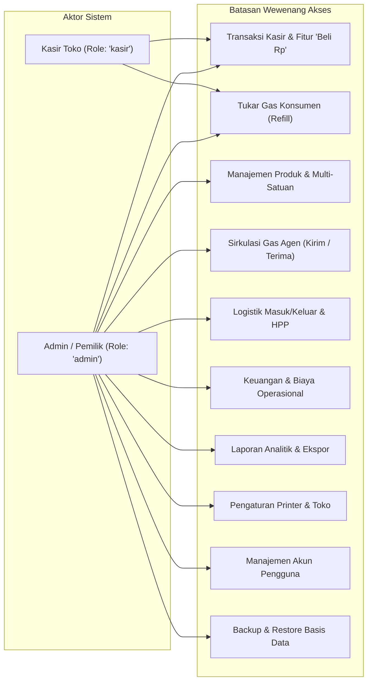

# BAB II: SOFTWARE REQUIREMENTS SPECIFICATION (SRS)

---

## 2.1 Deskripsi Umum Sistem
Sistem **SmartPOS: Sistem Kasir dan Manajemen Usaha (Beras, Telur, dan Gas LPG)** adalah perangkat lunak kasir dan tata kelola operasional berbasis desktop yang dirancang khusus untuk memenuhi kebutuhan spesifik toko sembako fisik dan pangkalan resmi gas LPG bersubsidi. Dokumen *Software Requirements Specification* (SRS) ini menyajikan spesifikasi kebutuhan fungsional dan nonfungsional yang mendasari rancangan sistem.

Sistem dibangun dengan filosofi **Desktop Mandiri (*Offline-First*)** yang mengutamakan kecepatan respon di meja kasir, integritas data transaksional yang tinggi, serta kemandirian penuh dari ketergantungan koneksi internet.

### 2.1.1 Arsitektur Tingkat Tinggi Sistem
Arsitektur SmartPOS mengadopsi model multi-proses berbasis Electron 31 dengan pemisahan tanggung jawab yang terisolasi secara ketat (*strict process isolation*):

### 2.1.2 Karakteristik Operasional & Lingkungan Pengguna
- **Model Interaksi**: Pengguna berinteraksi melalui antarmuka grafis (GUI) yang responsif terhadap input keyboard minimal (*hotkeys*) dan layar sentuh / klik mouse.
- **Kemandirian Jaringan**: Tidak memerlukan sambungan internet untuk seluruh alur transaksi, mutasi stok, hingga pencetakan struk.
- **Integritas Transaksi**: Seluruh pembaruan data yang melibatkan banyak tabel dieksekusi di dalam transaksi atomik SQLite (`db.transaction(...)`). Apabila terjadi pemadaman listrik secara tiba-tiba, basis data secara otomatis melakukan *rollback* ke kondisi konsisten terakhir (*Zero Data Corruption*).

---

## 2.2 Identifikasi Stakeholder
Dalam rekayasa kebutuhan perangkat lunak, pemangku kepentingan (*stakeholders*) dikelompokkan ke dalam tiga kategori hierarki berdasarkan keterlibatan langsung dan tidak langsung terhadap sistem:

| ID Stakeholder | Kategori | Entitas Stakeholder | Peran & Tanggung Jawab Operasional | Kepentingan terhadap Sistem |
| :---: | :--- | :--- | :--- | :--- |
| **ST-01** | Primer | **Pemilik Usaha / Admin** | Mengelola katalog barang, menentukan harga, mencatat barang masuk, mengawasi sirkulasi tabung gas ke agen, mencatat pengeluaran operasional, dan menganalisis laporan laba bersih. | Menjamin aset tabung gas terpantau, HPP terkendali, laporan laba bersih transparan, dan tidak ada biaya langganan bulanan. |
| **ST-02** | Primer | **Petugas Kasir** | Melayani antrean pembeli, memilih produk, menginput transaksi "Beli Rp", memproses penukaran tabung gas konsumen, menerima uang pembayaran, dan mencetak struk. | Kecepatan antarmuka kasir, kalkulasi otomatis tanpa kalkulator manual, validasi uang kembalian instan, dan kemudahan cetak struk kasir. |
| **ST-03** | Sekunder | **Agen Resmi LPG Pertamina** | Menyuplai pasokan tabung gas isi dan menerima penyerahan tabung kosong dari pangkalan. | Kesesuaian jumlah fisik tabung kosong yang dikirim dengan tabung isi yang diserahkan kembali ke pangkalan. |
| **ST-04** | Sekunder | **Pemasok Beras & Telur** | Mengirimkan komoditas pangan dalam satuan karung atau peti dengan fluktuasi harga beli grosir. | Kelancaran tanda terima barang dan kesesuaian faktur tagihan pengadaan barang. |
| **ST-05** | Sekunder | **Konsumen Akhir** | Membeli kebutuhan pokok secara eceran tunai/transfer dan menukarkan tabung gas kosong. | Pelayanan kasir yang cepat, keakuratan timbangan pecahan desimal, dan tanda bukti nota belanja yang jelas. |
| **ST-06** | Tersier | **Tim Pengembang RPL** | Merancang arsitektur perangkat lunak, memodelkan sistem, dan memelihara basis kode. | Struktur kode modular, keterlacakan kebutuhan formal (RTM), dan pemenuhan standar penilaian Sub-CPMK 052.2. |

---

## 2.3 Teknik Elisitasi Kebutuhan

### 2.3.1 Metode Elisitasi Faktual yang Dilaksanakan
Pada fase penyusunan laporan UTS ini, teknik elisitasi kebutuhan dilaksanakan melalui pendekatan **analisis berbasis bukti teknis dan dokumentasi (*technical document analysis & code-level reverse engineering*)**:

Rincian pelaksanaan teknik elisitasi meliputi:
1. **Analisis Dokumen dan Regulasi (*Document Analysis*)**:
   - Memeriksa dokumen spesifikasi teknis internal (`docs/03-spesifikasi-teknis/`), meliputi aturan bisnis penukaran gas LPG, formula konversi "Beli Rp", dan arsitektur keamanan Electron.
   - Mengkaji Keputusan Menteri ESDM Nomor 37.K/MG.01/MEM.M/2023 terkait petunjuk teknis pendistribusian fisik gas LPG 3 kg tepat sasaran.
2. **Inspeksi Kode Sumber dan Skema Basis Data (*Code & Schema Inspection*)**:
   - Menelusuri seluruh berkas implementasi: `main.js` (IPC handlers), `preload.js` (API bridge), modul `database/*.js` (logika bisnis transaksi, sirkulasi gas, stok, dan finansial), serta berkas skema relasional `database/schema.sql`.
   - Mengidentifikasi batasan implementasi, tipe data, constraint integritas, serta transaksi atomik (`db.transaction`).
3. **Pengujian Alur Fungsional Runtime (*Functional Runtime Verification*)**:
   - Menguji alur pencatatan transaksi kasir, kalkulasi konversi rupiah ke kuantitas kilogram, penukaran tabung gas konsumen, sirkulasi pengiriman ke agen, serta pembuatan laporan dan pencadangan basis data.

### 2.3.2 Status Validasi Lapangan dan Instrumen Konfirmasi
> **Pernyataan Integritas Elisitasi:**  
> Sesuai prinsip anti-asumsi akademik, sesi wawancara mendalam dan observasi langsung di tempat usaha toko fisik **belum dilaksanakan pada tahap ini**. Seluruh profil kebutuhan dirumuskan dari analisis domain bisnis dan implementasi yang tersedia.  
> Untuk menjamin validitas empiris pada tahap pengembangan lanjutan pasca-UTS, tim rekayasa telah menyusun dokumen **`DAFTAR_KONFIRMASI_LAPANGAN.md`** yang memuat butir-butir pertanyaan wawancara terstruktur mencakup alur kasir, kebiasaan transaksi nominal, sirkulasi agen Pertamina, fluktuasi HPP beras, dan jenis printer thermal yang tersedia.

### 2.3.3 Hasil Pemetaan Elisitasi (Problem $\rightarrow$ User Need $\rightarrow$ System Requirement)

| No | Masalah Teridentifikasi (*Problem Statement*) | Kebutuhan Pengguna (*User Need*) | Kebutuhan Sistem Terelisitasi (*System Requirement*) |
| :---: | :--- | :--- | :--- |
| **1** | Kasir lambat melayani pembeli saat memesan dengan nominal uang genap/acak ("Beli Rp"). | Kasir membutuhkan fungsi konversi otomatis dari nominal uang langsung ke bobot kilogram. | Sistem wajib menyediakan fungsi "Beli Rp" yang secara otomatis mengonversi $kg = \frac{\text{nominal}}{\text{harga}}$ dengan presisi desimal (FR-05). |
| **2** | Kerancuan saldo fisik tabung gas karena pencatatan umum menyatukan tabung isi dan kosong. | Pengelola membutuhkan pemisahan stok tabung isi, kosong, dan total aset secara tertutup. | Sistem wajib mengimplementasikan model *dual-stock closed-loop* (`filled_stock`, `empty_stock`, `total_cylinders`) dengan transaksi atomik (FR-09). |
| **3** | Pengiriman tabung kosong ke agen pengisian Pertamina berisiko selisih hitung. | Pengelola membutuhkan pencatatan bertahap saat tabung kosong dikirim dan saat tabung isi diterima. | Sistem wajib menyediakan modul sirkulasi agen 2-tahap: kirim tabung kosong dan terima tabung isi (FR-11, FR-12). |
| **4** | Pengadaan komoditas dalam satuan karung (50 kg) sedangkan penjualan dalam kilogram eceran. | Pengelola membutuhkan konversi satuan otomatis dan pembaruan modal HPP saat pasokan tiba. | Sistem wajib mendukung multi-satuan karung-ke-kg dan rekalkulasi HPP rata-rata tertimbang (FR-03, FR-15). |
| **5** | Koneksi internet di lingkungan toko tidak stabil dan biaya langganan SaaS memberatkan. | Pengelola membutuhkan aplikasi kasir mandiri yang beroperasi 100% tanpa internet tanpa biaya bulanan. | Sistem wajib berarsitektur desktop *offline-first* berbasis Electron dan basis data lokal SQLite (NFR-03, NFR-05). |

---

## 2.4 Identifikasi Aktor dan Hak Akses
Sistem SmartPOS menerapkan mekanisme pengendalian akses berbasis peran (*Role-Based Access Control* / RBAC) yang membedakan hak akses antara dua peran pengguna:

### Matriks Hak Akses Berbasis Peran (RBAC Matrix):

| Modul Fungsionalitas | Aksi / Operasi Sistem | Kasir (`kasir`) | Admin (`admin`) | Keterangan Batasan Wewenang |
| :--- | :--- | :---: | :---: | :--- |
| **Autentikasi** | Login akun & logout sesi | Ya | Ya | Setiap pengguna memiliki kredensial unik. |
| **Kasir & POS** | Buka katalog & tambah keranjang | Ya | Ya | Hak operasional meja kasir. |
| **Kasir & POS** | Kalkulasi otomatis "Beli Rp" | Ya | Ya | Fitur inti kasir komoditas curah. |
| **Kasir & POS** | Checkout transaksi & cetak struk | Ya | Ya | Transaksi tunai, transfer, dan QRIS statis. |
| **Kasir & POS** | Pembatalan transaksi (*void*) | Terbatas | Ya | Pembatalan transaksi mengembalikan stok otomatis. |
| **Manajemen Gas** | Tukar gas konsumen (*refill*) | Ya | Ya | Mutasi tabung isi berkurang, kosong bertambah. |
| **Manajemen Gas** | Kirim/terima tabung ke/dari agen | Tidak | Ya | Pengawasan aset tabung pangkalan di luar toko. |
| **Manajemen Gas** | Penyesuaian fisik (*stock opname*) | Tidak | Ya | Otoritas koreksi selisih fisik gudang. |
| **Katalog Produk** | Tambah, ubah, nonaktifkan produk | Tidak | Ya | Menentukan harga beli, jual, dan konversi satuan. |
| **Logistik Stok** | Catat barang masuk & keluar | Tidak | Ya | Menambah stok pasokan dan mencatat susut/rusak. |
| **Keuangan** | Catat beban operasional & kas ekstra| Tidak | Ya | Pengelolaan kas pengeluaran toko. |
| **Laporan** | Lihat grafik & ekspor Excel/PDF | Tidak | Ya | Akses data analitik omzet dan laba bersih. |
| **Pengaturan** | Ubah data toko & konfigurasi printer| Tidak | Ya | Konfigurasi alamat, telepon, dan port ESC/POS. |
| **Manajemen User**| Tambah kasir, reset password | Tidak | Ya | Manajemen kredensial pengguna lokal. |
| **Pemeliharaan** | Backup & restore basis data | Tidak | Ya | Operasi administratif basis data SQLite. |

---

## 2.5 Kebutuhan Fungsional (Functional Requirements)
Kebutuhan Fungsional dirumuskan menggunakan format kalimat baku normatif (*"Sistem harus dapat..."*) dengan mencantumkan pemicu (*trigger*), masukan (*input*), aturan proses (*business rules*), keluaran (*output*), serta status implementasi faktual:

| ID Kebutuhan | Nama Kebutuhan | Deskripsi Rumusan Kebutuhan Fungsional | Status Implementasi |
| :---: | :--- | :--- | :---: |
| **FR-01** | Autentikasi Pengguna | Sistem harus dapat memvalidasi kredensial pengguna (username dan password) menggunakan algoritma derivasi kunci kriptografi `scrypt` berkombinasi salt acak, serta mengarahkan pengguna ke antarmuka yang sesuai dengan perannya (`admin` atau `kasir`). | **Implemented** |
| **FR-02** | Manajemen Pengguna | Sistem harus dapat memfasilitasi Admin untuk membuat akun pengguna baru, menonaktifkan status akun pengguna, serta mengubah kata sandi pengguna secara aman. | **Implemented** |
| **FR-03** | Manajemen Katalog Komoditas | Sistem harus dapat memfasilitasi Admin untuk mengelola data katalog produk (beras, telur, gas), meliputi nama, kategori, satuan dasar (kg/tabung), satuan sekunder (karung), rasio konversi satuan, harga modal, harga jual, dan batas stok minimum. | **Implemented** |
| **FR-04** | Pemrosesan Transaksi Penjualan | Sistem harus dapat memfasilitasi Kasir untuk memilih produk, menambahkan item ke keranjang belanja, menerapkan potongan harga (diskon), memilih metode pembayaran (tunai, transfer, QRIS), dan memproses checkout di dalam satu transaksi atomik basis data. | **Implemented** |
| **FR-05** | Konversi Otomatis "Beli Rp" | Sistem harus dapat mengonversi nilai nominal uang rupiah yang diinput kasir menjadi kuantitas pecahan desimal kilogram secara otomatis berdasarkan harga jual per unit dasar produk curah ($kg = \frac{\text{nominal}}{\text{harga}}$). | **Implemented** |
| **FR-06** | Validasi Pembayaran & Kembalian | Sistem harus dapat memvalidasi nominal uang pembayaran dari konsumen dan menghitung nilai uang kembalian secara otomatis, serta menolak transaksi jika uang pembayaran tunai kurang dari total tagihan akhir. | **Implemented** |
| **FR-07** | Pencetakan Struk Thermal Kasir | Sistem harus dapat memformat dan mencetak nota transaksi kasir ke printer thermal lebar 80 mm (atau 58 mm kompatibel) melalui driver Windows Spooler atau perintah raw ESC/POS via USB dan TCP socket. | **Device Dependent** |
| **FR-08** | Pembatalan Transaksi (*Void*) | Sistem harus dapat membatalkan transaksi penjualan yang berstatus selesai, mengubah status transaksi menjadi batal, serta mengembalikan kuantitas stok produk atau tabung gas secara atomik. | **Implemented** |
| **FR-09** | Pemisahan Inventaris Tabung Gas | Sistem harus dapat mencatat persediaan tabung gas LPG secara terpisah antara tabung isi (`filled_stock`), tabung kosong (`empty_stock`), dan total aset tabung di pangkalan (`total_cylinders`). | **Implemented** |
| **FR-10** | Transaksi Penukaran Gas Konsumen | Sistem harus dapat memproses transaksi penukaran (*refill*) gas LPG dengan mengurangi stok tabung isi sebanyak $N$ unit dan menambah stok tabung kosong sebanyak $N$ unit, dengan total aset tabung di toko tetap konstan. | **Implemented** |
| **FR-11** | Sirkulasi Agen: Kirim Tabung Kosong | Sistem harus dapat mencatat pengiriman tabung kosong pangkalan ke agen Pertamina dengan mengurangi stok tabung kosong dan mengurangi total aset fisik tabung yang berada di dalam toko. | **Implemented** |
| **FR-12** | Sirkulasi Agen: Terima Tabung Isi | Sistem harus dapat mencatat penerimaan tabung isi hasil penukaran dari agen Pertamina dengan menambah stok tabung isi dan menambah kembali total aset fisik tabung di dalam toko. | **Implemented** |
| **FR-13** | Penjualan Gas Perdana (Tanpa Tukar) | Sistem harus dapat memproses penjualan tabung gas baru beserta isinya kepada konsumen tanpa penukaran tabung kosong, dengan memotong stok tabung isi dan total tabung toko menggunakan harga khusus perdana (`no_exchange_price`). | **Implemented** |
| **FR-14** | Penyesuaian Fisik (*Stock Opname*) Gas | Sistem harus dapat mencatat koreksi penyesuaian stok tabung isi dan tabung kosong secara manual saat audit fisik gudang, serta menyimpan riwayat perubahan stok pada catatan log audit. | **Implemented** |
| **FR-15** | Pencatatan Logistik Barang Masuk | Sistem harus dapat mencatat penerimaan pasokan barang masuk dari pemasok/agen, mengonversi satuan kemasan sekunder ke satuan dasar, menambah saldo stok fisik, serta mencatat rekalkulasi HPP rata-rata tertimbang pada gas LPG dan harga beli pasokan terbaru pada beras/telur. | **Implemented** |
| **FR-16** | Pencatatan Barang Keluar Non-Penjualan | Sistem harus dapat mencatat pengurangan stok fisik akibat barang rusak, susut penimbangan, barang hilang, retur ke pemasok, atau pemakaian pribadi pemilik (*prive*). | **Implemented** |
| **FR-17** | Pencatatan Biaya Operasional Toko | Sistem harus dapat mencatat pengeluaran operasional toko (listrik, sewa, gaji, perlengkapan) serta mencatat pemasukan kas ekstra di luar transaksi kasir. | **Implemented** |
| **FR-18** | Visualisasi Kinerja Finansial | Sistem harus dapat mengagregasi omzet penjualan kasir, penerimaan ekstra, beban pokok pasokan, dan beban operasional untuk menyajikan visualisasi ringkasan laba bersih operasional toko pada dashboard. | **Implemented** |
| **FR-19** | Pembuatan dan Ekspor Laporan | Sistem harus dapat menghasilkan laporan penjualan, laporan stok komoditas, laporan sirkulasi mutasi gas, dan laporan keuangan dalam rentang tanggal fleksibel, serta mengekspor data ke dalam berkas format Excel (.xlsx) dan PDF (.pdf). | **Implemented** |
| **FR-20** | Pencadangan & Pemulihan Basis Data | Sistem harus dapat mencadangkan basis data relasional SQLite secara atomik ke berkas eksternal (`.db`) menggunakan perintah `VACUUM INTO`, serta memulihkan basis data dari berkas cadangan melalui mekanisme restart aplikasi yang aman. | **Implemented** |

---

## 2.6 Kebutuhan Nonfungsional (Nonfunctional Requirements)
Kebutuhan Nonfungsional dirumuskan mengacu pada tolok ukur atribut kualitas perangkat lunak standar **ISO/IEC 25010 (SQuaRE)** dengan parameter yang spesifik dan dapat diuji:

| ID NFR | Atribut Kualitas (ISO/IEC 25010) | Definisi Kebutuhan Spesifik | Lingkup & Mekanisme Teknis Pemenuhan | Metode Pengujian |
| :---: | :--- | :--- | :--- | :--- |
| **NFR-01** | **Security (Keamanan Data)** | Sistem wajib melindungi kredensial otentikasi dari serangan kebocoran kata sandi dan membatasi eksekusi skrip berbahaya. | Hashing password menggunakan `crypto.scrypt` Node.js dengan 16-byte random salt. Konfigurasi Electron menerapkan `contextIsolation: true` dan `nodeIntegration: false`. | Inspeksi berkas `app.db` dan audit keamanan konfigurasi BrowserWindow. |
| **NFR-02** | **Reliability & ACID Compliance** | Sistem wajib menjamin konsistensi basis data saat terjadi pemadaman listrik tiba-tiba (*zero transaction loss*). | Seluruh mutasi lintas tabel (transaksi kasir, tukar gas, barang masuk) dibungkus transaksi atomik SQLite (`db.transaction`). Mode basis data diatur ke Write-Ahead Logging (`WAL`). | Simulasi terminasi paksa proses (`kill process`) saat operasi transaksi berlangsung. |
| **NFR-03** | **Availability (Ketersediaan Offline)** | Sistem wajib dapat beroperasi 100% tanpa sambungan internet untuk seluruh fungsi kasir dan logistik toko. | Arsitektur desktop mandiri (*offline-first*). Seluruh dependensi antarmuka, aset ikon SVG, dan engine basis data dimuat dari disk lokal komputer kasir. | Pengujian operasi transaksi kasir dan manajemen stok saat koneksi jaringan dinonaktifkan (*airplane mode*). |
| **NFR-04** | **Performance Efficiency** | Sistem wajib merespons pencarian produk, kalkulasi "Beli Rp", dan checkout kasir dalam waktu singkat. | Waktu respon pencarian produk dan kalkulasi konversi nominal rupiah di bawah 500 milidetik pada data katalog lokal. Waktu eksekusi checkout di bawah 1 detik. | Pengukuran latensi eksekusi handler IPC menggunakan `performance.now()`. |
| **NFR-05** | **Portability & Self-Containment** | Sistem wajib dapat dijalankan pada lingkungan desktop Windows 64-bit tanpa memerlukan instalasi server basis data terpisah. | Aplikasi dipaketkan sebagai berkas instalasi desktop mandiri (NSIS installer) yang memuat runtime Electron dan binary `better-sqlite3` terkompilasi. | Uji instalasi dan eksekusi pada komputer Windows 10/11 yang bersih dari Node.js/server DB. |
| **NFR-06** | **Usability & Ergonomics** | Antarmuka kasir wajib dirancang ergonomis untuk meminimalkan beban ketik dan klik operator kasir di jam sibuk. | Antarmuka kasir dilengkapi tombol pintas (*hotkeys*), pencarian teks instan, navigasi keyboard pada modal "Beli Rp", serta status peringatan stok minimum berwarna kontras. | Evaluasi alur kerja kasir (jumlah langkah klik dari memilih barang hingga struk terformat). |
| **NFR-07** | **Maintainability & Recoverability** | Sistem wajib menyediakan mekanisme pencadangan dan pemulihan data yang mudah dilakukan oleh pengguna awam. | Fitur backup mengeksekusi `VACUUM INTO` menghasilkan salinan konsisten. Fitur restore menyalin file cadangan dan me-relaunch aplikasi secara otomatis. | Pengujian siklus backup basis data, modifikasi data, restore berkas backup, dan verifikasi integritas data pulih. |

---

## 2.7 User Story
Kebutuhan pengguna dimodelkan ke dalam 5 User Story utama yang mencakup seluruh peran pengguna:

### US-01: Transaksi Kasir Cepat & Konversi Otomatis "Beli Rp" (Aktor: Petugas Kasir)
> **Sebagai** Petugas Kasir Toko,  
> **Saya ingin** mengonversi input nominal uang belanja rupiah langsung menjadi kuantitas pecahan kilogram pada antarmuka kasir,  
> **Agar** saya dapat melayani transaksi eceran curah secara cepat tanpa perlu menghitung pembagian menggunakan kalkulator meja secara manual.

### US-02: Transaksi Penukaran Tabung Gas Konsumen (Aktor: Petugas Kasir)
> **Sebagai** Petugas Kasir Toko,  
> **Saya ingin** mencatat transaksi penukaran gas LPG konsumen dengan alur otomatis (stok tabung isi berkurang dan stok tabung kosong bertambah),  
> **Agar** saldo stok tabung fisik pangkalan selalu akurat dan tidak terjadi selisih antara pencatatan sistem dengan kondisi fisik toko.

### US-03: Pengawasan Sirkulasi Tabung Gas ke Agen Pertamina (Aktor: Pemilik Usaha / Admin)
> **Sebagai** Pemilik Usaha / Pengelola Pangkalan LPG,  
> **Saya ingin** mencatat alur sirkulasi tabung gas ke agen secara 2-tahap (pengiriman tabung kosong dan penerimaan tabung isi),  
> **Agar** saya dapat mengetahui secara transparan jumlah tabung kosong pangkalan yang masih berada di agen penyalur Pertamina.

### US-04: Penerimaan Barang Masuk & Rekalkulasi Modal HPP (Aktor: Pemilik Usaha / Admin)
> **Sebagai** Pemilik Usaha / Admin Toko,  
> **Saya ingin** mencatat penerimaan pasokan beras dalam satuan kemasan karung yang otomatis terkonversi ke satuan kilogram eceran serta memperbarui modal HPP,  
> **Agar** stok persediaan fisik eceran toko selalu konsisten dan nilai modal perolehan barang terkalibrasi secara akurat.

### US-05: Pelaporan Finansial Laba Bersih & Pemeliharaan Data (Aktor: Pemilik Usaha / Admin)
> **Sebagai** Pemilik Usaha / Admin Toko,  
> **Saya ingin** melihat ringkasan performa finansial yang memisahkan omzet kasir dari beban operasional toko serta mencadangkan basis data secara mandiri,  
> **Agar** saya mengetahui laba bersih riil usaha dan memiliki salinan cadangan data yang aman jika komputer mengalami kendala fisik.

---

## 2.8 Acceptance Criteria
Setiap User Story dilengkapi kriteria penerimaan (*Acceptance Criteria*) berformat terstruktur **GIVEN - WHEN - THEN** yang mencakup skenario normal (*positive flow*) dan skenario penanganan kegagalan (*negative/validation flow*):

### Acceptance Criteria untuk US-01 (Kasir & "Beli Rp")
- **AC-1.1: Skenario Sukses Konversi "Beli Rp"**  
  **Given** Kasir berada pada halaman kasir dan memilih produk beras medium seharga Rp 13.000 / kg.  
  **When** Kasir mengklik tombol "Beli Rp", memasukkan nominal uang `15000`, lalu menekan tombol "Tambahkan".  
  **Then** Sistem secara instan menambahkan item beras ke keranjang dengan kuantitas pecahan desimal $15.000 / 13.000 \approx 1,15385\text{ kg}$, dan subtotal baris keranjang terkunci tepat sebesar Rp 15.000.
- **AC-1.2: Skenario Gagal Validasi Input Nominal Tidak Valid**  
  **Given** Kasir membuka modal dialog "Beli Rp" untuk produk telur ayam.  
  **When** Kasir memasukkan nilai nominal `0` atau angka negatif atau membiarkan field kosong lalu menekan "Tambahkan".  
  **Then** Sistem menolak penambahan item, menampilkan pesan peringatan (*toast error*) "Masukkan nominal uang yang valid", dan modal tetap terbuka.

### Acceptance Criteria untuk US-02 (Tukar Gas Konsumen)
- **AC-2.1: Skenario Sukses Tukar Tabung Gas Konsumen**  
  **Given** Stok fisik Gas LPG 3 kg di toko tercatat 50 tabung isi dan 30 tabung kosong (total aset = 80 tabung).  
  **When** Kasir memproses transaksi kasir untuk penukaran 2 tabung Gas LPG 3 kg dengan mode default "Tukar Tabung".  
  **Then** Transaksi berhasil disimpan secara atomik, stok tabung isi berkurang menjadi 48, stok tabung kosong bertambah menjadi 32, dan total kepemilikan tabung toko tetap 80 tabung.
- **AC-2.2: Skenario Gagal Penukaran Akibat Stok Tabung Isi Kurang**  
  **Given** Stok tabung isi Gas LPG 12 kg di toko hanya tersisa 1 tabung.  
  **When** Kasir mencoba melakukan checkout penukaran gas sebanyak 2 tabung.  
  **Then** Sistem menolak transaksi, melakukan rollback penuh basis data, dan menampilkan notifikasi kesalahan "Stok gas isi Gas LPG 12 KG tidak mencukupi".

### Acceptance Criteria untuk US-03 (Sirkulasi Tabung Agen 2-Tahap)
- **AC-3.1: Skenario Sukses Kirim Tabung Kosong ke Agen (Tahap 1)**  
  **Given** Pangkalan memiliki stok tabung kosong Gas LPG 3 kg sebanyak 40 tabung.  
  **When** Admin membuka modul Manajemen Gas, memilih aksi "Kirim ke Agen", menginput jumlah 30 tabung, dan menyimpan.  
  **Then** Stok tabung kosong berkurang dari 40 menjadi 10, total tabung fisik di toko berkurang 30 (tercatat sedang berada di luar toko / agen), dan riwayat mutasi tercatat pada log `gas_transactions`.
- **AC-3.2: Skenario Sukses Terima Tabung Isi dari Agen (Tahap 2)**  
  **Given** Truk agen mengantar pasokan isi ulang sebanyak 30 tabung Gas LPG 3 kg.  
  **When** Admin memilih aksi "Terima dari Agen" dengan jumlah 30 tabung.  
  **Then** Stok tabung isi pangkalan bertambah 30 unit, total kepemilikan fisik di toko kembali pulih ke jumlah semula, dan riwayat mutasi penerimaan tersimpan.

### Acceptance Criteria untuk US-04 (Penerimaan Barang Masuk & Multi-Satuan)
- **AC-4.1: Skenario Sukses Konversi Pasokan Karung ke Kilogram**  
  **Given** Produk Beras Premium memiliki satuan primer `kg`, satuan sekunder `karung`, rasio konversi 50 kg/karung, dan stok awal 100 kg.  
  **When** Admin mencatat penerimaan barang masuk sebanyak 4 karung pada modul Logistik Barang Masuk.  
  **Then** Sistem secara otomatis mengonversi $4\text{ karung} \times 50\text{ kg} = 200\text{ kg}$, saldo stok fisik beras bertambah menjadi 300 kg, dan total belanja pasokan dicatat pada tabel pengeluaran kas.
- **AC-4.2: Skenario Gagal Validasi Input Jumlah Pasokan Nol/Negatif**  
  **Given** Admin berada pada formulir pencatatan barang masuk.  
  **When** Admin menginput kuantitas `0` atau nilai negatif pada kolom jumlah pasokan.  
  **Then** Sistem menolak penyimpanan data dan menampilkan pesan validasi "Jumlah pasokan harus lebih besar dari nol".

### Acceptance Criteria untuk US-05 (Pelaporan Finansial & Backup)
- **AC-5.1: Skenario Agregasi Laba Bersih Operasional Toko**  
  **Given** Dalam periode berjalan tercatat omzet kasir selesai Rp 10.000.000, kas ekstra Rp 500.000, pengeluaran pembelian pasokan Rp 7.500.000, dan pengeluaran operasional listrik/gaji Rp 1.000.000.  
  **When** Admin mengakses modul Laporan Keuangan pada periode tersebut.  
  **Then** Sistem menampilkan Total Pemasukan Rp 10.500.000, Total Pengeluaran Rp 8.500.000, dan menghitung Laba Bersih operasional tepat sebesar Rp 2.000.000.
- **AC-5.2: Skenario Sukses Pembuatan Cadangan Basis Data (*Backup*)**  
  **Given** Admin berada pada halaman Pengaturan dan koneksi basis data SQLite aktif dalam mode WAL.  
  **When** Admin mengklik tombol "Buat Backup Database" dan memilih lokasi penyimpanan berkas pada dialog sistem operasi.  
  **Then** Sistem mengeksekusi perintah SQLite `VACUUM INTO`, menghasilkan salinan berkas basis data mandiri (.db) yang konsisten, dan menampilkan konfirmasi "Backup database berhasil disimpan".

---

## 2.9 Prioritas Kebutuhan
Kebutuhan sistem dipetakan ke dalam skema prioritas 4 tingkat (**High, Medium, Low, No Priority**) sesuai modul fungsional:

| Domain Fungsionalitas | High Priority (Wajib di Rilis Inti) | Medium Priority (Penting di Rilis Lanjutan) | Low Priority (Penyempurna Antarmuka) | No Priority (Di Luar Ruang Lingkup Proyek) |
| :--- | :--- | :--- | :--- | :--- |
| **1. Autentikasi & Akun** | Login akun terenkripsi (FR-01), RBAC Kasir & Admin (FR-02). | Penonaktifan akun staf kasir. | Avatar inisial visual pengguna. | Registrasi mandiri daring, login biometric, OAuth2 Google. |
| **2. Transaksi Kasir** | Keranjang belanja, checkout transaksi atomik (FR-04), validasi uang bayar & kembalian (FR-06). | Pembatalan transaksi kasir (*void*) dengan pemulihan stok otomatis (FR-08). | Cetak nota kasir thermal 80 mm otomatis (FR-07). | Integrasi mesin EDC kartu kredit/debit, payment gateway daring otomatis. |
| **3. Komoditas Curah** | Otomasi kalkulasi konversi instan "Beli Rp" (FR-05). | Pengelolaan multi-satuan karung-ke-kg pada katalog (FR-03). | Tampilan pecahan desimal bobot timbangan hingga 5 digit. | Integrasi langsung kabel data timbangan digital ke PC. |
| **4. Sirkulasi Gas LPG** | Pemisahan stok tabung isi & kosong (FR-09), transaksi tukar konsumen tertutup (FR-10). | Sirkulasi agen 2-tahap: kirim kosong (FR-11) dan terima isi (FR-12), jual perdana (FR-13). | Penyesuaian fisik (*stock opname*) manual tabung gas (FR-14). | Sistem pelacakan GPS armada truk agen, integrasi API Pertamina pusat. |
| **5. Logistik & Stok** | Pencatatan pasokan barang masuk (FR-15), pemotongan stok otomatis saat penjualan. | Pencatatan barang keluar non-penjualan (rusak, susut, retur, prive) (FR-16). | Peringatan visual stok di bawah batas minimum (*low stock badge*). | Pemesanan otomatis ke distributor berbasis AI forecasting. |
| **6. Finansial & Usaha** | Pencatatan pengeluaran operasional toko (FR-17), agregasi omzet dan laba bersih (FR-18). | Pencatatan pendapatan kas ekstra di luar kasir. | Visualisasi grafik tren pendapatan 7 hari (Chart.js). | Integrasi sistem perpajakan e-Faktur, pencatatan neraca akuntansi ganda. |
| **7. Laporan & Utilitas** | Ekspor laporan penjualan dan stok ke Excel (.xlsx) dan PDF (FR-19). | Pencadangan (*backup*) basis data lokal atomik (FR-20). | Pemulihan (*restore*) basis data melalui restart aplikasi. | Sinkronisasi multi-toko berbasis cloud, backup berkala otomatis ke cloud drive. |

---

## 2.10 Requirements Traceability Matrix (RTM)
Matriks Ketertelusuran Kebutuhan (*Requirements Traceability Matrix* / RTM) menghubungkan secara formal setiap butir masalah (P-xx) dan kebutuhan fungsional (FR) dari hulu ke hilir: mulai dari User Story, Acceptance Criteria, artefak pemodelan Use Case, proses DFD, implementasi kode/antarmuka, hingga kode pengujian verifikasi:

| ID Masalah | ID Kebutuhan (FR) | Target User Story | Acceptance Criteria | Use Case ID | Pemodelan Aliran Data (DFD) | Komponen UI & Kode Sumber Implementasi | Skenario Pengujian (Test Case) | Status Verifikasi |
| :---: | :---: | :---: | :---: | :---: | :---: | :--- | :---: | :---: |
| **P-05** | **FR-01** | US-05 | AC-5.2 | **UC-01** | DFD 1.0 (Autentikasi) | `pages/login.html`, `database/auth.js:5` | **TC-01** | **Implemented** |
| **P-05** | **FR-02** | US-05 | AC-5.2 | **UC-15** | DFD 1.0 (Autentikasi) | `pages/settings.html`, `database/auth.js:19` | **TC-02** | **Implemented** |
| **P-04** | **FR-03** | US-04 | AC-4.1 | **UC-06** | DFD 2.0 (Katalog Produk) | `pages/products.html`, `database/products.js:15` | **TC-03** | **Implemented** |
| **P-01** | **FR-04** | US-01 | AC-1.1 | **UC-02** | DFD 3.0 & Subproses 3.2, 3.3 | `pages/kasir.html`, `database/transactions.js:11` | **TC-04** | **Implemented** |
| **P-01** | **FR-05** | US-01 | AC-1.1 | **UC-03** | DFD Subproses 3.1 | `pages/kasir.html`, `renderer/js/kasir.js:127` | **TC-05** | **Implemented** |
| **P-01** | **FR-06** | US-01 | AC-1.1 | **UC-02** | DFD Subproses 3.3 | `pages/kasir.html`, `database/transactions.js:46` | **TC-06** | **Implemented** |
| **P-01** | **FR-07** | US-01 | AC-1.1 | **UC-04** | DFD Subproses 3.4 | `main.js:177` (`receipt:print`), `kasir.js:220` | **TC-07** | **Device Dep.** |
| **P-01** | **FR-08** | US-01 | AC-1.2 | **UC-16** | DFD 3.0 (Transaksi Kasir) | `database/transactions.js:98` (`voidTransaction`) | **TC-08** | **Implemented** |
| **P-02** | **FR-09** | US-02 | AC-2.1 | **UC-05** | DFD 4.0 (Manajemen Gas) | `pages/gas.html`, `database/gas.js:38` | **TC-09** | **Implemented** |
| **P-02** | **FR-10** | US-02 | AC-2.1 | **UC-05** | DFD 4.0 (Manajemen Gas) | `database/gas.js:161` (`tukarCustomer`) | **TC-10** | **Implemented** |
| **P-03** | **FR-11** | US-03 | AC-3.1 | **UC-07** | DFD 4.0 (Manajemen Gas) | `database/gas.js:170` (`kirimKeAgen`) | **TC-11** | **Implemented** |
| **P-03** | **FR-12** | US-03 | AC-3.2 | **UC-07** | DFD 4.0 (Manajemen Gas) | `database/gas.js:187` (`terimaDariAgen`) | **TC-12** | **Implemented** |
| **P-02** | **FR-13** | US-02 | AC-2.1 | **UC-05** | DFD 4.0 (Manajemen Gas) | `database/gas.js:234` (`jualTanpaTukar`) | **TC-13** | **Implemented** |
| **P-02** | **FR-14** | US-02 | AC-2.1 | **UC-08** | DFD 4.0 (Manajemen Gas) | `database/gas.js:256` (`penyesuaian`) | **TC-14** | **Implemented** |
| **P-04** | **FR-15** | US-04 | AC-4.1 | **UC-09** | DFD 5.0 (Logistik Stok) | `pages/stock-in.html`, `database/stock.js:35` | **TC-15** | **Implemented** |
| **P-04** | **FR-16** | US-04 | AC-4.2 | **UC-10** | DFD 5.0 (Logistik Stok) | `pages/stock-out.html`, `database/stock.js:130` | **TC-16** | **Implemented** |
| **P-05** | **FR-17** | US-05 | AC-5.1 | **UC-11** | DFD 6.0 (Finansial) | `pages/finance.html`, `database/finance.js:35` | **TC-17** | **Implemented** |
| **P-05** | **FR-18** | US-05 | AC-5.1 | **UC-12** | DFD 6.0 (Finansial) | `pages/dashboard.html`, `database/dashboard.js:7` | **TC-18** | **Implemented** |
| **P-05** | **FR-19** | US-05 | AC-5.1 | **UC-13** | DFD 7.0 (Laporan Usaha) | `pages/reports.html`, `database/export.js:12` | **TC-19** | **Implemented** |
| **P-05** | **FR-20** | US-05 | AC-5.2 | **UC-14** | DFD 7.0 & Utilitas | `pages/settings.html`, `database/backup.js:6` | **TC-20** | **Implemented** |
