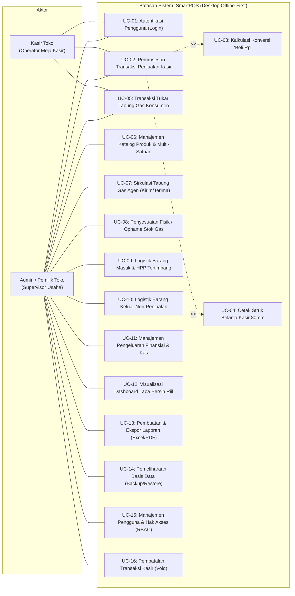
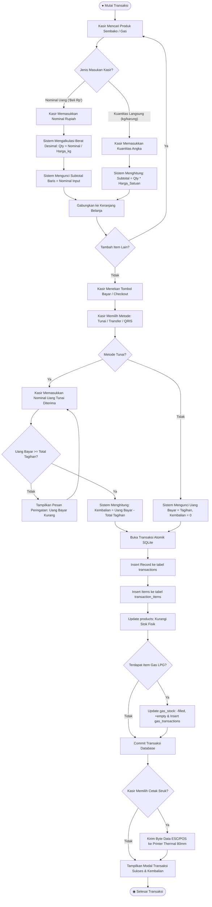
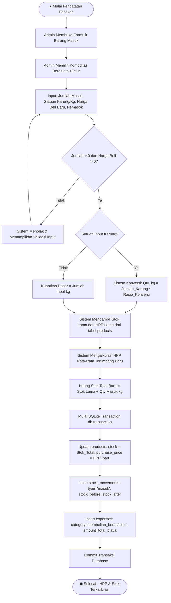
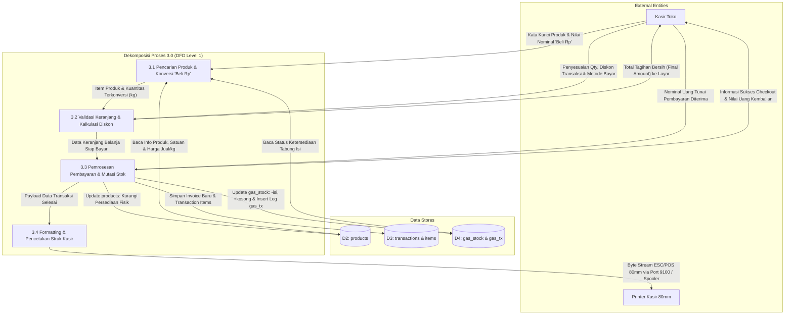

# BAB III: PEMODELAN ANALISIS SISTEM

---

## 3.1 Use Case Diagram
Pemodelan interaksi fungsional antara pengguna dengan sistem **SmartPOS** dirancang mengacu pada standar formal **OMG Unified Modeling Language (UML) Versi 2.5.1**. Diagram memetakan batas sistem (*system boundary*), aktor manusia yang berinteraksi langsung, 16 use case fungsional, relasi asosiasi (*association*), serta relasi dependensi `<<include>>` dan `<<extend>>`:

### Penjelasan Notasi dan Relasi UML 2.5.1:
1. **Aktor (*Actors*)**:
   - `Kasir Toko`: Aktor primer yang mengoperasikan fungsi harian penjualan retail dan penukaran gas konsumen.
   - `Admin / Pemilik`: Aktor dengan hak istimewa (*superuser*) yang mengendalikan master data, pengadaan logistik, finansial, dan audit.
2. **Relasi `<<include>>` (Ketergantungan Wajib)**:
   - `UC-02 (Transaksi Kasir)` $\xrightarrow{\text{<<include>>}}$ `UC-03 (Konversi 'Beli Rp')`: Fungsi konversi instan merupakan bagian terintegrasi dari keranjang belanja kasir. Saat kasir menginput nominal belanja uang tunai, logika kalkulasi kuantitas pecahan desimal wajib dieksekusi untuk menghasilkan item valid di keranjang.
3. **Relasi `<<extend>>` (Perluasan Opsional)**:
   - `UC-02 (Transaksi Kasir)` $\xleftarrow{\text{<<extend>>}}$ `UC-04 (Cetak Struk 80mm)`: Pencetakan struk fisik bersifat kondisional. Pengguna dapat memilih untuk mencetak struk thermal ke mesin printer atau hanya menyelesaikan transaksi secara digital di layar komputer (*paperless*).

---

## 3.2 Deskripsi / Skenario Use Case
Sesuai standar rekayasa perangkat lunak, skenario use case disusun mendalam mencakup identifikasi tujuan, aktor, prakondisi (*precondition*), alur normal (*main flow*), alur alternatif (*alternative flow*), penanganan kesalahan (*exception flow*), dan pascakondisi (*postcondition*):

### 3.2.1 Skenario UC-02: Pemrosesan Transaksi Penjualan Kasir & Fitur "Beli Rp"
- **ID & Nama Use Case**: `UC-02 / Pemrosesan Transaksi Penjualan Kasir`
- **Tujuan Utama**: Mencatat transaksi penjualan retail komoditas sembako (beras, telur), mengonversi pembelian berbasis nominal uang rupiah menjadi berat kilogram, memvalidasi uang pembayaran tunai, memotong saldo stok produk, dan menerbitkan invoice nota penjualan.
- **Aktor Utama**: Kasir Toko, Admin / Pemilik Toko
- **Prakondisi (*Precondition*)**: Pengguna telah berhasil login ke dalam sistem; katalog produk aktif tersedia dengan saldo persediaan fisik $> 0$.
- **Alur Utama (*Main Flow*)**:
  1. Kasir membuka menu antarmuka transaksi kasir.
  2. Kasir mencari komoditas beras atau telur berdasarkan nama atau kategori.
  3. Pembeli memesan berdasarkan nominal rupiah (misal: *"Beli beras Rp 20.000"*). Kasir menekan tombol **"Beli Rp"** pada baris produk yang dipilih.
  4. Kasir memasukkan nilai nominal `20000` pada dialog modal.
  5. Sistem mengeksekusi `UC-03`, mengalkulasi kuantitas pecahan desimal:
     $$\text{Kuantitas} = \frac{\text{Nominal}}{\text{Harga Jual/kg}} = \frac{20.000}{14.000} \approx 1,43\text{ kg}$$
     dan mengunci subtotal belanja baris tepat sebesar Rp 20.000. Item masuk ke keranjang belanja.
  6. Kasir meninjau daftar keranjang belanja dan menekan tombol **"Bayar (Checkout)"**.
  7. Kasir memilih metode pembayaran **Tunai (*Cash*)**.
  8. Kasir memasukkan nominal uang fisik yang diserahkan pembeli (misal: Rp 50.000).
  9. Sistem memverifikasi bahwa nominal pembayaran $\ge$ total tagihan belanja, kemudian menghitung uang kembalian secara otomatis:
     $$\text{Kembalian} = \text{Uang Bayar} - \text{Total Tagihan} = 50.000 - 20.000 = \text{Rp } 30.000$$
  10. Sistem membuka transaksi atomik SQLite, menyimpan data penjualan ke tabel `transactions` dan `transaction_items`, serta mengurangi saldo stok di tabel `products`.
  11. Sistem menampilkan modal konfirmasi transaksi berhasil beserta nilai uang kembalian.
- **Alur Alternatif (*Alternative Flow*)**:
  - *4a. Pembelian Kuantitas Karung/Kg Langsung*: Kasir menginput langsung kuantitas angka (misal: 2 kg atau 1 karung) tanpa melalui fitur "Beli Rp". Sistem mengalikan kuantitas dengan harga satuan produk.
  - *7a. Pembayaran Non-Tunai*: Kasir memilih metode Transfer atau QRIS. Kolom nominal bayar secara otomatis terkunci sama dengan total tagihan (tanpa kembalian), dan kasir memverifikasi bukti mutasi rekening.
  - *11a. Ekstensi Cetak Struk (`UC-04`)*: Kasir menekan tombol "Cetak Struk". Sistem mengirim format teks ESC/POS ke printer thermal 80 mm.
- **Alur Pengecualian (*Exception Flow*)**:
  - *8a. Uang Pembayaran Kurang*: Jika uang tunai yang diinput kasir $<$ total tagihan, sistem mendisinfeksi tombol konfirmasi bayar, mewarnai input dengan batas merah, dan menampilkan peringatan *"Nominal pembayaran kurang"*.
  - *10a. Stok Produk Tidak Mencukupi*: Jika saat checkout saldo fisik di database telah habis atau kurang dari kuantitas yang diminta, sistem membatalkan transaksi (*rollback*), memunculkan notifikasi galat stok, dan meminta penyesuaian kuantitas.
- **Pascakondisi (*Postcondition*)**: Nomor invoice unik terbit (format `INV-YYYYMMDD-XXXX`), saldo persediaan fisik produk terpotong akurat, saldo kas harian bertambah, dan transaksi tercatat permanen di basis data.

---

### 3.2.2 Skenario UC-05: Transaksi Penukaran Tabung Gas LPG Konsumen
- **ID & Nama Use Case**: `UC-05 / Transaksi Penukaran Tabung Gas LPG Konsumen`
- **Tujuan Utama**: Memproses transaksi penukaran (*refill*) tabung gas LPG 3 kg oleh konsumen dengan jaminan integritas persediaan *dual-stock* tertutup (tabung isi berkurang, tabung kosong bertambah, total aset fisik tabung toko tetap).
- **Aktor Utama**: Kasir Toko, Admin / Pemilik Toko
- **Prakondisi (*Precondition*)**: Pengguna login; data varian gas aktif dengan persediaan tabung isi (`filled_stock`) $\ge$ kuantitas penukaran.
- **Alur Utama (*Main Flow*)**:
  1. Kasir membuka halaman Transaksi Gas atau memilih varian gas pada keranjang kasir.
  2. Kasir memilih varian komoditas: **Gas LPG 3 KG**.
  3. Kasir memilih jenis transaksi: **Tukar Tabung (Refill)**.
  4. Kasir memasukkan kuantitas tabung yang ditukarkan (misal: 2 tabung) seharga Rp 22.000 / tabung (total tagihan Rp 44.000).
  5. Kasir memproses penerimaan uang pembayaran tunai dari konsumen.
  6. Sistem membuka transaksi SQLite atomik dan mengeksekusi mutasi tertutup (*closed-loop mutation*):
     - Mengurangi `filled_stock` sebesar 2 tabung.
     - Menambah `empty_stock` sebesar 2 tabung.
     - Mempertahankan `total_cylinders` toko tetap konstan ($\Delta S_{\text{total}} = 0$).
  7. Sistem mencatat log audit transaksi ke tabel `gas_transactions` dengan tipe `'tukar_customer'` disertai snapshot saldo stok sebelum dan sesudah mutasi.
  8. Sistem menambahkan nominal uang penjualan ke pembukuan kas dan mencetak nota transaksi gas.
- **Alur Alternatif (*Alternative Flow*)**:
  - *3a. Pembelian Tabung Perdana (Tanpa Tukar)*: Konsumen membeli tabung gas baru beserta isinya (`UC-13`). Sistem mengurangi `filled_stock` sebesar $N$, tidak menambah `empty_stock`, dan mengurangi `total_cylinders` di toko sebesar $N$. Harga yang dikenakan mencakup harga isi gas plus harga fisik tabung baru (`no_exchange_price`).
- **Alur Pengecualian (*Exception Flow*)**:
  - *4a. Tabung Isi Habis*: Jika kasir memasukkan kuantitas melebihi `filled_stock`, sistem menolak transaksi, menampilkan notifikasi *"Stok tabung isi tidak mencukupi"*, dan transaksi dibatalkan.
- **Pascakondisi (*Postcondition*)**: Saldo fisik tabung isi berkurang, saldo tabung kosong bertambah, total aset wadah di toko tidak berubah, dan log audit mutasi tercatat permanen.

---

### 3.2.3 Skenario UC-07: Sirkulasi Tabung Gas Agen 2-Tahap (Kirim & Terima)
- **ID & Nama Use Case**: `UC-07 / Sirkulasi Tabung Gas Agen (Kirim/Terima)`
- **Tujuan Utama**: Mencatat perputaran fisik tabung gas LPG antara pangkalan toko dengan truk agen penyalur resmi Pertamina dalam dua tahapan terpisah guna mencegah hilangnya aset tabung di pihak ketiga.
- **Aktor Utama**: Admin / Pemilik Toko
- **Prakondisi (*Precondition*)**: Pengguna memiliki peran `admin`; terdapat saldo tabung kosong di pangkalan toko.
- **Alur Utama (*Main Flow*)**:
  - **Tahap 1: Pengiriman Tabung Kosong ke Agen (Kirim Kosong)**:
    1. Truk agen Pertamina tiba di pangkalan untuk mengangkut tabung kosong.
    2. Admin membuka menu *Sirkulasi Gas Agen* dan memilih tab **"Kirim Tabung Kosong"**.
    3. Admin memilih varian Gas LPG 3 KG dan menginput kuantitas tabung kosong yang diangkut (misal: 50 tabung).
    4. Sistem memverifikasi ketersediaan saldo `empty_stock` $\ge 50$.
    5. Sistem mengurangi `empty_stock` sebesar 50 dan mengurangi `total_cylinders` fisik di toko sebesar 50. Mutasi dicatat sebagai `'tukar_agen_kirim'` dengan keterangan tabung berada di luar toko (agen pengisian).
  - **Tahap 2: Penerimaan Tabung Isi dari Agen (Terima Isi)**:
    6. Truk agen mengantarkan kembali tabung gas yang telah terisi penuh.
    7. Admin membuka tab **"Terima Tabung Isi"**.
    8. Admin menginput kuantitas tabung isi yang diterima (50 tabung) beserta total nominal biaya pengadaan/tebusan agen (misal: Rp 19.000 / tabung = Rp 950.000).
    9. Sistem menambah saldo `filled_stock` sebesar 50 dan memulihkan kembali saldo `total_cylinders` fisik di toko sebesar 50.
    10. Sistem mencatat mutasi `'tukar_agen_terima'` dan secara otomatis mencatat pengeluaran modal pengadaan ke tabel `expenses` kategori `'pembelian_gas'`.
- **Alur Alternatif (*Alternative Flow*)**:
  - *8a. Penerimaan Tabung Isi Parsial*: Jika agen hanya mengembalikan sebagian tabung isi (misal baru 30 tabung), Admin mencatat penerimaan 30 tabung. Saldo total tabung di toko pulih sebesar 30, dan sisa 20 tabung tetap tercatat berada di pihak agen hingga pengiriman berikutnya.
- **Alur Pengecualian (*Exception Flow*)**:
  - *4a. Tabung Kosong Toko Kurang*: Jika kuantitas kirim melebihi saldo `empty_stock` riil, sistem memblokir pencatatan dan mewajibkan Admin melakukan rekonsiliasi stok fisik terlebih dahulu.
- **Pascakondisi (*Postcondition*)**: Siklus sirkulasi tabung agen tertutup dengan saldo aset kembali seimbang, riwayat log perputaran tabung tercatat transparan, dan biaya penebusan masuk ke laporan pengeluaran toko.

---

## 3.3 Activity Diagram
Activity Diagram memodelkan alur kerja (*workflow*) logika kontrol internal sistem menggunakan notasi formal OMG UML: *Initial Node*, *Action Node*, *Decision Node*, *Merge Node*, dan *Activity Final Node*.

### 3.3.1 Activity Diagram 1: Alur Checkout Transaksi Kasir ("Beli Rp", Pembayaran, & Transaksi Database)

---

### 3.3.2 Activity Diagram 2: Alur Logistik Barang Masuk & Rekalkulasi HPP Tertimbang

---

## 3.4 Context Diagram
Context Diagram mendefinisikan batasan sistem makro (*system boundary*) yang merepresentasikan **seluruh aplikasi SmartPOS sebagai satu proses tunggal bernomor 0**, serta memetakan seluruh aliran data yang melintasi batas sistem dari dan menuju empat entitas eksternal:

```mermaid
flowchart TD
    subgraph "Entitas Eksternal Lingkungan Sistem"
        E1["Kasir Toko<br>(Operator Meja Transaksi)"]
        E2["Admin / Pemilik Toko<br>(Supervisor Usaha)"]
        E3["Pemasok / Agen Resmi<br>(Distributor Pangan & LPG 3kg)"]
        E4["Printer Kasir Thermal 80mm<br>(Periferal Output POS)"]
    end

    subgraph "Batasan Sistem (System Boundary)"
        SYS(("0<br>SISTEM INFORMASI POINT OF SALE DAN MANAJEMEN USAHA<br>(SmartPOS)"))
    end

    %% Aliran Kasir
    E1 -->|"Kredensial Login Kasir"| SYS
    E1 -->|"Pencarian Produk & Input Nominal 'Beli Rp'"| SYS
    E1 -->|"Data Transaksi Tukar Tabung Gas Konsumen"| SYS
    E1 -->|"Nominal Uang Pembayaran & Pilihan Metode"| SYS
    SYS -->|"Info Katalog, Kuantitas Konversi, Status Stok"| E1
    SYS -->|"Rincian Kembalian, Struk Layar, Notifikasi Sukses"| E1

    %% Aliran Admin
    E2 -->|"Kredensial Login Admin & Manajemen Akun User"| SYS
    E2 -->|"Data Master Katalog, Satuan Karung & Harga Beli/Jual"| SYS
    E2 -->|"Data Sirkulasi Gas Agen (Kirim/Terima Kosong/Isi)"| SYS
    E2 -->|"Data Opname Fisik Tabung Gas & Catatan Selisih"| SYS
    E2 -->|"Data Barang Masuk, Pasokan Karung & Harga Beli Baru"| SYS
    E2 -->|"Data Pengurangan Stok Non-Penjualan (Rusak/Susut)"| SYS
    E2 -->|"Pencatatan Biaya Operasional Toko & Kas Ekstra"| SYS
    E2 -->|"Perintah Pembatalan Transaksi Kasir (Void)"| SYS
    E2 -->|"Parameter Filter Periode & Perintah Ekspor Laporan"| SYS
    E2 -->|"Perintah Pencadangan (Backup) & Berkas Restore .db"| SYS
    SYS -->|"Visualisasi Dashboard Omzet & Laba Bersih Riil"| E2
    SYS -->|"Dokumen Laporan Transaksi Terformat (.xlsx & .pdf)"| E2
    SYS -->|"Berkas Cadangan Basis Data SQLite (.db)"| E2
    SYS -->|"Notifikasi Log Audit Mutasi & Status Sistem"| E2

    %% Aliran Supplier
    E3 -->|"Surat Jalan & Fisik Pasokan Beras, Telur & Tabung Gas"| SYS
    SYS -->|"Tanda Bukti Penerimaan Barang & Tanda Terima Tabung Agen"| E3

    %% Aliran Printer
    SYS -->|"Perintah Cetak ESC/POS & Tata Letak Struk 80mm"| E4
```

> [!NOTE]
> Sesuai kaidah pemodelan terstruktur (Yourdon / DeMarco), Context Diagram hanya menampilkan proses tunggal bernomor 0 dan entitas eksternal. **Tidak diperkenankan menampilkan proses internal maupun data store** pada tingkat diagram ini.

---

## 3.5 Data Flow Diagram (DFD) Level 0
Data Flow Diagram (DFD) Level 0 menguraikan sistem SmartPOS menjadi **tujuh proses fungsional utama bernomor 1.0 sampai 7.0**, serta menghubungkannya dengan entitas eksternal dan **tujuh data store fisik lokal** (`D1` sampai `D7`):

```mermaid
flowchart TD
    subgraph External Entities
        E_Kasir["Kasir Toko"]
        E_Admin["Admin / Pemilik"]
        E_Supplier["Pemasok / Agen Gas"]
        E_Printer["Printer Kasir 80mm"]
    end

    subgraph Data Stores
        D1[("D1: Data Pengguna (users)")]
        D2[("D2: Katalog Produk (products)")]
        D3[("D3: Transaksi Kasir (transactions & items)")]
        D4[("D4: Persediaan Gas (gas_stock & gas_tx)")]
        D5[("D5: Log Audit Stok (stock_movements)")]
        D6[("D6: Finansial Toko (expenses & income_extra)")]
        D7[("D7: Pengaturan Sistem (settings)")]
    end

    subgraph "Proses Utama DFD Level 0"
        P1["1.0 Autentikasi & Manajemen Pengguna"]
        P2["2.0 Manajemen Katalog & Multi-Satuan"]
        P3["3.0 Pemrosesan Transaksi Kasir & Checkout"]
        P4["4.0 Pengelolaan Sirkulasi Tabung Gas LPG"]
        P5["5.0 Manajemen Logistik (Barang Masuk & Keluar)"]
        P6["6.0 Pengelolaan Keuangan & Laba Bersih"]
        P7["7.0 Pelaporan, Ekspor, & Utilitas Backup"]
    end

    %% P1: Autentikasi
    E_Kasir -->|"Username & Password"| P1
    E_Admin -->|"Kredensial & Pengelolaan Akun Kasir"| P1
    P1 <-->|"Verifikasi Kredensial & Otorisasi Role"| D1
    P1 -->|"Hak Akses Antarmuka & Sesi Aktif"| E_Kasir
    P1 -->|"Hak Akses Antarmuka & Sesi Aktif"| E_Admin

    %% P2: Katalog
    E_Admin -->|"Input Data Produk, Rasio Konversi, Harga Beli/Jual"| P2
    P2 <-->|"Simpan / Perbarui Master Katalog"| D2

    %% P3: Transaksi Kasir
    E_Kasir -->|"Pencarian Barang, Input 'Beli Rp', Uang Bayar"| P3
    P3 <-->|"Baca Harga Produk & Potong Saldo Stok"| D2
    P3 -->|"Catat Header Transaksi & Detail Items"| D3
    P3 -.->|"Periksa & Potong Tabung Isi Kasir"| D4
    P3 -->|"Format Byte Data Struk ESC/POS"| E_Printer
    P3 -->|"Uang Kembalian & Struk Transaksi Layar"| E_Kasir
    E_Admin -->|"Otorisasi Void Transaksi Salah"| P3
    P3 <-->|"Update Status Batal & Rollback Stok"| D3

    %% P4: Sirkulasi Gas LPG
    E_Kasir -->|"Data Tukar Tabung Gas Konsumen"| P4
    E_Admin -->|"Data Kirim/Terima Agen, Tabung Baru, Opname"| P4
    E_Supplier -->|"Fisik Tabung Isi Pengganti dari Agen"| P4
    P4 <-->|"Update Saldo Isi, Kosong, Total Aset & Log Mutasi"| D4
    P4 -->|"Catat Biaya Beli Tebusan Gas dari Agen"| D6
    P4 -->|"Tanda Terima Penukaran Tabung Agen"| E_Supplier

    %% P5: Logistik Masuk & Keluar
    E_Admin -->|"Input Barang Masuk Karungan & Barang Rusak/Susut"| P5
    E_Supplier -->|"Surat Jalan & Pasokan Fisik Beras/Telur"| P5
    P5 <-->|"Update Stok Total kg & Rekalkulasi HPP Baru"| D2
    P5 -->|"Catat Riwayat Audit Sebelum/Sesudah Mutasi"| D5
    P5 -->|"Catat Beban Pembelian Pasokan Masuk"| D6
    P5 -->|"Bukti Penerimaan Pasokan Barang"| E_Supplier

    %% P6: Finansial & Keuangan
    E_Admin -->|"Input Biaya Operasional (Listrik, Gaji) & Kas Ekstra"| P6
    P6 <-->|"Simpan / Baca Beban Biaya & Pendapatan Lain"| D6
    P6 <-->|"Baca Agregasi Total Omzet Kasir Selesai"| D3
    P6 -->|"Tampilan Laba Kotor, Biaya, Laba Bersih & Grafik"| E_Admin

    %% P7: Pelaporan & Backup
    E_Admin -->|"Filter Rentang Tanggal Laporan & Perintah Backup/Restore"| P7
    P7 <-->|"Baca Data Penjualan & Items"| D3
    P7 <-->|"Baca Data Persediaan & HPP"| D2
    P7 <-->|"Baca Mutasi Tabung Gas & Log Audit"| D4
    P7 <-->|"Baca Biaya Operasional & Kas Ekstra"| D6
    P7 <-->|"Baca Identitas & Konfigurasi Toko"| D7
    P7 -->|"Unduhan Berkas Excel (.xlsx) & PDF (.pdf)"| E_Admin
    P7 <-->|"Pencadangan & Pemulihan Berkas app.db"| D1
```

---

## 3.6 Data Flow Diagram (DFD) Level 1
Sesuai dengan ketentuan soal UTS halaman 4, minimal satu proses utama pada DFD Level 0 wajib didekomposisi menjadi subproses yang lebih terperinci dengan mempertahankan prinsip keseimbangan masukan dan keluaran (*balancing*). 

Pada sistem SmartPOS, didekomposisi **Proses 3.0: Pemrosesan Transaksi Kasir & Checkout** menjadi empat subproses spesifik:
- `3.1 Pencarian Produk & Kalkulasi Konversi Eceran ("Beli Rp")`
- `3.2 Validasi Keranjang & Perhitungan Tagihan Diskon`
- `3.3 Eksekusi Pembayaran Tunai & Validasi Kembalian`
- `3.4 Formatting & Pencetakan Struk Kasir (Print Spooler)`

---

## 3.7 Kamus Data (Data Dictionary)
Kamus data mendokumentasikan spesifikasi struktur data logis dan fisik yang mengalir pada DFD dan tersimpan pada basis data relasional SQLite `app.db`:

### 3.7.1 Kamus Data: Tabel Master Katalog `products` (Data Store D2)
- **Nama Arus Data**: Data Produk & Stok Komoditas
- **Deskripsi Bisnis**: Menyimpan katalog komoditas sembako (beras, telur) dan pemetaan harga gas, konversi satuan, HPP rata-rata tertimbang, dan saldo stok dasar kilogram.

| Nama Atribut | Deskripsi Fungsional | Tipe Data | Format / Panjang | Constraint | Sumber Data |
| :--- | :--- | :--- | :--- | :--- | :--- |
| `id` | Kunci primer identitas produk | INTEGER | Bilangan bulat | Primary Key, Auto-increment | Sistem |
| `name` | Nama komoditas barang dagangan | TEXT | Maksimal 100 karakter | Not Null | Admin |
| `category` | Klasifikasi komoditas | TEXT | 'beras' \| 'telur' \| 'gas' | Not Null | Admin |
| `unit` | Satuan pengukuran dasar penjualan | TEXT | 'kg' \| 'karung' \| 'tabung' | Not Null, Default 'kg' | Admin |
| `secondary_unit` | Satuan kemasan grosir | TEXT | Maksimal 20 karakter | Nullable | Admin |
| `secondary_conversion`| Rasio konversi ke satuan dasar | REAL | Angka desimal positif | Nilai $> 0$ jika ada kemasan | Admin |
| `purchase_price` | HPP per satuan dasar produk | REAL | Desimal mata uang | Default 0, Not Null | Sistem / Admin |
| `selling_price` | Harga jual eceran per satuan dasar | REAL | Desimal mata uang | Nilai $> 0$, Not Null | Admin |
| `secondary_price` | Harga jual khusus satuan sekunder | REAL | Desimal mata uang | Nullable | Admin |
| `stock` | Persediaan fisik satuan dasar | REAL | Desimal (mendukung timbangan) | Default 0, Not Null | Sistem |
| `minimum_stock` | Batas minimum persediaan (*alert*) | REAL | Angka desimal non-negatif | Default 0, Not Null | Admin |
| `gas_id` | Kunci asing relasi ke tabel gas | INTEGER | Bilangan bulat | Foreign Key ke `gas_stock.id` | Sistem |
| `active` | Status keaktifan produk di kasir | INTEGER | 0 (nonaktif) atau 1 (aktif) | Default 1, Not Null | Admin |

### 3.7.2 Kamus Data: Tabel Transaksi Kasir `transactions` & `transaction_items` (Data Store D3)
- **Nama Arus Data**: Nota Penjualan & Baris Belanja Kasir
- **Deskripsi Bisnis**: Menyimpan rekaman transaksi penjualan meja kasir, total belanja, potongan diskon, metode bayar, uang pembayaran, kembalian, dan rincian item produk yang dibeli.

| Nama Atribut | Deskripsi Fungsional | Tipe Data | Format / Panjang | Constraint | Sumber Data |
| :--- | :--- | :--- | :--- | :--- | :--- |
| `id` | Kunci primer transaksi penjualan | INTEGER | Bilangan bulat | Primary Key, Auto-increment | Sistem |
| `invoice_number` | Nomor unik faktur penjualan kasir | TEXT | Format `INV-YYYYMMDD-XXXX` | Unique, Not Null | Sistem |
| `transaction_date` | Waktu stempel terjadinya transaksi | TEXT | `YYYY-MM-DD HH:MM:SS` | Default waktu lokal | Sistem |
| `cashier_name` | Nama staf kasir yang bertugas | TEXT | Maksimal 50 karakter | Nullable | Sistem (Sesi) |
| `payment_method` | Metode pembayaran belanja | TEXT | 'tunai' \| 'transfer' \| 'qris' | Default 'tunai', Not Null | Kasir |
| `total_amount` | Total nominal kotor belanjaan | REAL | Desimal mata uang | Nilai $\ge 0$, Not Null | Sistem |
| `discount` | Potongan harga transaksi | REAL | Desimal mata uang | Default 0, Not Null | Kasir |
| `final_amount` | Tagihan bersih setelah diskon | REAL | Desimal mata uang | `total_amount - discount` | Sistem |
| `paid_amount` | Uang tunai diserahkan pembeli | REAL | Desimal mata uang | Wajib $\ge$ final_amount | Kasir |
| `change_amount` | Nominal uang kembalian pembeli | REAL | Desimal mata uang | `paid_amount - final_amount` | Sistem |
| `status` | Status validitas transaksi kasir | TEXT | 'selesai' \| 'batal' | Default 'selesai', Not Null | Sistem / Admin |
| `item.product_name` | Nama produk saat transaksi | TEXT | Maksimal 100 karakter | Not Null | Sistem |
| `item.quantity` | Kuantitas komoditas terjual | REAL | Desimal positif | Nilai $> 0$, Not Null | Kasir / Sistem |
| `item.price` | Harga satuan saat transaksi | REAL | Desimal mata uang | Nilai $> 0$, Not Null | Sistem |
| `item.subtotal` | Total harga baris belanjaan | REAL | Desimal mata uang | `quantity * price` | Sistem |

### 3.7.3 Kamus Data: Tabel Inventaris Gas `gas_stock` & `gas_transactions` (Data Store D4)
- **Nama Arus Data**: Mutasi Sirkulasi Tabung Gas LPG
- **Deskripsi Bisnis**: Mengelola inventaris fisik tabung gas LPG terpisah (isi, kosong, total aset) dan mencatat seluruh riwayat penukaran konsumen serta agen.

| Nama Atribut | Deskripsi Fungsional | Tipe Data | Format / Panjang | Constraint | Sumber Data |
| :--- | :--- | :--- | :--- | :--- | :--- |
| `id` | Kunci primer data varian gas | INTEGER | Bilangan bulat | Primary Key, Auto-increment | Sistem |
| `gas_name` | Nama varian gas LPG | TEXT | 'Gas LPG 3 KG', dll | Unique, Not Null | Admin |
| `filled_stock` | Saldo tabung isi siap jual | INTEGER | Bilangan bulat non-negatif | Nilai $\ge 0$, Not Null | Sistem |
| `empty_stock` | Saldo tabung kosong penampungan | INTEGER | Bilangan bulat non-negatif | Nilai $\ge 0$, Not Null | Sistem |
| `total_cylinders` | Total aset wadah fisik di toko | INTEGER | Bilangan bulat positif | `filled_stock + empty_stock` | Sistem |
| `purchase_price` | Biaya tebusan isi ulang ke agen | REAL | Desimal mata uang | Default 0, Not Null | Admin |
| `selling_price` | Harga jual penukaran konsumen | REAL | Desimal mata uang | Nilai $> 0$, Not Null | Admin |
| `no_exchange_price` | Harga jual tabung baru + isi | REAL | Desimal mata uang | Nullable | Admin |
| `transaction_type` | Klasifikasi perpindahan tabung | TEXT | 'tukar_customer' \| 'tukar_agen' \| 'tabung_baru' \| 'penyesuaian' | Not Null | Sistem |
| `filled_before / after`| Audit saldo tabung isi | INTEGER | Bilangan bulat | Nilai audit snapshot | Sistem |
| `empty_before / after` | Audit saldo tabung kosong | INTEGER | Bilangan bulat | Nilai audit snapshot | Sistem |
| `total_before / after` | Audit saldo total aset toko | INTEGER | Bilangan bulat | Nilai audit snapshot | Sistem |
