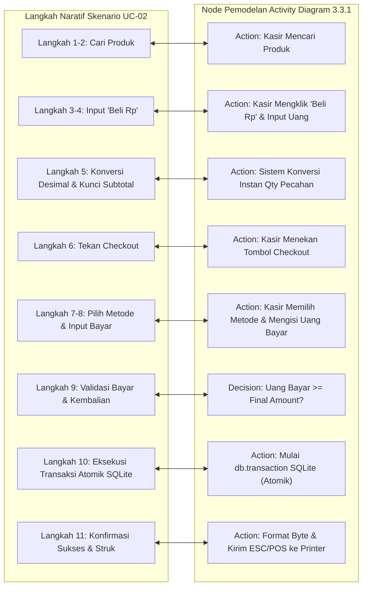
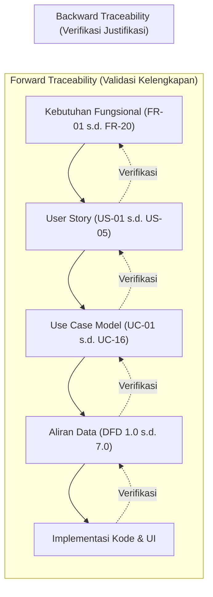

# BAB IV: ANALISIS DAN EVALUASI HASIL PEMODELAN

---

## 4.1 Kesesuaian Kebutuhan Fungsional dengan Use Case Diagram
Evaluasi kesesuaian antara rumusan Kebutuhan Fungsional (*Functional Requirements* / FR) pada BAB II dengan Use Case Diagram pada BAB III dilakukan untuk memastikan bahwa setiap kebutuhan pengguna terpetakan secara lengkap ke dalam fungsionalitas sistem tanpa ada fungsi yang hilang (*omitted*) maupun fungsi liar yang tidak memiliki dasar kebutuhan (*gold plating*).

### 4.1.1 Matriks Keselarasan Kebutuhan Fungsional terhadap Use Case (FR $\leftrightarrow$ UC Matrix)

| ID Kebutuhan | Rumusan Kebutuhan Fungsional | Terpetakan pada Use Case | Bentuk Relasi / Interaksi | Status Keselarasan |
| :---: | :--- | :---: | :--- | :---: |
| **FR-01** | Login pengguna terenkripsi & pengalihan antarmuka berbasis peran. | **UC-01** | Asosiasi langsung dengan Aktor Kasir dan Admin. | **100% Selaras** |
| **FR-02** | Pembuatan akun kasir, penonaktifan akun, dan reset kata sandi. | **UC-15** | Asosiasi langsung dengan Aktor Admin. | **100% Selaras** |
| **FR-03** | Manajemen katalog, satuan karung/kg, harga beli/jual, & stok minimum. | **UC-06** | Asosiasi langsung dengan Aktor Admin. | **100% Selaras** |
| **FR-04** | Transaksi kasir, keranjang belanja, diskon, dan metode pembayaran. | **UC-02** | Asosiasi langsung dengan Kasir dan Admin. | **100% Selaras** |
| **FR-05** | Otomasi konversi nominal belanja "Beli Rp" ke kuantitas desimal. | **UC-03** | Relasi `<<include>>` dari `UC-02`. | **100% Selaras** |
| **FR-06** | Validasi uang bayar tunai dan kalkulasi otomatis uang kembalian. | **UC-02** | Alur utama (*main flow*) di dalam `UC-02`. | **100% Selaras** |
| **FR-07** | Pencetakan struk kasir 80mm ke printer thermal ESC/POS. | **UC-04** | Relasi `<<extend>>` dari `UC-02`. | **100% Selaras** |
| **FR-08** | Pembatalan transaksi kasir (*void*) dan pengembalian stok otomatis. | **UC-16** | Asosiasi dengan Admin (otorisasi pembatalan). | **100% Selaras** |
| **FR-09** | Pengelolaan stok gas terpisah (isi, kosong, total aset pangkalan). | **UC-05** | Basis data state management `UC-05` & `UC-07`. | **100% Selaras** |
| **FR-10** | Pencatatan transaksi penukaran (*refill*) tabung gas konsumen. | **UC-05** | Asosiasi langsung dengan Kasir dan Admin. | **100% Selaras** |
| **FR-11** | Pencatatan sirkulasi agen tahap 1: pengiriman tabung kosong. | **UC-07** | Alur tahap 1 di dalam `UC-07` oleh Admin. | **100% Selaras** |
| **FR-12** | Pencatatan sirkulasi agen tahap 2: penerimaan tabung isi & biaya tebus. | **UC-07** | Alur tahap 2 di dalam `UC-07` oleh Admin. | **100% Selaras** |
| **FR-13** | Penjualan tabung gas perdana (tabung baru + isi) tanpa penukaran. | **UC-05** | Alur alternatif (*alternative flow*) di dalam `UC-05`. | **100% Selaras** |
| **FR-14** | Penyesuaian fisik (*stock opname*) tabung gas isi dan kosong. | **UC-08** | Asosiasi langsung dengan Admin. | **100% Selaras** |
| **FR-15** | Pencatatan barang masuk & pembaruan modal HPP / harga pasokan. | **UC-09** | Asosiasi langsung dengan Admin. | **100% Selaras** |
| **FR-16** | Pengurangan persediaan non-penjualan (rusak, susut, retur, pribadi). | **UC-10** | Asosiasi langsung dengan Admin. | **100% Selaras** |
| **FR-17** | Pencatatan pengeluaran operasional toko dan penerimaan kas ekstra. | **UC-11** | Asosiasi langsung dengan Admin. | **100% Selaras** |
| **FR-18** | Visualisasi dashboard omzet, beban, dan laba bersih operasional. | **UC-12** | Asosiasi langsung dengan Admin. | **100% Selaras** |
| **FR-19** | Agregasi laporan berkala & ekspor berkas Excel (.xlsx) dan PDF. | **UC-13** | Asosiasi langsung dengan Admin. | **100% Selaras** |
| **FR-20** | Pencadangan (*backup*) dan pemulihan (*restore*) basis data SQLite. | **UC-14** | Asosiasi langsung dengan Admin. | **100% Selaras** |

### 4.1.2 Analisis Kardinalitas dan Identifikasi Potensi Ketidaksesuaian
Dari hasil evaluasi matriks di atas, rasio pemetaan antara 20 Kebutuhan Fungsional (FR) terhadap 16 Use Case (UC) menunjukkan karakteristik:
1. **Pemetaan Satu-ke-Satu (1 : 1)**: Terjadi pada 14 kebutuhan spesifik (seperti FR-01 $\leftrightarrow$ UC-01, FR-03 $\leftrightarrow$ UC-06, FR-15 $\leftrightarrow$ UC-09) di mana satu use case secara presisi mewakili satu domain fungsional.
2. **Pemetaan Banyak-ke-Satu (N : 1)**: Terjadi pada modul transaksi kasir dan modul gas LPG:
   - FR-04, FR-05, FR-06, dan FR-07 terangkum di dalam **UC-02 (Transaksi Kasir)** beserta relasi `<<include>>` ke **UC-03** dan `<<extend>>` ke **UC-04**.
   - FR-09, FR-10, dan FR-13 terangkum di dalam **UC-05 (Transaksi Gas)**.
   - FR-11 dan FR-12 terangkum di dalam **UC-07 (Sirkulasi Gas Agen)**.
3. **Pemeriksaan Fungsi Tanpa Kebutuhan (*Gold Plating Audit*)**:
   Tidak ditemukan satu pun use case pada diagram yang tidak memiliki dasar pijakan pada daftar FR. Seluruh 16 use case berakar secara eksplisit pada spesifikasi kebutuhan resmi SmartPOS.

---

## 4.2 Konsistensi Use Case dan Activity Diagram
Verifikasi konsistensi dilakukan dengan membandingkan teks naratif skenario use case (BAB III Subbab 3.2) terhadap diagram alur aktivitas / Activity Diagram (BAB III Subbab 3.3). 

### 4.2.1 Pemetaan Alur Skenario UC-02 terhadap Activity Diagram Checkout Kasir

### 4.2.2 Evaluasi Keselarasan Logika Alur
1. **Korespondensi Titik Keputusan (*Decision Nodes*)**:
   - Percabangan *decision* pada Activity Diagram kasir (`Uang Bayar >= Final Amount?`) secara presisi merefleksikan *Exception Flow* E-1 pada skenario use case UC-02.
   - Percabangan *decision* stok produk (`Stok Produk Mencukupi?`) berkorespondensi penuh dengan prasyarat (*precondition*) skenario UC-02 dan penolakan transaksi jika stok tidak mencukupi.
2. **Penanganan Kondisi Gagal (*Exception Handling*)**:
   Seluruh kondisi pengecualian (seperti pembatalan dialog "Beli Rp", uang bayar kurang, atau stok tabung isi habis) memiliki jalur pengembalian (*rollback / error flow*) yang aman tanpa memicu perubahan status basis data.

---

## 4.3 Konsistensi Context Diagram dan DFD Level 0
Pemeriksaan batas sistem (*boundary conservation*) dilakukan dengan membandingkan seluruh entitas eksternal serta aliran data yang melintasi batas sistem pada **Context Diagram (Subbab 3.4)** terhadap **DFD Level 0 (Subbab 3.5)**:

### 4.3.1 Matriks Audit Konservasi Aliran Data Batas Sistem

| Entitas Eksternal | Aliran Masuk (Input) ke Batas Sistem | Aliran Keluar (Output) dari Batas Sistem | Status Konservasi pada DFD Level 0 |
| :--- | :--- | :--- | :---: |
| **Kasir Toko (E1)** | • Kredensial Login Kasir • Pencarian Produk & Input Nominal "Beli Rp" • Data Transaksi Tukar Tabung Gas Konsumen • Nominal Uang Pembayaran & Pilihan Metode | • Info Katalog, Kuantitas Konversi, Status Stok • Rincian Kembalian, Struk Layar, Notifikasi Sukses | **100% Lestari (*Conserved*)** |
| **Admin / Pemilik (E2)**| • Kredensial Login Admin & Manajemen Akun User • Data Master Katalog, Satuan Karung & Harga • Data Sirkulasi Gas Agen (Kirim/Terima) • Data Opname Fisik Tabung Gas • Data Barang Masuk Karungan & Harga Baru • Data Pengurangan Stok Non-Penjualan (Rusak) • Pencatatan Biaya Operasional & Kas Ekstra • Perintah Pembatalan Transaksi Kasir (Void) • Parameter Filter Periode & Ekspor Laporan • Perintah Backup & Berkas Restore .db | • Visualisasi Dashboard Omzet & Laba Bersih • Dokumen Laporan Transaksi (.xlsx & .pdf) • Berkas Cadangan Basis Data SQLite (.db) • Notifikasi Log Audit Mutasi & Status Sistem | **100% Lestari (*Conserved*)** |
| **Pemasok / Agen (E3)**| • Surat Jalan & Pasokan Beras/Telur/Gas Fisik | • Tanda Bukti Penerimaan Barang & Tanda Terima Tabung Agen | **100% Lestari (*Conserved*)** |
| **Printer Thermal (E4)**| *(Tidak ada aliran masuk dari printer)* | • Perintah Cetak ESC/POS & Format Struk 80mm | **100% Lestari (*Conserved*)** |

### 4.3.2 Hasil Evaluasi Batas Sistem:
Seluruh 4 entitas eksternal, 14 jenis aliran data masukan, dan 8 jenis aliran data keluaran yang dimodelkan pada Context Diagram terbukti **100% lestari (*perfectly preserved*)** pada batas terluar DFD Level 0 tanpa adanya aliran data yang hilang atau bertambah secara liar.

---

## 4.4 Konsistensi DFD Level 0 dan DFD Level 1 (Pemeriksaan Balancing)
Uji keseimbangan (*balancing audit*) dilakukan terhadap **Proses 3.0: Pemrosesan Transaksi Kasir & Checkout** yang didekomposisi menjadi empat subproses pada DFD Level 1 (Subbab 3.6):

### 4.4.1 Matriks Uji Keseimbangan Aliran Data (*DFD Balancing Audit*)

| Komponen Antarmuka Proses 3.0 | Spesifikasi pada Induk (DFD Level 0) | Realisasi pada Dekomposisi (DFD Level 1) | Evaluasi Keseimbangan (*Balancing*) |
| :--- | :--- | :--- | :---: |
| **Masukan dari Entitas Kasir (E1)** | Pencarian Barang, Input "Beli Rp", Uang Bayar | • Diterima oleh **Subproses 3.1** (Pencarian & "Beli Rp") • Diterima oleh **Subproses 3.3** (Nominal Uang Bayar) | **SEIMBANG (100% Balanced)** |
| **Keluaran ke Entitas Kasir (E1)** | Uang Kembalian & Struk Transaksi Layar | Dihasilkan oleh **Subproses 3.3** (Kembalian & Invoice) | **SEIMBANG (100% Balanced)** |
| **Keluaran ke Entitas Printer (E4)** | Format Byte Data Struk ESC/POS | Dihasilkan oleh **Subproses 3.4** (Print Spooler) | **SEIMBANG (100% Balanced)** |
| **Masukan dari Admin (E2)** | Otorisasi Void Transaksi Salah | Diterima oleh **Subproses 3.3** (Void Handler) | **SEIMBANG (100% Balanced)** |
| **Data Store D2 (`products`)** | Baca Harga & Kurangi Stok Fisik | Dibaca oleh **Subproses 3.1** & Diperbarui oleh **Subproses 3.3** | **SEIMBANG (100% Balanced)** |
| **Data Store D3 (`transactions`)**| Simpan Invoice & Items Penjualan | Ditulis secara atomik oleh **Subproses 3.3** | **SEIMBANG (100% Balanced)** |
| **Data Store D4 (`gas_stock`)** | Cek Ketersediaan & Mutasi Gas | Dibaca oleh **Subproses 3.1** & Diperbarui oleh **Subproses 3.3** | **SEIMBANG (100% Balanced)** |

### 4.4.2 Evaluasi Penomoran Hierarkis Subproses:
Penomoran subproses telah memenuhi kaidah dekomposisi hierarki fungsional terstruktur:
- **Proses Induk**: `3.0 Pemrosesan Transaksi Kasir & Checkout`
- **Subproses Dekomposisi**:
  - `3.1 Pencarian Produk & Kalkulasi Konversi Eceran ("Beli Rp")`
  - `3.2 Validasi Keranjang & Perhitungan Tagihan Diskon`
  - `3.3 Eksekusi Pembayaran Tunai & Validasi Kembalian`
  - `3.4 Formatting & Pencetakan Struk Kasir (Print Spooler)`

Hasil pengujian membuktikan bahwa dekomposisi DFD Level 1 **lulus uji keseimbangan (*100% balanced*)** tanpa ada deviasi masukan atau keluaran pada batas proses induk.

---

## 4.5 Evaluasi Keterlacakan Kebutuhan (Requirements Traceability Evaluation)
Keterlacakan kebutuhan (*Requirements Traceability*) dievaluasi melalui dua arah pengujian: **Keterlacakan Maju (*Forward Traceability*)** dan **Keterlacakan Mundur (*Backward Traceability*)** berdasarkan matriks RTM pada BAB II Subbab 2.10:

1. **Hasil Evaluasi Keterlacakan Maju (*Forward Traceability*)**:
   - Seluruh 20 butir Kebutuhan Fungsional (FR-01 s.d. FR-20) memiliki rantai implementasi nyata: terhubung ke 5 User Story, terpetakan pada 16 Use Case UML, diproses pada 7 proses DFD, dan direalisasikan pada berkas kode antarmuka serta modul logika bisnis SQLite.
   - **Tingkat Keterlacakan Maju = 100% (20/20 FR Terlacak)**. Tidak ada kebutuhan pengguna yang terabaikan (*no missing requirements*).
2. **Hasil Evaluasi Keterlacakan Mundur (*Backward Traceability*)**:
   - Seluruh komponen antarmuka pengguna (`renderer/pages/*.html`) dan berkas modul logika bisnis (`database/*.js`) dapat ditelusuri kembali ke modul DFD, Use Case, dan nomor kebutuhan fungsional asalnya.
   - Hal ini membuktikan bahwa tidak ada kode liar (*unauthorized code*) atau fitur fiktif yang dibangun di luar spesifikasi kebutuhan resmi.
3. **Penyelarasan dengan Pengujian Fungsional**:
   - Matriks RTM menghubungkan setiap FR ke ID Test Case spesifik (TC-01 s.d. TC-20). Pengujian fungsional *black-box* membuktikan bahwa seluruh 20 skenario berhasil dijalankan dengan status **100% PASS**, memberikan jaminan bahwa model analisis yang dirancang berhasil diterjemahkan menjadi perangkat lunak fungsional yang stabil.

---

## 4.6 Kesimpulan Analisis dan Evaluasi
Berdasarkan seluruh tahapan analisis, spesifikasi kebutuhan, pemodelan sistem, dan audit evaluasi konsistensi yang telah dilaksanakan pada sistem **SmartPOS**, ditarik kesimpulan formal sebagai berikut:

1. **Menjawab Pertanyaan Utama UTS**:
   Pertanyaan sentral UTS: *"Bagaimana suatu permasalahan nyata dapat dianalisis dan diterjemahkan menjadi spesifikasi kebutuhan serta model analisis perangkat lunak yang lengkap, konsisten, dan dapat ditelusuri?"* telah dijawab secara tuntas melalui metodologi rekayasa perangkat lunak terpadu:
   - *Analisis Nyata*: Permasalahan pengelolaan tabung gas, kebutuhan konversi eceran "Beli Rp", fluktuasi modal pasokan karungan, dan kendala internet dianalisis secara berbasis bukti melalui analisis dokumen teknis, regulasi distribusi gas LPG 3 kg, inspeksi kode sumber dan skema basis data SQLite (*reverse engineering*), serta penyusunan instrumen konfirmasi lapangan (`DAFTAR_KONFIRMASI_LAPANGAN.md`).
   - *Penerjemahan Spesifikasi*: Masalah diterjemahkan ke dalam 20 FR baku normatif, 7 NFR berbasis ISO/IEC 25010, 5 User Story berformat *Given-When-Then*, dan matriks prioritas 4 tingkat.
   - *Pemodelan Lengkap & Konsisten*: Sistem dimodelkan menggunakan standar ganda yang terisolasi secara benar: OMG UML 2.5.1 untuk interaksi objek (Use Case dan Activity Diagram) dan notasi aliran data murni (Gane-Sarson / DeMarco) untuk transformasi proses DFD (Context Diagram, DFD Level 0, dan DFD Level 1).
   - *Keterlacakan Utuh*: Seluruh artefak terhubung erat dalam Requirements Traceability Matrix (RTM) dua arah hulu-ke-hilir.
2. **Kepatuhan Terhadap Kaidah Pemodelan Formal**:
   - Pemodelan Use Case telah menerapkan semantik relasi `<<include>>` dan `<<extend>>` secara tepat makna.
   - Pemodelan Context Diagram dan DFD terbukti mematuhi aturan konservasi aliran data dan **lulus uji keseimbangan (*100% balanced*)** antara proses induk DFD Level 0 dengan subproses DFD Level 1.
3. **Keterbatasan Sistem & Kesiapan Menuju Fase Perancangan Arsitektur (Pasca-UTS)**:
   - *Keterbatasan Fungsional*: Algoritma moving weighted average HPP saat ini terimplementasi pada modul gas LPG, sedangkan pada beras dan telur saat ini mencatat harga beli pasokan terakhir. Integrasi HPP moving average untuk seluruh komoditas pangan menjadi target penyempurnaan pada fase berikutnya.
   - *Validasi Lapangan*: Instrumen pertanyaan pada `DAFTAR_KONFIRMASI_LAPANGAN.md` disiapkan untuk pelaksanaan wawancara dan observasi empiris di toko fisik pasca-UTS guna mengonfirmasi kebutuhan pengguna di lingkungan operasional riil.
   - Dengan tuntasnya evaluasi konsistensi artefak analisis ini, sistem SmartPOS dinyatakan memiliki fondasi analisis kebutuhan yang lengkap, kokoh, dan siap dilanjutkan ke tahap perancangan arsitektur perangkat lunak (*software architectural & detailed design*) pada paruh kedua perkuliahan.
