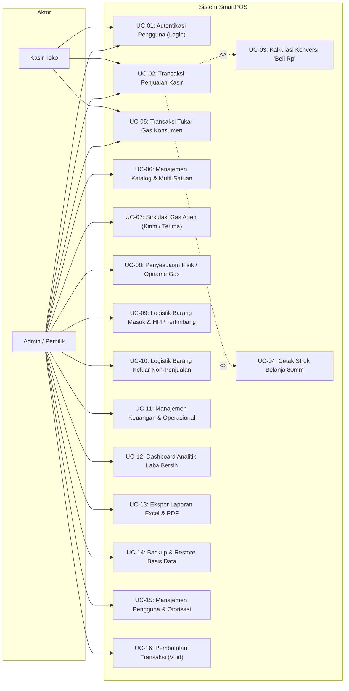
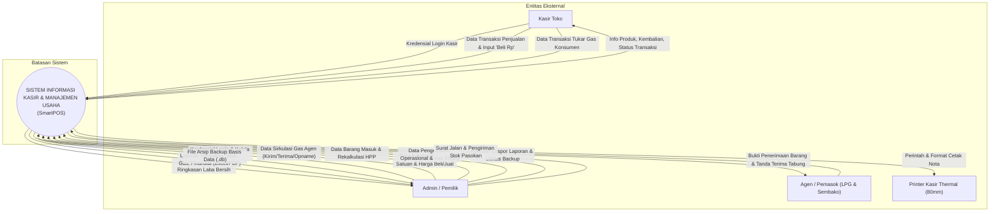
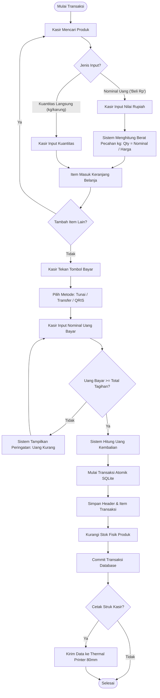
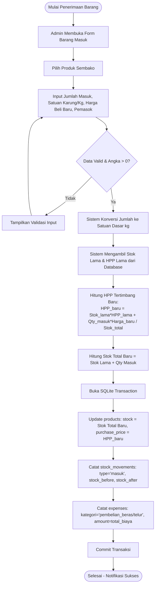

# BAB IV: PEMODELAN ANALISIS SISTEM & PROSES BISNIS

---

## 4.1 Pemodelan Interaksi: Use Case Diagram
Diagram Use Case memetakan batasan fungsionalitas sistem SmartPOS yang diakses oleh aktor **Kasir** dan **Admin (Pemilik Usaha)**:

---

## 4.2 Skenario Use Case Terstruktur (Detailed Use Case Scenarios)

### Skenario 1: UC-02 Memproses Transaksi Penjualan Kasir & Fitur "Beli Rp"

| Elemen Skenario | Deskripsi Spesifikasi |
| :--- | :--- |
| **Use Case ID** | **UC-02** (termasuk perluasan UC-03 dan UC-04) |
| **Nama Use Case** | Memproses Transaksi Penjualan Kasir dan Konversi "Beli Rp" |
| **Aktor** | Kasir, Admin |
| **Precondition** | Pengguna telah berhasil login dan berada pada halaman Kasir (`pages/kasir.html`). Stok produk $> 0$. |
| **Trigger** | Kasir memilih komoditas belanja atas permintaan pembeli. |
| **Main Flow (Alur Utama)** | 1. Kasir mencari produk sembako pada kotak pencarian cepat antarmuka kasir. 2. Kasir menekan tombol **"Beli Rp"** dan menginput nominal belanja rupiah (misal Rp 15.000). 3. Sistem mengonversi nominal menjadi kuantitas pecahan desimal berdasarkan harga per kg dan memasukkan item ke keranjang belanja. 4. Kasir menekan tombol **"Bayar"** dan memilih metode pembayaran (Tunai / Transfer / QRIS). 5. Kasir menginput jumlah uang yang diterima dari konsumen. 6. Sistem memvalidasi nominal bayar, menghitung uang kembalian, dan mengeksekusi penyimpanan transaksi di dalam transaksi basis data SQLite. 7. Sistem secara otomatis mengurangi saldo stok fisik produk di tabel `products`. 8. Sistem menampilkan konfirmasi sukses beserta pratinjau struk kasir. |
| **Alternative Flow 1** | **Pembelian Kuantitas Bulat / Karungan**: Kasir memilih opsi unit sekunder (karung) atau mengetik kuantitas kilogram langsung tanpa melalui tombol "Beli Rp". |
| **Alternative Flow 2** | **Diskon Transaksi**: Kasir memasukkan nilai potongan harga nominal/persen sebelum menekan tombol bayar; sistem mengkalkulasi ulang tagihan bersih `final_amount`. |
| **Alternative Flow 3** | **Cetak Struk Fisik**: Kasir memilih tombol "Cetak Struk"; sistem mengirim perintah cetak ke printer thermal 80 mm (UC-04). |
| **Exception Flow 1** | **Uang Pembayaran Kurang**: Nominal uang bayar tunai lebih kecil dari total tagihan; sistem menampilkan peringatan *"Nominal pembayaran kurang"* dan menolak proses checkout. |
| **Exception Flow 2** | **Stok Tidak Mencukupi**: Kuantitas yang diminta melebihi sisa stok di database; sistem menampilkan pesan error dan membatalkan penambahan item ke keranjang. |
| **Postcondition** | Catatan transaksi tersimpan di tabel `transactions` dan `transaction_items`, stok produk terpotong secara akurat, dan nomor invoice unik terbit. |

---

### Skenario 2: UC-05 Transaksi Penukaran Tabung Gas LPG Konsumen

| Elemen Skenario | Deskripsi Spesifikasi |
| :--- | :--- |
| **Use Case ID** | **UC-05** |
| **Nama Use Case** | Transaksi Penukaran Tabung Gas LPG Konsumen |
| **Aktor** | Kasir, Admin |
| **Precondition** | Kasir telah login; stok tabung isi varian gas yang dipilih (misal LPG 3 kg) $\ge$ kuantitas tukar. |
| **Trigger** | Konsumen menyerahkan tabung kosong dan meminta tabung isi baru. |
| **Main Flow (Alur Utama)** | 1. Kasir memilih varian tabung gas pada antarmuka kasir/gas. 2. Kasir memilih jenis transaksi: **"Tukar Tabung (Refill)"**. 3. Kasir memasukkan jumlah tabung yang ditukarkan (misal 2 tabung). 4. Kasir memproses pembayaran harga isi gas (misal Rp 22.000 $\times$ 2 = Rp 44.000). 5. Sistem mengeksekusi mutasi tertutup secara atomik:    - `filled_stock` berkurang 2 tabung.    - `empty_stock` bertambah 2 tabung.    - `total_cylinders` tidak mengalami perubahan. 6. Sistem mencatat riwayat mutasi ke tabel `gas_transactions` dengan tipe `tukar_customer`. 7. Sistem memperbarui pendapatan kasir dan mencetak nota. |
| **Alternative Flow** | **Penjualan Tanpa Tukar (Beli Tabung Perdana + Gas)**: Konsumen membeli tabung perdana tanpa membawa tabung kosong (UC-13); sistem memotong `filled_stock` dan memotong `total_cylinders`, sementara `empty_stock` tetap. |
| **Exception Flow** | **Stok Tabung Isi Habis**: `filled_stock` bernilai 0; sistem menolak transaksi dan menampilkan pesan *"Stok tabung isi tidak mencukupi"*. |
| **Postcondition** | Rasio tabung isi dan kosong terperbarui secara konsisten, total aset fisik tabung toko tetap terlacak utuh. |

---

### Skenario 3: UC-07 Transaksi Sirkulasi Tabung Gas Agen 2-Tahap

| Elemen Skenario | Deskripsi Spesifikasi |
| :--- | :--- |
| **Use Case ID** | **UC-07** |
| **Nama Use Case** | Transaksi Sirkulasi Tabung Gas Agen (Kirim Kosong & Terima Isi) |
| **Aktor** | Admin (Pemilik Usaha) |
| **Precondition** | Pengguna memiliki peran `admin`; terdapat persediaan tabung kosong di toko. |
| **Trigger** | Pemasok agen LPG datang untuk mengambil tabung kosong atau mengantarkan tabung isi. |
| **Main Flow (Alur Utama)** | **Tahap 1: Pengiriman Tabung Kosong ke Agen** 1. Admin membuka modul Manajemen Gas (`pages/gas.html`). 2. Admin memilih aksi **"Kirim Tabung Kosong ke Agen"**. 3. Admin menginput jumlah tabung kosong yang diangkut agen (misal 50 tabung) dan catatan nama agen/supir. 4. Sistem memvalidasi bahwa `empty_stock` $\ge 50$. 5. Sistem mengurangi `empty_stock` sebesar 50 dan mengurangi `total_cylinders` fisik di toko sebesar 50. 6. Mutasi dicatat di `gas_transactions` dengan tipe `tukar_agen_kirim`.  **Tahap 2: Penerimaan Tabung Isi dari Agen** 7. Saat tabung isi hasil pengisian kembali datang, Admin memilih aksi **"Terima Tabung Isi dari Agen"**. 8. Admin menginput jumlah tabung isi yang diterima (50 tabung), harga beli per tabung dari agen, dan nama pemasok. 9. Sistem menambah `filled_stock` sebesar 50 dan menambah `total_cylinders` toko sebesar 50. 10. Sistem secara otomatis mencatat pengeluaran biaya pembelian gas ke tabel `expenses`. |
| **Exception Flow** | **Kuantitas Kirim Melebihi Stok Kosong**: Admin menginput kuantitas kirim lebih besar dari `empty_stock`; sistem memblokir eksekusi mutasi dengan pesan validasi. |
| **Postcondition** | Saldo fisik tabung di toko kembali seimbang setelah siklus 2 tahap selesai, dan biaya modal pembelian gas tercatat pada laporan pengeluaran toko. |

---

## 4.3 Pemodelan Aliran Data: Context Diagram

---

## 4.4 Data Flow Diagram (DFD Level 0)

```mermaid
flowchart TD
    subgraph External Entities
        E_Kasir["Kasir Toko"]
        E_Admin["Admin / Pemilik"]
        E_Printer["Printer Kasir 80mm"]
    end

    subgraph Data Stores
        D1[("D1: Data Pengguna (users)")]
        D2[("D2: Katalog Produk (products)")]
        D3[("D3: Transaksi Kasir (transactions, items)")]
        D4[("D4: Inventaris Gas (gas_stock, gas_tx)")]
        D5[("D5: Mutasi Stok (stock_movements)")]
        D6[("D6: Finansial Toko (expenses, income_extra)")]
        D7[("D7: Pengaturan Toko (settings)")]
    end

    subgraph Processes
        P1["1.0 Autentikasi & Manajemen Pengguna"]
        P2["2.0 Manajemen Katalog & Multi-Satuan"]
        P3["3.0 Pemrosesan Transaksi Kasir & Checkout"]
        P4["4.0 Pengelolaan Sirkulasi Tabung Gas LPG"]
        P5["5.0 Manajemen Logistik (Barang Masuk & Keluar)"]
        P6["6.0 Pengelolaan Keuangan & Laba Bersih"]
        P7["7.0 Pelaporan, Ekspor, & Utilitas Backup"]
    end

    %% P1
    E_Kasir -->|"Username & Password"| P1
    E_Admin -->|"Kredensial & Buat Akun"| P1
    P1 <-->|"Verifikasi Kredensial & Role"| D1
    P1 -->|"Hak Akses & Sesi"| E_Kasir
    P1 -->|"Hak Akses & Sesi"| E_Admin

    %% P2
    E_Admin -->|"Input Produk, Satuan & Harga"| P2
    P2 <-->|"Simpan / Baca Katalog Produk"| D2

    %% P3
    E_Kasir -->|"Pilihan Produk, Qty / Beli Rp, Bayar"| P3
    P3 <-->|"Cek Harga & Potong Stok"| D2
    P3 -->|"Catat Invoice & Item Penjualan"| D3
    P3 -.->|"Cek & Potong Gas Isi"| D4
    P3 -->|"Format Nota Kasir"| E_Printer
    P3 -->|"Bukti Transaksi & Kembalian"| E_Kasir

    %% P4
    E_Kasir -->|"Tukar Tabung Konsumen"| P4
    E_Admin -->|"Tukar Agen, Tabung Baru, Opname"| P4
    P4 <-->|"Update Stok Isi/Kosong & Total"| D4
    P4 -->|"Catat Biaya Beli Gas dari Agen"| D6

    %% P5
    E_Admin -->|"Barang Masuk (Karung) & Barang Keluar"| P5
    P5 <-->|"Update Stok & Rekalkulasi HPP"| D2
    P5 -->|"Catat Log Audit Stok Before/After"| D5
    P5 -->|"Catat Beban Pengadaan Barang"| D6

    %% P6
    E_Admin -->|"Input Biaya Operasional & Kas Ekstra"| P6
    P6 <-->|"Simpan / Baca Catatan Biaya"| D6
    P6 <-->|"Baca Omzet Penjualan"| D3
    P6 -->|"Tampilan Laba Bersih & Grafik"| E_Admin

    %% P7
    E_Admin -->|"Parameter Filter Periode & Ekspor"| P7
    P7 <-->|"Baca Data Transaksi, Stok, Finansial"| D3
    P7 <-->|"Baca Data Stok Gas & Logistik"| D4
    P7 <-->|"Baca Konfigurasi Identitas Toko"| D7
    P7 -->|"Unduhan Berkas Excel & PDF"| E_Admin
    P7 <-->|"Backup / Restore SQLite Database"| D1
```

---

## 4.5 Pemodelan Aliran Aktivitas (Activity Diagrams)

### Activity Diagram 1: Alur Checkout Transaksi Kasir ("Beli Rp" & Pembayaran)

---

### Activity Diagram 2: Alur Logistik Barang Masuk & Rekalkulasi HPP Tertimbang

---

## 4.6 Kamus Data (Data Dictionary)

### 4.6.1 Kamus Data: Tabel `products` (Katalog Produk & Persediaan)
| Nama Atribut | Deskripsi Bisnis | Tipe Data | Format / Panjang | Constraint | Sumber Data |
| :--- | :--- | :--- | :--- | :--- | :--- |
| `id` | Kunci primer unik identitas produk | INTEGER | Auto-increment | Primary Key, Not Null | Sistem |
| `name` | Nama komoditas barang dagangan | TEXT | Maks. 100 karakter | Not Null | Admin |
| `category` | Klasifikasi jenis komoditas | TEXT | 'beras' \| 'telur' \| 'gas' | Not Null | Admin |
| `unit` | Satuan pengukuran dasar penjualan | TEXT | 'kg' \| 'karung' \| 'tabung' | Not Null | Admin |
| `secondary_unit` | Satuan kemasan grosir | TEXT | Maks. 20 karakter | Nullable | Admin |
| `secondary_conversion`| Rasio konversi kemasan ke satuan dasar | REAL | Angka desimal positif | Nilai $> 0$ jika ada secondary_unit | Admin |
| `purchase_price` | HPP per satuan dasar produk | REAL | Angka desimal non-negatif | Default 0, Not Null | Sistem / Admin |
| `selling_price` | Harga jual eceran per satuan dasar | REAL | Angka desimal positif | Nilai $> 0$, Not Null | Admin |
| `secondary_price` | Harga jual khusus untuk satuan sekunder | REAL | Angka desimal positif | Nullable | Admin |
| `stock` | Jumlah persediaan fisik dalam satuan dasar | REAL | Desimal (mendukung timbangan) | Default 0, Not Null | Sistem |
| `minimum_stock` | Batas persediaan minimum (*alert threshold*) | REAL | Angka desimal non-negatif | Default 0, Not Null | Admin |
| `gas_id` | Relasi kunci asing ke tabel stok gas | INTEGER | Integer | Foreign Key ke `gas_stock.id` | Sistem |
| `active` | Indikator keaktifan status produk di kasir | INTEGER | 0 (nonaktif) atau 1 (aktif) | Default 1, Not Null | Admin |

### 4.6.2 Kamus Data: Tabel `transactions` & `transaction_items` (Penjualan Kasir)
| Nama Atribut | Deskripsi Bisnis | Tipe Data | Format / Panjang | Constraint | Sumber Data |
| :--- | :--- | :--- | :--- | :--- | :--- |
| `id` | Kunci primer unik transaksi kasir | INTEGER | Auto-increment | Primary Key, Not Null | Sistem |
| `invoice_number` | Nomor nota penjualan kasir | TEXT | Format `INV-YYYYMMDD-XXXX` | Unique, Not Null | Sistem |
| `transaction_date` | Waktu stempel terjadinya transaksi | TEXT | `YYYY-MM-DD HH:MM:SS` | Default waktu lokal | Sistem |
| `cashier_name` | Nama petugas kasir yang bertugas | TEXT | Maks. 50 karakter | Nullable | Sistem (Sesi) |
| `payment_method` | Kanal metode penerimaan pembayaran | TEXT | 'tunai' \| 'transfer' \| 'qris' | Default 'tunai', Not Null | Kasir |
| `total_amount` | Total nominal kotor belanjaan | REAL | Desimal mata uang | Nilai $\ge 0$, Not Null | Sistem |
| `discount` | Potongan harga transaksi | REAL | Desimal mata uang | Default 0, Not Null | Kasir |
| `final_amount` | Total tagihan bersih setelah diskon | REAL | Desimal mata uang | `total_amount - discount` | Sistem |
| `paid_amount` | Nominal uang diserahkan pembeli | REAL | Desimal mata uang | Wajib $\ge$ final_amount | Kasir |
| `change_amount` | Nominal uang kembalian untuk pembeli | REAL | Desimal mata uang | `paid_amount - final_amount` | Sistem |
| `status` | Status validitas transaksi | TEXT | 'selesai' \| 'batal' | Default 'selesai', Not Null | Sistem / Admin |
| `item.quantity` | Kuantitas produk terjual per baris | REAL | Angka desimal positif | Nilai $> 0$, Not Null | Kasir / Sistem |
| `item.subtotal` | Total harga baris item | REAL | Desimal mata uang | `quantity * price` | Sistem |

### 4.6.3 Kamus Data: Tabel `gas_stock` & `gas_transactions` (Sirkulasi Tabung Gas)
| Nama Atribut | Deskripsi Bisnis | Tipe Data | Format / Panjang | Constraint | Sumber Data |
| :--- | :--- | :--- | :--- | :--- | :--- |
| `id` | Kunci primer data varian gas | INTEGER | Auto-increment | Primary Key, Not Null | Sistem |
| `gas_name` | Nama varian tabung gas elpiji | TEXT | 'Gas LPG 3 KG', dll | Unique, Not Null | Admin |
| `filled_stock` | Jumlah tabung siap jual (berisi) | INTEGER | Integer non-negatif | Nilai $\ge 0$, Not Null | Sistem |
| `empty_stock` | Jumlah tabung kosong penampungan | INTEGER | Integer non-negatif | Nilai $\ge 0$, Not Null | Sistem |
| `total_cylinders` | Total aset tabung fisik di toko | INTEGER | Integer positif | `filled_stock + empty_stock` | Sistem |
| `transaction_type` | Klasifikasi perpindahan fisik tabung | TEXT | 'tukar_customer' \| 'tukar_agen' \| 'tabung_baru' \| 'penyesuaian' | Not Null | Sistem |
| `filled_before / after`| Saldo tabung isi sebelum dan sesudah mutasi | INTEGER | Integer | Audit snapshot nilai | Sistem |
| `empty_before / after` | Saldo tabung kosong sebelum dan sesudah mutasi| INTEGER | Integer | Audit snapshot nilai | Sistem |
| `total_before / after` | Saldo total tabung sebelum dan sesudah mutasi| INTEGER | Integer | Audit snapshot nilai | Sistem |

---

## 4.7 Verifikasi Konsistensi Context Diagram dan DFD
1. **Keseimbangan Aliran Data (*Balancing Rule*)**: Seluruh aliran masukan dan keluaran yang menghubungkan entitas Kasir, Admin, Supplier, dan Printer pada Context Diagram berkorespondensi $1 : 1$ secara seimbang dengan proses pada DFD Level 0.
2. **Kesesuaian Data Store**: Data Store D1 hingga D7 merepresentasikan tabel fisik yang ada pada basis data SQLite `app.db`.
3. **Pemisahan Wewenang Entitas**: Entitas Kasir dibatasi hanya dapat berinteraksi dengan proses autentikasi (P1), proses transaksi kasir (P3), dan proses penukaran tabung gas (P4). Seluruh proses manajemen inventaris, rekalkulasi HPP, dan manajemen keuangan hanya dapat diakses oleh entitas Admin.
