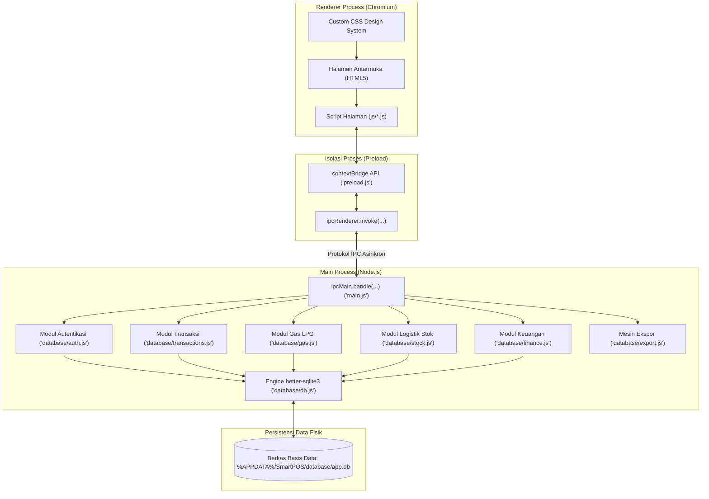

# Arsitektur & Keamanan Aplikasi Desktop Electron
## Dokumentasi Teknis Sistem SmartPOS

Dokumen ini menjelaskan arsitektur internal, pola komunikasi antar-proses, dan standar keamanan yang diterapkan pada aplikasi desktop **SmartPOS**.

---

## 1. Topologi Arsitektur Electron Multi-Proses

SmartPOS dibangun di atas runtime **Electron 31** (Node.js 20+ dan Chromium) dengan pemisahan proses yang ketat:

---

## 2. Prinsip Keamanan Proses (Security Hardening)

Mengacu pada *Electron Security Best Practices*:
1. **`contextIsolation: true`**: Menjamin bahwa skrip di sisi renderer berjalan di dalam konteks JavaScript yang terisolasi secara memori dari skrip preload dan proses utama.
2. **`nodeIntegration: false`**: Mencegah renderer mengeksekusi modul berbahaya seperti `child_process`, `fs`, atau require sembarangan yang dapat dieksploitasi melalui serangan XSS (*Cross-Site Scripting*).
3. **Penyaluran API Terkendali via `contextBridge`**: Hanya fungsi-fungsi API spesifik yang diekspos ke objek global `window.api` di sisi renderer (misal `window.api.transactions.checkout(...)`).
4. **Pola Respons Seragam `{ ok: true, data }` / `{ ok: false, error }`**: Seluruh IPC handler mengembalikan objek status terstandar sehingga penanganan error di sisi renderer konsisten dan tidak menyebabkan aplikasi crash.

---

## 3. Keamanan Kredensial & Autentikasi

1. **Algoritma Hashing Kriptografi `scrypt`**:
   - Kata sandi tidak pernah disimpan dalam bentuk *plaintext*.
   - Menggunakan fungsi derivasi kunci `crypto.scrypt` bawaan Node.js dengan parameter komputasi memori tinggi untuk mencegah serangan *brute-force* dan *rainbow table*.
   - Setiap kata sandi digabungkan dengan **16-byte random salt** acak sebelum di-hash:
     $$\text{Stored Password} = \text{Salt (Hex)} + ":" + \text{Hash (Hex)}$$
2. **Role-Based Access Control (RBAC)**:
   - Sesi pengguna mencatat peran aktif (`admin` atau `kasir`).
   - Sisi renderer mengontrol visibilitas navigasi menu (halaman pengaturan, laporan keuangan, dan manajemen user hanya ditampilkan untuk peran `admin`).
   - Sisi backend IPC handler memverifikasi integritas aksi yang membutuhkan otoritas administratif.
