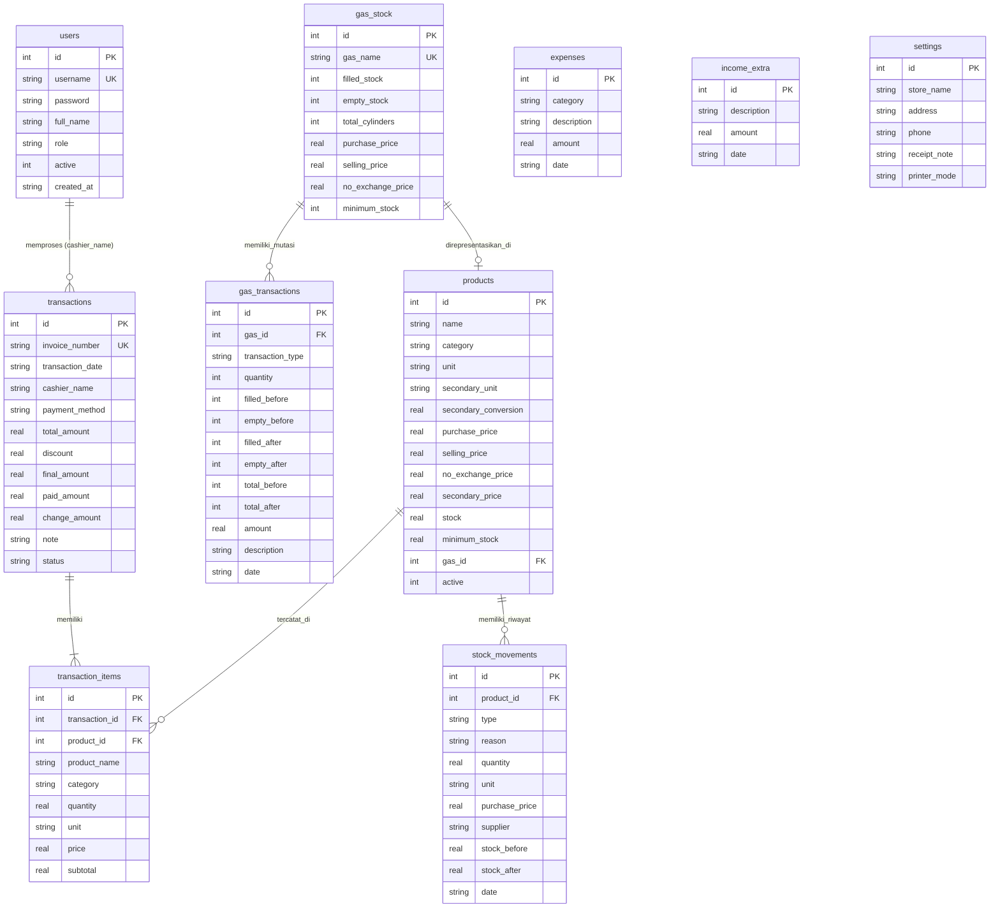

# Skema Basis Data & Spesifikasi Teknis Relasi
## Dokumentasi Basis Data SQLite Sistem SmartPOS

SmartPOS menggunakan engine basis data **SQLite 3** melalui native C++ binding `better-sqlite3`. Basis data disimpan sebagai berkas lokal mandiri pada path direktori pengguna (`%APPDATA%/SmartPOS/database/app.db`).

---

## 1. Diagram Relasi Entitas (Entity-Relationship Diagram)



---

## 2. Integritas Transaksional (ACID Guarantee)

Untuk menjamin tidak terjadinya inkonsistensi saldo stok jika terjadi gangguan listrik (*power loss*), seluruh mutasi lintas tabel dibungkus di dalam transaksi SQLite atomik:

```javascript
// Contoh transaksi atomik pada database/transactions.js
const checkout = db.transaction((payload) => {
  // 1. Simpan Header Transaksi
  const stmtTx = db.prepare('INSERT INTO transactions (...) VALUES (...)');
  const result = stmtTx.run(...);
  const txId = result.lastInsertRowid;

  // 2. Simpan Item & Potong Stok Produk
  for (const item of payload.items) {
    db.prepare('INSERT INTO transaction_items (...) VALUES (...)').run(txId, ...);
    
    // Potong stok produk sembako / gas isi
    db.prepare('UPDATE products SET stock = stock - ? WHERE id = ?').run(item.quantity, item.productId);
  }

  return { id: txId, invoiceNumber: payload.invoiceNumber };
});
```
Jika terjadi kegagalan sistem di tengah perulangan item, SQLite secara otomatis melakukan *rollback* penuh, sehingga saldo stok tidak akan pernah berkurang separuh jalan.
